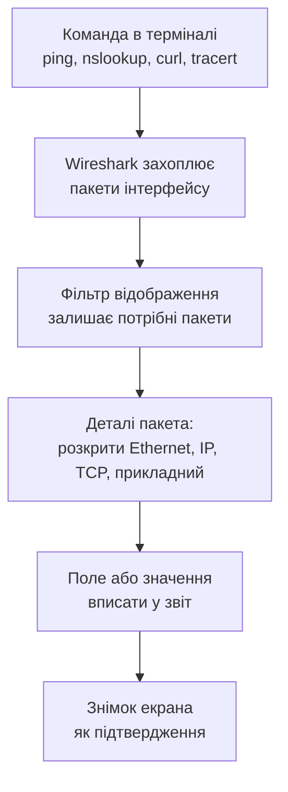

# Аналіз мережевого трафіку у Wireshark

> [!abstract] Коротко
> Завдання на парі для комп'ютерного класу, якому не потрібні ні Cisco Packet Tracer, ні мережеве обладнання: працюємо лише зі своїм комп'ютером і мережею аудиторії. Ви запустите аналізатор трафіку Wireshark і «розслідуєте» власний обмін даними: знайдете ARP-запит і дізнаєтеся, чия MAC-адреса стоїть у кадрі, перевірите на живих пакетах, що MAC змінюється на кожній ділянці шляху, а IP – ні, розберете DNS-запит байт за байтом, побачите триетапне рукостискання TCP, а за допомогою `tracert` власноруч відновите маршрут за зростаючим TTL. Усе, про що ми говорили на лекціях про OSI, IP, TCP і DNS, ви побачите не на схемі, а в реальних пакетах.

> [!info] Що потрібно
> Комп'ютер із Windows або Linux, встановлений **Wireshark** (на Windows разом із драйвером захоплення Npcap), доступ до мережі аудиторії й до інтернету. Усі команди нижче наведено для Windows і Linux. Окремої віртуальної машини не треба. **Викладачеві перед парою:** перевірте, що на комп'ютерах класу захоплення трафіку дозволене звичайному користувачеві. Якщо ні, заздалегідь підготуйте готовий файл захоплення `.pcapng` для спільного розбору.

## Мета

Навчитися читати мережевий трафік як послідовність вкладених заголовків і відповідати на запитання «що, ким і кому було відправлено» не з підручника, а з реальних пакетів.

Після заняття ви повинні вміти:

- запустити захоплення на потрібному інтерфейсі й відібрати потрібні пакети фільтром відображення;
- у кадрі знайти заголовки Ethernet, IPv4, TCP або UDP й прикладний рівень та назвати ключові поля кожного з них;
- на прикладі `ping` пояснити, чому MAC-адреса призначення в кадрі змінюється від вузла до вузла, а IP-адреса призначення лишається незмінною;
- знайти в захопленні ARP-обмін, DNS-запит і відповідь, рукостискання TCP та відповіді ICMP Time Exceeded і пояснити, що кожен з них означає;
- відновити маршрут до сервера за результатами `tracert` і підтвердити його пакетами.

## Розподіл часу

| Етап | Час |
|---|---|
| 1. Підготовка й перше захоплення | 10 хв |
| 2. ARP та ICMP: `ping` сусіда й `ping` зовнішнього сайту | 15 хв |
| 3. DNS: розбираємо запит і відповідь | 10 хв |
| 4. TCP і HTTP: рукостискання та закриття | 20 хв |
| 5. `tracert`: маршрут за TTL | 10 хв |
| 6. Звіт і захист | 15 хв |

## Теоретична частина

### Як виглядає один кадр

Коли ми говорили про еталонні моделі, то малювали рівні OSI стопкою: прикладний над транспортним, транспортний над мережевим і так далі. Проте дані по дроту не рухаються стопкою. Кожен рівень бере те, що йому передав верхній, додає перед цим власний заголовок і віддає вниз. Тому реальний кадр схожий не на стопку, а на матрьошку: у найглибшій середині лежать самі дані, їх обгортає заголовок транспортного рівня, цей пакет обгортає заголовок IP, а все разом обгортає заголовок Ethernet.

![[attachments/ksm-z01-matriushka-kadru.svg|900]]

Подивіться на рисунок і зверніть увагу на два наслідки. По-перше, кожен заголовок містить рівно ту інформацію, яку потрібно його власному рівню. Ethernet знає лише про MAC-адреси сусідніх пристроїв на одному сегменті, і більше нічого. IP знає про адреси кінцевих вузлів і про TTL, а портів не знає. TCP знає про порти, номери байтів і прапорці, а про те, у кого яка MAC-адреса, не знає нічого. По-друге, кожен пристрій на шляху розбирає лише свою частину матрьошки. Комутатор дивиться на Ethernet і не заглядає всередину. Маршрутизатор знімає Ethernet, дивиться на IP, обирає наступний вузол і обгортає пакет у **новий** заголовок Ethernet, уже для наступної ділянки. Саме це ви перевірите у завданні 2.

Wireshark показує кадр у тому ж порядку, що й малюнок. У нижній частині вікна він окремо виводить сирі байти, а посередині кожен рівень окремим розкривним рядком: `Frame`, `Ethernet II`, `Internet Protocol Version 4`, `Transmission Control Protocol` і далі прикладний протокол. Натисніть на рядок рівня, і в нижній панелі підсвітяться саме ті байти, що йому належать. Одне зауваження: чотирибайтної контрольної суми Ethernet (FCS) наприкінці кадру ви не побачите, бо мережева карта відкидає її ще до того, як кадр потрапляє в програму.

### Три панелі Wireshark

Вікно програми завжди ділиться на три частини, і варто одразу запам'ятати, для чого кожна.

| Панель | Що показує | Навіщо вам |
|---|---|---|
| Список пакетів (угорі) | один рядок на пакет: номер, час, джерело, призначення, протокол, інформація | знайти потрібний пакет |
| Деталі пакета (посередині) | розкривне дерево заголовків | прочитати поля |
| Байти пакета (внизу) | шістнадцяткове подання | побачити, де саме лежить поле |

Є ще пара речей, без яких у шумному захопленні втонути легко. На комп'ютері постійно працюють десятки програм, і за хвилину у вас накопичаться сотні пакетів, серед яких потрібних буде кілька. Тому тут обов'язковий **фільтр відображення**: рядок над списком пакетів, куди вводять умову. Коли умова синтаксично правильна, поле стає зеленим, інакше червоним. Нічого не видаляється: пакети лишаються в захопленні, просто сховані. Усі фільтри цього завдання зібрано в таблиці нижче.

| Що шукаємо | Фільтр |
|---|---|
| ARP та ICMP разом | `arp or icmp` |
| лише ICMP-відповіді «час вичерпано» | `icmp.type == 11` |
| DNS | `dns` |
| рукостискання TCP (пакети з прапорцем SYN) | `tcp.flags.syn == 1` |
| весь обмін з конкретним сервером | `ip.addr == 93.184.216.34` |
| лише TCP порту 80 | `tcp.port == 80` |

> [!warning] Типова помилка
> Плутають **фільтр відображення** з **фільтром захоплення**. Фільтр відображення, той самий рядок над списком пакетів, лише ховає вже зібрані пакети й може змінюватися будь-коли. Фільтр захоплення задається до запуску і відсікає пакети на льоту, назад їх повернути неможливо. У цьому завданні користуйтеся лише фільтром відображення: помилившись, ви завжди зможете змінити умову й побачити те, що сховалося.

### Чого не можна й що можна

Wireshark є інструментом, який бачить усе, що проходить через мережевий інтерфейс, тому працювати з ним треба відповідально. У цьому завданні ви аналізуєте **лише власний трафік**, тобто пакети, які створені вашими ж командами. У вікні вибору інтерфейсу після подвійного кліку відкрийте **Capture → Options** і зніміть позначку **Promiscuous mode**: вона змушує карту збирати чужі кадри, а вам вони не потрібні. Не відкривайте логінів і паролів, які можуть випадково потрапити в чужий незашифрований обмін (адже в аудиторії працює багато комп'ютерів, і на радіоканалі Wi-Fi теж). Якщо ви побачили чужі дані, закрийте захоплення й не зберігайте його.

## Практична частина

**Мета:** на власному трафіку дослідити, як рівні OSI виглядають у реальних пакетах, і скласти таблицю «рівень → протокол → поле → значення» з підтвердженням у вигляді знімків екрана.

Кожен студент отримує варіант за номером у списку групи. Варіант визначає сайт, який ви досліджуєте в завданнях 3 і 4.

| Варіант | Сайт | Варіант | Сайт |
|---|---|---|---|
| 1 | `example.com` | 5 | `info.cern.ch` |
| 2 | `example.org` | 6 | `httpforever.com` |
| 3 | `example.net` | 7 | `detectportal.firefox.com` |
| 4 | `neverssl.com` | 8 | `captive.apple.com` |

Усі ці сайти відповідають по звичайному HTTP на порту 80, тому вміст сторінки можна прочитати в пакетах. Якщо сайт вашого варіанта не відкривається, попросіть у викладача заміну з цієї таблиці.

### Завдання 1. Підготовка й перше захоплення (10 хв)

Спершу з'ясуйте, хто ви в мережі. Відкрийте командний рядок (Windows: `Win+R`, `cmd`) і виконайте:

```
ipconfig /all
```

Для Linux аналогом є пара команд `ip a` та `ip route`. З виводу випишіть чотири речі: назву активного інтерфейсу, власну IP-адресу з маскою, власну MAC-адресу (у Windows вона називається «Фізична адреса») і адресу шлюзу за замовчуванням. Також запишіть адресу DNS-сервера. Усе це знадобиться у звіті.

Тепер запустіть Wireshark. На стартовому екрані у списку інтерфейсів поруч із кожним малюється маленький графік активності, і той, у якого він «дихає», і є потрібним. Подвійним кліком запустіть захоплення. Не вимикаючи його, виконайте в командному рядку:

```
ping -n 2 127.0.0.1
```

У Linux ключ записується як `-c 2`. Зверніть увагу: у списку пакетів ніщо не з'явилося, адже запит на `127.0.0.1` ніколи не покидає комп'ютер і мережевий інтерфейс не торкається. Це корисне спостереження: **захоплення бачить лише те, що справді пройшло через вибраний інтерфейс**.

Зупиніть захоплення (червоний квадрат) і запишіть, скільки пакетів потрапило у вікно за ці півхвилини. Скільки з них належить вашим командам, а скільки є фоновим шумом від операційної системи й програм? Це перший пункт звіту.

### Завдання 2. ARP та ICMP (15 хв)

Мета цього завдання – побачити на практиці, як працює адресація на двох рівнях одночасно. Розпочніть нове захоплення (`Ctrl+E`), у рядку фільтра введіть `arp or icmp` і виконайте `ping` на комп'ютер сусіда за партою. Його IP-адресу попросіть у нього (він знайде її командою `ipconfig`).

```
ping -n 4 <IP-адреса сусіда>
```

> [!example] Що має статися
> Ваш комп'ютер знає IP сусіда, але не знає його MAC, а кадр Ethernet без MAC-адреси призначення відправити не можна. Тому перед першим `ping` він розсилає ARP-запит усій мережі: «Хто має адресу `192.168.х.х`? Відповісти потрібно мені». Сусід відповідає, і лише тоді починається обмін ICMP.

Знайдіть у списку пакет **ARP-запит** і відкрийте його деталі. Подивіться на Ethernet: MAC призначення там `ff:ff:ff:ff:ff:ff`, тобто широкомовна адреса. Відповідь на запит іде **вже на конкретну адресу**. Запишіть у звіт, у яких полях ви побачили ці значення, і як Wireshark називає код операції (`Opcode`) запиту й відповіді.

Далі знайдіть перший ICMP-пакет. Тип 8 це Echo request, тип 0 це Echo reply. У полі `Time to Live` IP-заголовка відповіді ви побачите число, найчастіше `128`, `64` або `255`. Воно розповідає про те, яка операційна система у відповідача: Windows зазвичай стартує з `128`, Linux і macOS з `64`, а мережеве обладнання нерідко з `255`. Це не доказ, але гарна підказка. Припустіть, під якою ОС працює сусід, і запитайте в нього.

> [!warning] Типова помилка
> «Ping не пройшов, отже, і ARP не було». Це хибно: брандмауер сусіда може заборонити ICMP, але ARP на рівні нижче працює завжди, інакше пристрій узагалі не зміг би спілкуватися в мережі. Тому ви можете побачити запит і відповідь ARP, а після них лише «Request timed out». Це нормальний результат, зафіксуйте його як є.

Тепер найцікавіше. Очистіть захоплення, залиште фільтр `arp or icmp` і виконайте:

```
ping -n 2 <сайт вашого варіанта>
```

Порівняйте цей кадр із попереднім. У Ethernet MAC призначення тепер **не належить сайту**. Виконайте `arp -a` і переконайтеся: це MAC вашого шлюзу з Завдання 1. А в IP-заголовку тієї самої відповіді призначення лежить далеко за межами аудиторії. Отже, Ethernet адресує наступну ділянку шляху, а IP адресує кінцевого одержувача. На кожній ділянці MAC міняється, а IP лишається, і саме так працює маршрутизація.

### Завдання 3. DNS (10 хв)

Перш ніж комп'ютер зможе відправити `GET` на сайт, він мусить дізнатися, яка в нього IP-адреса. Очистіть захоплення, введіть фільтр `dns` і виконайте:

```
nslookup <сайт вашого варіанта>
```

У виводі `nslookup` ви побачите IP-адреси сервера. Запишіть IPv4-адресу: вона знадобиться у Завданні 4.

> [!info] Чому в захопленні пакетів більше, ніж ви очікували
> Ви побачите щонайменше три запити. Перший, зворотний (`PTR`), `nslookup` робить сам, щоб дізнатися ім'я вашого DNS-сервера. Далі йдуть запити типу `A` (адреса IPv4) і `AAAA` (адреса IPv6): сучасна система питає про обидва. Не плутайте їх: у звіті потрібен запит саме про ім'я вашого сайту.

Відкрийте **запит** про ім'я сайту й випишіть: транспортний протокол і обидва порти (джерела та призначення), ідентифікатор транзакції (`Transaction ID`), тип запиту (`Type`) і поле `Flags`. Тепер знайдіть **відповідь** з тим самим ідентифікатором: він і є способом, за яким клієнт зіставляє відповідь із запитом. У відповіді випишіть адресу (чи адреси) та значення `Time to live`.

> [!warning] Не плутайте два TTL
> У DNS-відповіді поле `Time to live` означає, **скільки секунд** кеш може зберігати цей запис. А TTL в IP-заголовку це **кількість маршрутизаторів**, яких пакет ще може пройти. Це два зовсім різних числа, хоч і названі однаково. У звіті підпишіть, про який саме йдеться.

Чому тут обрано саме `nslookup`, а не браузер? Сучасні браузери (Chrome, Firefox) можуть надсилати DNS-запити всередині зашифрованого HTTPS (DNS over HTTPS), і в захопленні ви їх просто не побачите. Системний `nslookup` ходить звичайним шляхом через UDP порт 53.

### Завдання 4. TCP і HTTP (20 хв)

Тепер з'ясуємо, що відбувається, коли відкривається сторінка. Очистіть захоплення, у фільтр введіть `ip.addr == <IP-адреса сайту із Завдання 3>` і виконайте. На Windows у PowerShell потрібно писати саме `curl.exe` (без `.exe` це псевдонім іншої команди), у Linux просто `curl`:

```
curl.exe -s -o NUL http://<сайт вашого варіанта>
```

Для Linux замість `NUL` пишіть `/dev/null`. Ключ `-s` вимикає індикатор прогресу, а `-o NUL` відкидає тіло відповіді: нам цікаві не дані на екрані, а пакети.

У списку пакетів ви побачите приблизно таку послідовність, і подивіться на неї уважно, бо вона описує життя будь-якого TCP-з'єднання.

![[attachments/ksm-z01-rukostyskannia-tcp.svg|900]]

Перші три пакети це **триетапне рукостискання**. Клієнт надсилає сегмент із прапорцем `SYN` і своїм початковим номером. Сервер відповідає сегментом `SYN, ACK`: він підтверджує, що отримав запит, і одночасно оголошує власний початковий номер. Клієнт підтверджує сегментом `ACK`, після чого з'єднання відкрито, і лише тепер можна передавати дані. Знайдіть ці три пакети (допоможе фільтр `tcp.flags.syn == 1`) і заповніть таблицю:

| № | Прапорці | Seq | Ack | Вікно (Win) | Чим відрізняється від попереднього |
|---|---|---|---|---|---|
| 1 | | | | | |
| 2 | | | | | |
| 3 | | | | | |

> [!question] Загадка про номери
> Сервер у відповідь на `SYN` із `Seq=0` ставить `Ack=1`, а не `Ack=0`. Чому? Підказка: прапорець `SYN` сам «займає» один номер у послідовності, ніби це один байт даних. Саме тому підтвердження вказує номер наступного очікуваного байта.

> [!info] Для допитливих
> У Wireshark за замовчуванням показано **відносні** номери, що починаються з нуля. Справжній початковий номер у кожному з'єднанні випадковий (так захищаються від підробки). Побачити реальні числа можна в деталях пакета: у розкритому рядку TCP є поле `Sequence Number (raw)`.

Після рукостискання знайдіть пакет із прикладним протоколом `HTTP`: клієнт відправляє `GET / HTTP/1.1`. Відкрийте його деталі й знайдіть у Ethernet тип `0x0800`, у IP протокол `TCP (6)`, у TCP порт призначення `80`, а в самому HTTP рядок запиту і заголовок `Host`. Це чотири рівні матрьошки, які ви бачили на малюнку, в одному пакеті.

Тепер натисніть правою кнопкою на цей пакет і виберіть **Follow → TCP Stream** (або `Ctrl+Alt+Shift+T`). Wireshark зіб'є всі сегменти потоку в один читабельний текст: запит клієнта (одним кольором) і відповідь сервера (іншим). Знайдіть у відповіді рядок статусу (`HTTP/1.1 200 OK`) і заголовок `Content-Type`. Зробіть знімок цього вікна: він підтверджує, що вміст сторінки передавався відкритим текстом, і будь-хто на шляху міг його прочитати. Закрийте вікно потоку і поверніться до списку пакетів.

Нарешті, знайдіть пакети із прапорцем `FIN` наприкінці обміну. Скільки їх і хто саме закриває з'єднання першим? Які прапорці несе кожен із них?

> [!exam] На іспиті
> Типове запитання: «Скільки пакетів потрібно для встановлення TCP-з'єднання і для його закриття?» Відповідь «три» й «чотири» залежить від того, як ви рахуєте. Три сегменти встановлюють з'єднання (`SYN`, `SYN-ACK`, `ACK`). Закриття в «підручниковому» вигляді потребує чотирьох сегментів (`FIN`, `ACK`, `FIN`, `ACK`), але на практиці часто два середніх зливають в один `FIN, ACK`, і вийде три. У вашому захопленні ви побачите, як це відбувається насправді.

### Завдання 5. tracert і TTL (10 хв)

У Завданні 2 ви помітили в IP-заголовку поле TTL. Його справжня роль полягає в захисті від петель маршрутизації: кожен маршрутизатор, через який проходить пакет, зменшує TTL на одиницю, а якщо виходить нуль, відкидає пакет і повідомляє відправника повідомленням ICMP «Time Exceeded». Утиліта `tracert` перетворює цей захист на інструмент розвідки.

![[attachments/ksm-z01-tracert-ttl.svg|900]]

Принцип зображено на рисунку. Програма шле запит із TTL=1, і перший же маршрутизатор (ваш шлюз) відкидає його й відповідає: «Час вичерпано». З адреси відправника цієї відповіді ви дізнаєтеся адресу першого вузла. Далі іде запит із TTL=2, і відповідь надсилає другий вузол, і так далі, доки запит не дійде до цілі. Очистіть захоплення, у фільтр введіть `icmp` і виконайте:

```
tracert -d -h 6 <сайт вашого варіанта>
```

У Linux це `traceroute -I -n -m 6 <сайт>`. Ключ `-d` (у Linux `-n`) вимикає зворотне перетворення адрес на імена, щоб команда не засмічувала захоплення зайвими DNS-запитами, а `-h 6` (у Linux `-m 6`) обмежує маршрут шістьма вузлами. Ключ `-I` у Linux змушує `traceroute` використовувати ICMP, як це робить Windows.

Заповніть таблицю: для кожного вузла випишіть номер стрибка, TTL відправленого Echo request і адресу, з якої прийшов `Time Exceeded` (відповіді з типом 11 допоможе знайти фільтр `icmp.type == 11`). Порівняйте її з виводом самої команди: вони мають збігатися. Якщо в рядку виводу стоять зірочки `*`, то цей вузол просто не відповідає на ICMP, і в захопленні ви теж не побачите відповіді.

> [!question] Подумайте
> Перший вузол у вашому виводі має збігатися з адресою, яку ви записали в Завданні 1. Яка це адреса і чому саме вона? Що б ви побачили, якби запустили `tracert` на адресу сусіда по аудиторії?

> [!warning] Якщо мережа аудиторії блокує ICMP
> У деяких мережах `Time Exceeded` відкидають, і замість маршруту вийдуть одні зірочки. Тоді завдання виконується на ті вузли, що відповіли, а в звіті вкажіть, на якому стрибку відповіді припинилися. Викладач може також видати готовий файл захоплення `.pcapng` для спільного розбору.

### Додатково для тих, хто впорався раніше: що ховає шифрування

Повторіть Завдання 4, але з шифрованим протоколом (`https://` замість `http://`), і введіть у фільтр `tls.handshake.type == 1`. Це перший пакет TLS-рукостискання (`Client Hello`). Відкрийте його й знайдіть розширення `server_name`: ім'я сайту, до якого ви звертаєтесь, **передається відкритим текстом навіть у HTTPS**. А тепер натисніть **Follow → TCP Stream** на цьому з'єднанні й порівняйте результат із попереднім. Що з прикладних даних стало нечитабельним, а що лишилося видно стороннім спостерігачеві? Відповідь на це запитання вам знадобиться на лекціях із безпеки.



## Контрольні питання

> [!question] Перевірте себе
> 1. На яких рівнях моделі OSI працюють Ethernet, IP, TCP, DNS і ICMP? Де на цій схемі розташований ARP (однозначної відповіді немає, і це добре питання для обговорення)?
> 2. Чому MAC-адреса призначення у кадрі з `ping` на зовнішній сайт належить вашому шлюзу, а не сайту? Що буде з MAC джерела, коли цей пакет покине шлюз?
> 3. Навіщо DNS-клієнт вказує в запиті ідентифікатор транзакції? Що могло б статися без нього?
> 4. Чому DNS використовує UDP, а HTTP – TCP? У яких випадках DNS переходить на TCP?
> 5. Чому `SYN` та `FIN` «займають» по одному номеру в послідовності, а `ACK` – ні?
> 6. Що станеться, якщо маршрутизатор отримає пакет із TTL=1? А якщо TTL=0 уже на вході?
> 7. Чому `tracert` показує зірочки для деяких вузлів, хоча пакети далі проходять нормально?
> 8. Яку інформацію бачить сторонній спостерігач у захопленні HTTPS-з'єднання, а яку ні?

## Звіт

Звіт містить заповнену таблицю, у якій кожен рядок підтверджено знімком екрана з виділеним полем. Для кожного з п'яти завдань потрібно не менше одного рядка.

| Завдання | Рівень OSI | Протокол | Поле | Значення | Знімок |
|---|---|---|---|---|---|
| 2 | 2 | Ethernet | MAC призначення в ARP-запиті | | |
| 2 | 3 | ICMP | Type відповіді, TTL | | |
| 3 | 7 | DNS | Transaction ID, тип запиту, TTL запису | | |
| 4 | 4 | TCP | Seq і Ack трьох пакетів рукостискання | | |
| 5 | 3 | ICMP | відправник Time Exceeded на кожному стрибку | | |

Додатково до звіту входять відповіді на запитання з виділених блоків «Загадка про номери» та «Подумайте» і текстова відповідь на запитання про те, як змінюються MAC та IP на шляху до зовнішнього сайту.

**Захист.** Викладач обирає з вашого захоплення один пакет, а ви пояснюєте його зверху вниз: що за кадр, хто кому його відправив на кожному рівні, чому поля мають саме такі значення.

> [!info] Для викладача: очікувані відповіді
> - **ARP:** тип Ethernet `0x0806`, MAC призначення запиту `ff:ff:ff:ff:ff:ff`, `Opcode` 1 (запит) і 2 (відповідь), відповідь надсилається на конкретний MAC. ICMP: Echo request тип 8, Echo reply тип 0. TTL відповіді зазвичай 128 (Windows), 64 (Linux, macOS), 255 (мережеве обладнання).
> - **MAC і IP:** при `ping` на зовнішній сайт Ethernet призначення це MAC шлюзу, IP призначення це адреса сайту. На кожній ділянці MAC змінюється, IP ні.
> - **DNS:** транспорт UDP, порт призначення 53, порт джерела випадковий. Запит має `Flags 0x0100` (стандартний запит, потрібна рекурсія), відповідь зазвичай `0x8180` (відповідь, рекурсія доступна, помилок немає). Ідентифікатор транзакції в запиті й відповіді однаковий.
> - **TCP:** `SYN` із `Seq=0` (відносно), `SYN, ACK` із `Seq=0, Ack=1`, `ACK` із `Seq=1, Ack=1`. У `SYN` присутнє опція MSS, зазвичай `1460`. Номер `Ack=1` пояснюється тим, що `SYN` займає один номер.
> - **tracert:** TTL запиту дорівнює номеру стрибка, перший вузол це шлюз із Завдання 1, повідомлення `Time Exceeded` це ICMP тип 11.
> - Критерій «зараховано»: виконано завдання 1–5, у таблиці немає порожніх рядків, кожне значення підтверджене знімком, студент пояснює один довільний пакет із власного захоплення.

## Назад
← [[courses/computer-networks/lectures/17-dns-ta-prykladni-protokoly|Лекція 17. DNS та прикладні протоколи]]

## Далі
→ [[courses/computer-networks/lectures/18-hlobalni-merezhi-wan|Лекція 18. Глобальні мережі WAN]]

## Література
- [[courses/computer-networks/lectures/04-etalonni-modeli-osi-ta-tcp-ip|Лекція 4. Еталонні моделі OSI та TCP-IP]]: рівні OSI та інкапсуляція, на яких побудовано матрьошку заголовків.
- [[courses/computer-networks/lectures/09-stek-tcp-ip-protokoly-ip-ta-icmp|Лекція 9. Стек TCP-IP, протоколи IP та ICMP]]: заголовок IP, поле TTL, повідомлення ICMP.
- [[courses/computer-networks/lectures/10-transportnyi-riven-tcp-i-udp|Лекція 10. Транспортний рівень TCP і UDP]]: рукостискання, номери послідовності, прапорці.
- [[courses/computer-networks/lectures/17-dns-ta-prykladni-protokoly|Лекція 17. DNS та прикладні протоколи]]: структура DNS-запиту й відповіді.
- Wireshark User's Guide: <https://www.wireshark.org/docs/wsug_html_chunked/>.
- Довідник фільтрів відображення Wireshark: <https://www.wireshark.org/docs/dfref/>.
- RFC 826: ARP. RFC 792: ICMP. RFC 9293: TCP. RFC 1035: DNS.
