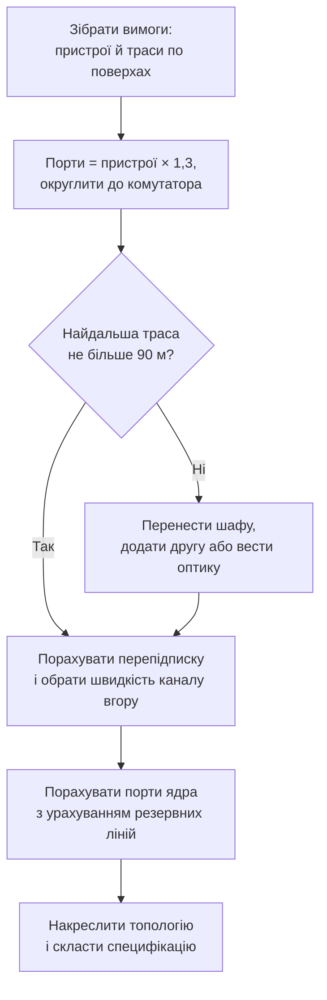

# Проєктування топології

> [!abstract] Пов'язана лекція
> [[courses/computer-networks/lectures/07-stp-ahrehatsiia-kanaliv-ta-qos|Лекція 7. STP, агрегація каналів та QoS]]. На цьому занятті ви проєктуєте мережу будівлі так, як це робить інженер перед закупівлею обладнання: рахуєте порти із запасом, перевіряєте довжину кожної траси, обираєте швидкість каналів між комутаторами й розв'язуєте, де потрібен резерв. Результат – схема топології та специфікація обладнання, під якою можна підписатися.

## Мета

Навчитися переходити від вимог замовника («стільки робочих місць, така будівля») до конкретного складу обладнання й схеми з'єднань: визначати кількість портів і комутаторів доступу, перевіряти обмеження довжини [[courses/computer-networks/glossary/vyta-para|виту пару]] за трасою, оцінювати перепідписку каналів вгору й обґрунтовувати місце резервних ліній.

Після заняття ви повинні вміти:

- розкласти мережу будівлі на рівні доступу, розподілу й ядра та пояснити, що робить кожен рівень;
- порівняти п'ять базових топологій за кількістю ліній, портів і поведінкою під час відмови та обрати топологію під задачу;
- обчислити потрібну кількість портів із запасом і округлити її до цілого числа комутаторів;
- перевірити довжину горизонтальної траси й запропонувати рішення, якщо ліміт перевищено;
- обчислити перепідписку каналу й порівняти її з орієнтиром;
- перевірити розрахунок невеликою програмою й оформити схему та специфікацію.

## Обладнання та програмне забезпечення

- аркуш паперу або редактор схем (diagrams.net, Draw.io чи будь-який інший) для малювання топології;
- калькулятор або текстовий редактор для таблиць: розрахунок виконується вручну;
- Python 3 для самоперевірки (достатньо стандартної бібліотеки, окремих модулів не потрібно);
- план будівлі й таблиця вимог за вашим варіантом (нижче в завданні 3).

## Розподіл часу

| Етап | Час |
|---|---|
| 1. Розминка: порти, траса, перепідписка | 10 хв |
| 2. Розбір зразка разом з викладачем | 20 хв |
| 3. Самостійне завдання за варіантом | 35 хв |
| 4. Перевірка програмою й захист | 15 хв |

## Теоретична частина

### З чого починається проєкт мережі

Початківець зазвичай бере аркуш і одразу малює комутатори. Досвідчений інженер починає з трьох чисел, які звучать як вимоги замовника, а не як технічні параметри. Скільки точок підключення потрібно і де вони розташовані? На якій відстані від телекомунікаційної шафи лежить найдальша з них? Який трафік піде вгору, до серверів і в зовнішню мережу? Усе, що з'явиться на схемі далі, виводиться з цих трьох відповідей: кількість комутаторів – з першої, місце шафи й тип кабелю – з другої, швидкість каналів між комутаторами – з третьої.

Як усе це розташувати, підказує модель з [[courses/computer-networks/lectures/01-vstup-do-kompiuternykh-merezh|першої лекції]] про ієрархічні мережі. Кінцеві пристрої (комп'ютери, точки доступу, принтери) підключаються до комутаторів рівня доступу. Кілька комутаторів доступу збираються на рівні розподілу, а той у свою чергу з'єднується з ядром, яке пересилає трафік між частинами підприємства і виводить його назовні.

![[attachments/ksm-p02-iierarkhiia.svg|900]]

На рисунку показана повна трирівнева схема, але у вашій роботі, як і в більшості навчальних корпусів, будівля мала, і рівні розподілу та ядра поєднано в одному комутаторі. Це нормальне інженерне рішення: окремий рівень розподілу потрібен тоді, коли комутаторів доступу так багато, що ядро просто не має достатньо портів, щоб прийняти їх усіх напряму. До такої кількості нам ще далеко.

### Топології: з чого складається схема

У лекції 1 ви познайомилися з п'ятьма базовими топологіями. Для проєкту цього недостатньо знати їхні назви, потрібно вміти відповісти на три практичні запитання: скільки кабелів і портів вона вимагає, що станеться, коли відмовить одна лінія, і що станеться, коли відмовить вузол. Саме ці три числа визначають, чи підійде топологія для вашого корпусу.

![[attachments/ksm-p02-bazovi-topolohii.svg|1000]]

Рисунок показує всі п'ять топологій на одному наборі з шести пристроїв, і відразу видно різницю в кількості ліній. Розберемо їх по черзі.

**Шина** – один спільний кабель, до якого під'єднуються всі. Така топологія була в перших мережах Ethernet на коаксіальному кабелі й сьогодні не будується. Але її варто пам'ятати, бо концентратор з [[courses/computer-networks/lectures/03-merezheve-obladnannia|лекції 3]] фізично виглядає як зірка, а поводиться як шина: усе, що надіслав один пристрій, чують усі. Обрив кабелю ділить мережу на дві частини, які не бачать одна одну.

**Зірка** – кожен пристрій має власний кабель до центрального комутатора. Це стандарт сучасних локальних мереж, і саме її ви малюєте на кожному поверсі. Її сильна сторона в тому, що відмова одного кабелю зачіпає лише один пристрій, а ремонт прозорий: замінили патч-корд, і все працює. Слабка сторона в самому центрі: якщо відмовив комутатор, мовчать усі, хто до нього підключений.

**Кільце** – кожен пристрій з'єднаний із двома сусідами. Один обрив мережа переживає, бо трафік піде в іншу сторону, а два обриви розбивають кільце на два окремих шматки. У локальних мережах будівлі кільце сьогодні майже не будують, зате воно часто виникає як результат резервування: наприклад, коли кілька комутаторів з'єднано послідовно, а останній ще й підключено назад до першого.

**Повна сітка** – кожен пристрій з'єднаний із кожним. Вона найнадійніша, але й найдорожча: для `n` пристроїв потрібно `n(n-1)/2` ліній, а кожен пристрій змушений мати `n-1` портів. Для чотирьох пристроїв це шість ліній, а для двадцяти вже сто дев'яносто. Тому повну сітку використовують лише там, де пристроїв мало, а ціна простою величезна, наприклад між магістральними маршрутизаторами.

**Ієрархічна топологія** – це кілька рівнів зірок: комутатори доступу під'єднані до розподілу, розподіл до ядра. Саме її ви проєктуєте в цій роботі. Вона поєднує дешевизну зірки з керованістю: відмова комутатора доступу зачіпає лише його групу користувачів, а не всю будівлю, і додавати нові групи можна, не переробляючи решту мережі.

| Топологія | Ліній для `n` вузлів | Портів на вузлі | Відмова однієї лінії | Відмова вузла |
|---|---|---|---|---|
| Шина | `n` | 1 | ділить мережу | ні на що не впливає |
| Зірка | `n` | 1 (центр: `n`) | відрізає один пристрій | центр вимикає всіх |
| Кільце | `n` | 2 | мережа працює | мережа працює, якщо лінія одна |
| Повна сітка | `n(n-1)/2` | `n-1` | непомітна | непомітна |
| Ієрархія | близько `n` плюс резерв | 1 на доступі, більше вгору | відрізає групу, якщо немає резерву | відрізає групу |

Головна пастка тут у числах. Здається, що найнадійніша топологія є найкращою, але подивіться, як швидко зростає кількість ліній.

![[attachments/ksm-p02-zrostannia-linii.svg|900]]

Червона крива – повна сітка, синя пряма – зірка й кільце. Для чотирьох вузлів різниця майже непомітна, але для дванадцяти вона вже шестикратна: шістдесят шість ліній проти дванадцяти. Це квадратична залежність проти лінійної, і вона не залишає повній сітці місця в звичайному проєкті корпусу.

> [!example] Приклад
> У зразку нижче вісім вузлів: сім комутаторів доступу й одне ядро. Якби ми з'єднали їх повною сіткою, потрібно було б `8 × 7 / 2 = 28` ліній, і кожен комутатор витратив би сім портів на сусідів. Кільце дало б `8` ліній, зірка навколо ядра `7`, а наша схема з двома лініями до ядра `14`. Різниця між `14` і `28` невелика у кабелі, але велика в портах: комутатор доступу втрачає два порти замість семи.

> [!warning] Типова помилка
> «Візьмемо повну сітку, вона найнадійніша». На папері так, а на практиці комутатор доступу на `24` порти віддасть сім із них сусідам і залишить користувачам лише сімнадцять. Надійність у проєкті купується не кількістю з'єднань між усіма, а розумним резервом там, де відмова коштує найдорожче: лініями до ядра й самим ядром.

### Рахуємо порти

Головна пастка розрахунку портів полягає в тому, що кількість потрібних портів і кількість пристроїв – це різні числа. Кожному комп'ютеру потрібен порт, але крім комп'ютерів порти займають точки доступу Wi-Fi, мережеві принтери, IP-телефони, камери, і про них регулярно забувають, бо їх немає в списку «робочих місць». Тому порти рахують за всіма пристроями, а не лише за людьми.

Друга поправка – запас. Мережа не залишається такою, якою ви її спроєктували: за три роки з'являються нові кабінети, нові принтери, нові камери. Комутатор, у якому зайнято всі порти до останнього, доводиться міняти повністю, а запас у тридцять відсотків дає змогу пережити ці зміни без закупівлі. Саме тому типовий розрахунок виглядає так: сума всіх пристроїв, помножена на `1,3`, і округлення вгору до цілого числа комутаторів. Округлення вгору обов'язкове: не існує «половини комутатора», тож `1,75` комутатора означає два.

![[attachments/ksm-p02-zapas-portiv.svg|850]]

Рисунок показує, як ці три числа співвідносяться на кожному поверсі зразка: потреба, потреба із запасом і встановлена ємність. Встановлена завжди більша за запас, бо округлення йде до цілого комутатора, і саме цей надлишок дає ще один резерв на зростання.

> [!warning] Типова помилка
> Порти ядра рахують лише за серверами й забувають про лінії від комутаторів доступу. Але кожний комутатор доступу займає на ядрі не один порт, а як мінімум два: основну лінію й резервну. Сім комутаторів доступу з подвійним підключенням – це чотирнадцять портів ядра ще до того, як ви підключили хоча б один сервер.

### Рахуємо відстані

Із [[courses/computer-networks/lectures/02-seredovyshche-peredachi-danykh|другої лекції]] ви знаєте, що сегмент виту пару не може перевищувати `100` метрів. Тепер варто уточнити, звідки береться ця цифра в проєкті. Сто метрів – це весь канал від порту комутатора до комп'ютера, разом з патч-кордами на обох кінцях. Самій горизонтальній трасі, тобто кабелю, прокладеному по стіні, у стелі й під підлогою, лишається `90` метрів, а решту `10` займають патч-корд у [[courses/computer-networks/glossary/patch-panel|патч-панелі]] і короткий кабель від розетки до комп'ютера.

Є ще одна тонкість: довжину вимірюють по трасі, а не по плану по прямій. Кабель не летить крізь стіни. Він іде коридором, обходить сходові клітки, піднімається до підвісної стелі й опускається до розетки, і кожен такий вигин додає метри. Тому «між шафою й кабінетом `70` метрів по плану» нічого не гарантує, і довжину потрібно рахувати вздовж реального маршруту.

![[attachments/ksm-p02-shafa-poverkh.svg|1000]]

Рисунок порівнює два розташування шафи на одному й тому самому поверсі довжиною майже сто метрів. Коли шафа стоїть у торці, довга сторона поверху лежить поза межею `90` м, і останні кімнати вже не підключити без додаткових заходів. Коли шафа в центрі, найдальша траса в обидва боки приблизно вдвічі коротша, і залишається запас на вигини, підйоми до стелі й патч-корди. Саме тому планування шафи на початку проєкту важливіше за вибір кабелю.

> [!info] Для допитливих
> Якщо найдальше робоче місце не вкладається в `90` метрів, є три практичні виходи: перенести телекомунікаційну шафу до центру поверху, поставити другу шафу, що обслуговуватиме віддалене крило, або вести до цього крила оптику, у якої обмеження на довжину значно слабше. Вибір залежить від кількості віддалених точок: для двох-трьох розеток економічніше оптика, для десятка – друга шафа.

### Перепідписка

Комутатор доступу на 24 порти по `1` Гбіт/с технічно здатний прийняти від користувачів до `24` Гбіт/с, а вгору відправити лише те, що пропускає його лінія до ядра. Якщо лінія вгору має `1` Гбіт/с, то відношення складає `24:1`. Це відношення називається перепідпискою.

> [!definition] Визначення
> **Перепідписка (oversubscription)** – відношення сумарної швидкості портів, до яких підключаються користувачі, до швидкості каналу вгору. Чим воно більше, тим вища ймовірність, що канал вгору стане вузьким місцем, коли активними виявляться багато користувачів одночасно.

Ця цифра не означає, що мережа працює з такою швидкістю погано. Користувачі рідко завантажують усі порти одночасно, тому певна перепідписка нормальна й економічно виправдана: вимагати, щоб кожен порт мав власний гарантований канал вгору, означало б будувати мережу в десять разів дорожчу, ніж потрібно. Орієнтири, які ми використовуємо в цій роботі, прийшли з настанов Cisco: до `20:1` між рівнем доступу й рівнем розподілу та до `4:1` між розподілом і ядром. Це не закон, а розумна межа, за якою слід або збільшувати канал, або обґрунтовувати рішення.

### Резерв і петлі

Резерв має кілька рівнів, і кожен наступний коштує дорожче за попередній. Рисунок нижче порівнює три найпоширеніші рішення для одного комутатора доступу.

![[attachments/ksm-p02-vidmovy.svg|1000]]

У першому варіанті комутатор має одну лінію вгору. Це найдешевше, але обрив одного кабелю відрізає від мережі всіх, хто до нього підключений. У другому варіанті ліній дві, і саме їх ви закладаєте в зразку: якщо одна відмовила, трафік іде другою, а коли обидві живі, одна лежить у запасі під керуванням STP або працює разом із другою завдяки агрегації. У третьому варіанті резервується вже саме ядро: кожен комутатор підключено до двох ядер, і відмова одного з них ніхто не помічає. Третій варіант потребує вдвічі більше портів на кожному комутаторі й другого ядра, тому його обирають там, де простій мережі коштує дорожче за обладнання.

Подвійне підключення комутатора до ядра розв'язує проблему відмови однієї лінії, але одночасно створює іншу, про яку ви вже чули в [[courses/computer-networks/lectures/07-stp-ahrehatsiia-kanaliv-ta-qos|лекції 7]]: дві паралельні лінії між тими самими комутаторами утворюють петлю. Без захисту такий кадр циркулює мережею нескінченно. Тому є два способи ужитися з резервною лінією. Перший – протокол STP, який блокує одну з двох ліній, тримаючи її як запасну. Другий – агрегація каналів, коли обидві лінії об'єднуються в один логічний канал і працюють одночасно. Для проєкту важливо вирішити, що саме ви хочете: тільки резерв чи ще й подвоєну пропускну здатність.

Ось послідовність, у якій зручно проходити весь розрахунок. Порядок важливий: кожен наступний крок використовує результат попереднього.



## Практична частина

### Завдання 1. Розминка (10 хв)

Виконайте вручну, записуючи кожен крок:

1. На поверсі `18` робочих місць, одна точка доступу й один мережевий принтер. Скільки портів потрібно із запасом `30%` і скільки 24-портових комутаторів доступу знадобиться?
2. Комутатор доступу має `24` порти по `1` Гбіт/с, а до ядра йде два канали по `1` Гбіт/с, об'єднані в один логічний канал. Яка перепідписка? Чи вкладається вона в орієнтир `20:1`?
3. За планом від шафи до найдальшої розетки `70` м по прямій. Траса йде коридором, який додає `15` м, а потім піднімається до підвісної стелі та опускається до розетки: по `3` м вгору й вниз. Яка довжина траси і чи вкладається вона в `90` м?
4. П'ять комутаторів потрібно з'єднати між собою. Скільки ліній знадобиться при з'єднанні кільцем і повною сіткою? Скільки портів витратить на це кожен комутатор у кожному з двох варіантів?
5. У якій із п'яти топологій обрив однієї лінії відрізає один пристрій, у якій ділить мережу навпіл, а в яких мережа продовжує працювати?

### Завдання 2. Зразок проєкту (20 хв, разом з викладачем)

Коледжу потрібно спроєктувати мережу триповерхового корпусу. На першому поверсі розташовано адміністрацію й бібліотеку, на другому – два комп'ютерні класи, на третьому – викладацькі кабінети. Серверна – на першому поверсі. Замовник надав такі дані:

| Поверх | Робочих місць | Точок доступу й принтерів | Найдальша траса, м |
|---|---|---|---|
| 1 | 28 | 4 | 62 |
| 2 | 44 | 3 | 78 |
| 3 | 20 | 3 | 96 |

Серверів у корпусі `8`, кожному потрібно по два порти (основний і резервний). Комутатори доступу беремо по `24` порти, ядро – на `48` портів.

Рахуємо за алгоритмом. На першому поверсі потрібно `28 + 4 = 32` порти, із запасом `32 × 1,3 = 41,6`, тобто `42`. Це `42 / 24 = 1,75`, отже два комутатори. На другому: `44 + 3 = 47`, із запасом `61,1`, тобто `62`, і `62 / 24 = 2,58`, отже три комутатори. На третьому: `20 + 3 = 23`, із запасом `29,9`, тобто `30`, а це `30 / 24 = 1,25`, отже два комутатори. Усього комутаторів доступу сім, а встановлених портів `7 × 24 = 168` проти потрібних `32 + 47 + 23 = 102` – запас більший за тридцять відсотків саме через округлення вгору.

Тепер траси. Перший і другий поверхи вкладаються в `90` м із запасом `28` і `12` метрів. Третій поверх – ні: найдальше місце лежить за `96` м, на шість метрів далі за ліміт. Розумне рішення – не міняти кабель, а перенести шафу третього поверху з торця будівлі до центру: тоді найдальша траса стане приблизно вдвічі коротшою, і всі розетки помістяться в ліміт.

![[attachments/ksm-p02-korpus.svg|900]]

Лишилося ядро. Кожен комутатор доступу має основну й резервну лінії вгору: `7 × 2 = 14` портів. Сервери дають `8 × 2 = 16` портів. Ще два порти потрібні для виходу в зовнішню мережу. Разом `14 + 16 + 2 = 32`, із запасом `32 × 1,3 = 41,6`, тобто `42`. Ядро на `48` портів вистачає з невеликим запасом.

Останнє питання – швидкість ліній вгору. Комутатор доступу на `24` порти по `1` Гбіт/с через лінію `1` Гбіт/с має перепідписку `24:1`, а це вже перевищує орієнтир `20:1`. Дві лінії по `1` Гбіт/с, об'єднані агрегацією, дають `12:1`, а одна лінія `10` Гбіт/с – лише `2,4:1`. Для нового корпусу, де різниця у вартості оптичного модуля невелика, розумно обирати `10` Гбіт/с з основною й резервною лінією.

> [!example] Приклад
> Перевірте себе на одному рядку таблиці. Другий поверх: `44 + 3 = 47` пристроїв, із запасом `62` порти, три комутатори по `24`, разом `72` порти. Найдальша траса `78` м не перевищує `90` м, отже шафу переносити не потрібно. Перепідписка кожного комутатора за лінії `10` Гбіт/с – `2,4:1`.

### Завдання 3. Самостійне (35 хв)

Кожен студент отримує варіант за номером у списку групи. Корпус у кожному варіанті триповерховий, комутатори доступу по `24` порти, запас `30%`, ядро `48` портів, кожен сервер займає два порти.

| Варіант | Робочих місць (1/2/3 пов.) | Точок доступу й принтерів (1/2/3) | Найдальша траса, м (1/2/3) | Серверів |
|---|---|---|---|---|
| 1 | 30 / 40 / 24 | 4 / 3 / 3 | 58 / 84 / 93 | 6 |
| 2 | 26 / 48 / 18 | 3 / 4 / 2 | 71 / 88 / 97 | 8 |
| 3 | 34 / 36 / 28 | 4 / 4 / 3 | 66 / 92 / 79 | 6 |
| 4 | 22 / 52 / 30 | 3 / 5 / 4 | 54 / 81 / 99 | 8 |
| 5 | 40 / 32 / 20 | 5 / 3 / 3 | 87 / 61 / 94 | 8 |
| 6 | 18 / 44 / 36 | 2 / 4 / 4 | 76 / 95 / 68 | 6 |
| 7 | 32 / 28 / 42 | 4 / 3 / 5 | 89 / 73 / 101 | 10 |
| 8 | 24 / 56 / 16 | 3 / 6 / 2 | 63 / 97 / 82 | 8 |

Що потрібно виконати й здати:

1. Для кожного поверху обчисліть потрібні порти, порти із запасом `30%` і кількість комутаторів доступу.
2. Перевірте довжину траси на кожному поверсі. Для поверхів, де перевищено `90` м, запропонуйте рішення й обґрунтуйте вибір.
3. Обчисліть перепідписку одного комутатора доступу для ліній `1` Гбіт/с, `2 × 1` Гбіт/с (агрегація) і `10` Гбіт/с та оберіть варіант, який вкладається в орієнтир `20:1`.
4. Обчисліть потрібну кількість портів ядра з урахуванням основних і резервних ліній комутаторів доступу, серверів і виходу назовні. Переконайтеся, що вистачає ядра на `48` портів.
5. Накресліть топологію: поверхи, комутатори доступу, ядро, сервери, лінії вгору з позначенням швидкості й резервних ліній. Підпишіть, яка базова топологія реалізована на кожному рівні.
6. Порівняйте топології для вашого корпусу: порахуйте кількість ліній і портів на комутаторі (комутатори доступу й ядро разом), якби їх з'єднали кільцем, повною сіткою й за вашою схемою з двома лініями вгору. Зробіть висновок, чому обрано ієрархію.
7. Додатково для тих, хто впорався раніше: розділіть корпус на мережі за допомогою [[courses/computer-networks/practicals/01-rozrakhunok-adresnoho-prostoru|методу VLSM з практичної роботи 1]]: кожному поверху виділіть підмережу, що вміщує всі його пристрої із запасом, і впишіть адреси в схему.

> [!warning] Перед тим як перевіряти програмою
> Розрахуйте все самостійно, на папері. Програма існує для того, щоб виявити помилку в ваших цифрах, а не для того, щоб замінити розуміння. Якщо ви просто перепишете її результат, на захисті не зможете пояснити, звідки він узявся.

### Завдання 4. Самоперевірка програмою (15 хв)

Програма нижче повторює розрахунок для вашого варіанта, друкує по поверхах результат і вказує, де траса перевищує ліміт. Змініть значення в словнику `floors` і кількість серверів на дані власного варіанта й порівняйте результат зі своєю таблицею.

```python
RESERVE = 30      # запас портів, %
PORTS = 24        # портів у комутатора доступу
MAX_RUN = 90      # м, максимум горизонтальної траси


def ceil_div(a, b):
    return -(-a // b)


# поверх: (робочих місць, точок доступу й принтерів, найдальша траса, м)
floors = {
    "1 поверх": (28, 4, 62),
    "2 поверх": (44, 3, 78),
    "3 поверх": (20, 3, 96),
}
servers = 8

total = 0
for name, (places, devices, run) in floors.items():
    need = places + devices
    with_reserve = ceil_div(need * (100 + RESERVE), 100)
    switches = ceil_div(with_reserve, PORTS)
    total += switches
    verdict = "траса в нормі" if run <= MAX_RUN else f"ТРАСА {run} м > {MAX_RUN} м"
    print(f"{name}: потрібно {need:3}, із запасом {with_reserve:3}, "
          f"комутаторів {switches}, {verdict}")

core_need = total * 2 + servers * 2 + 2
core_ports = ceil_div(core_need * (100 + RESERVE), 100)
print(f"Комутаторів доступу: {total}; портів ядра: {core_need}, із запасом {core_ports}")
assert core_ports <= 48, "ядру не вистачить 48 портів"

for uplink in (1, 2, 10):
    print(f"Лінія вгору {uplink} Гбіт/с: перепідписка {PORTS / uplink:.1f}:1")

nodes = total + 1   # комутатори доступу й ядро
print(f"Вузлів {nodes}: кільце {nodes} ліній, повна сітка {nodes * (nodes - 1) // 2}, "
      f"ієрархія з двома лініями вгору {total * 2}")
```

Для зразка з завдання 2 програма має надрукувати для третього поверху `ТРАСА 96 м > 90 м`, сім комутаторів доступу й `42` порти ядра із запасом, а в останньому рядку порівняння: вісім вузлів, кільце `8` ліній, повна сітка `28`, ієрархія `14`. Якщо спрацював `assert`, ядра на `48` портів не вистачає: порахуйте, скільки потрібно портів, і запропонуйте або більше ядро, або другий комутатор розподілу.

## Контрольні питання

> [!question] Перевірте себе
> 1. Чому порти рахують за всіма пристроями, а не лише за робочими місцями? Які пристрої найчастіше забувають?
> 2. Навіщо додавати запас портів і чому результат завжди округлюють вгору?
> 3. Що входить у `100` м допустимої довжини каналу для вити пари і чому горизонтальній трасі лишається `90` м?
> 4. Для розетки за планом на відстані `65` м по прямій траса вийшла `93` м. Які рішення можливі?
> 5. Що таке перепідписка і чому нормально, що вона не дорівнює `1:1`? Коли її значення вже тривожне?
> 6. Чому в проєкті з резервними лініями необхідно або STP, або агрегація каналів? Яку проблему вони розв'язують?
> 7. Чому повну сітку не використовують для з'єднання комутаторів доступу, хоча вона найнадійніша? Скільки ліній і портів на комутатор потрібно для десяти комутаторів?
> 8. Порівняйте три рішення резерву: одна лінія вгору, дві лінії, два ядра. Що переживає відмову в кожному випадку і чим за це платять?
> 9. Чому розташування телекомунікаційної шафи в центрі поверху вигідніше за торець? Які ще наслідки це має для проєкту?

## Звіт

Звіт містить: таблицю розрахунку портів і комутаторів по поверхах за вашим варіантом, перевірку довжини траси з обраним рішенням для поверхів, що не вкладаються в ліміт, розрахунок перепідписки для трьох варіантів ліній вгору, розрахунок портів ядра, порівняння топологій за кількістю ліній і портів із висновком, схему топології з підписаними лініями й швидкостями, а також знімок екрана виконання перевірочної програми.

## Назад
← [[courses/computer-networks/lectures/07-stp-ahrehatsiia-kanaliv-ta-qos|Лекція 7. STP, агрегація каналів та QoS]]

## Далі
→ [[courses/computer-networks/lectures/08-bezdrotovi-merezhi-wi-fi|Лекція 8. Бездротові мережі Wi-Fi]]

## Література
- [[courses/computer-networks/lectures/01-vstup-do-kompiuternykh-merezh|Лекція 1. Вступ до комп'ютерних мереж]]: ієрархічна модель доступ, розподіл, ядро.
- [[courses/computer-networks/lectures/02-seredovyshche-peredachi-danykh|Лекція 2. Середовище передачі даних]]: обмеження довжини вити пари, оптика й структурована кабельна система.
- [[courses/computer-networks/lectures/07-stp-ahrehatsiia-kanaliv-ta-qos|Лекція 7. STP, агрегація каналів та QoS]]: резервні лінії, STP та агрегація каналів.
- Cisco Networking Academy. *Switching, Routing, and Wireless Essentials* (курс CCNA v7/v7.1) – розділи про ієрархічну мережу й агрегацію каналів.
- ANSI/TIA-568. *Commercial Building Telecommunications Cabling Standard* – обмеження довжини горизонтального кабелю й каналу.
