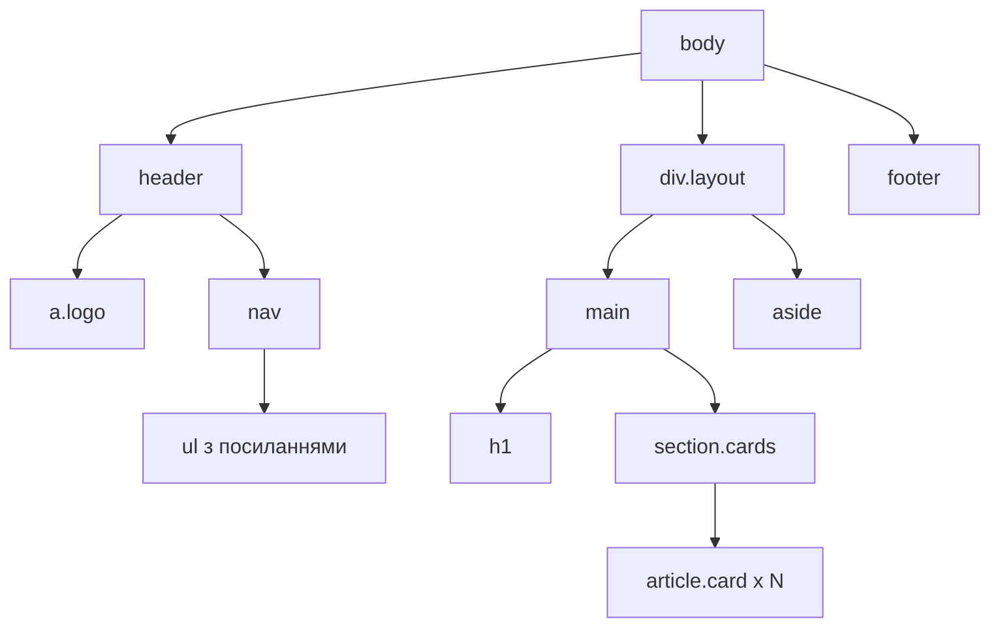

# Верстання адаптивної сторінки засобами HTML і CSS

> [!abstract] Коротко
> Перша лабораторна курсу. Ви зверстаєте повноцінну сторінку: семантична розмітка, меню на Flexbox, сітка карток на Grid, макет «основний вміст і бічна панель» на іменованих областях Grid. Потім змусите її пристосовуватися до будь-якого екрана за підходом «спершу мобільні», додасте темну тему на змінних CSS і перевірите доступність інструментами браузера. Фізичного телефона для цього не потрібно.

## Мета і результати навчання

Після виконання роботи ви вмієте:

- [ ] будувати семантичну структуру сторінки й пояснювати, чому `div` там, де потрібен `nav`, – це помилка;
- [ ] керувати розкладкою одновимірно (Flexbox) і двовимірно (Grid) та обирати інструмент під задачу;
- [ ] писати адаптивні стилі за підходом «спершу мобільні» з медіазапитами `min-width`;
- [ ] будувати тему на змінних CSS і перемикати її через `prefers-color-scheme`;
- [ ] перевіряти сторінку валідатором, інструментом Lighthouse та емуляцією пристроїв.

## Професійні компетентності

Після виконання лабораторної роботи здобувач освіти повинен навчитися будувати семантичну розмітку сторінки та реалізовувати адаптивний макет засобами Flexbox, Grid і медіазапитів.

Відповідно до освітньої програми робота формує компетентності:

- СК03. Здатність застосовувати теоретичні та емпіричні знання для розроблення, тестування, впровадження та супроводу програмного забезпечення.
- СК07. Здатність розробляти модулі і компоненти програмного забезпечення за допомогою типових алгоритмів та інструментів.

## Перелік необхідного обладнання та програмного забезпечення

- Персональний комп'ютер, редактор коду (Visual Studio Code), сучасний вебпереглядач з інструментами розробника (Chrome або Firefox).
- Розширення «Live Server» для VS Code або команда `python3 -m http.server 5500` у теці проєкту.
- Доступ до W3C Markup Validator (validator.w3.org) і вбудованого в Chrome інструмента Lighthouse.

## Варіанти завдання

Тема сайту визначається номером у журналі групи (номер за модулем 10). Однакових сторінок у групі бути не повинно: структура одна, а вміст – ваш.

| № | Тема сайту | № | Тема сайту |
|---|---|---|---|
| 1 | Кав'ярня з меню та акціями | 6 | Фотостудія з портфоліо |
| 2 | Каталог онлайн-курсів | 7 | Туристичний маршрут по Одещині |
| 3 | Спортивний клуб з розкладом | 8 | Ветеринарна клініка з послугами |
| 4 | Книгарня з новинками | 9 | Студія веб-розробки з кейсами |
| 5 | Майстер-клас з кулінарії | 0 | Бібліотека настільних ігор |

У кожному варіанті мають бути: шапка з логотипом і меню, 3 і більше розділів меню, не менше шести карток у сітці, бічна панель з додатковою інформацією (контакти, новини, фільтри) і підвал.

## Теоретична частина

### Чому розмітка має бути семантичною

Браузер показує `<div class="header">` і `<header>` однаково, але решта програм бачить їх зовсім по-різному. Програма екранного доступу читає сліпому користувачеві: «навігація, список із п'яти пунктів», і той одним натисканням переходить до головного вмісту. Пошуковий робот розуміє, що `article` – самостійний матеріал, а `aside` – побічна інформація. Семантичні теги не змінюють вигляду, вони описують **призначення** блоку, і саме тому є основою доступності та SEO.

Структура сторінки цієї роботи така:



### Блокова модель і box-sizing

Кожен елемент – прямокутник, що складається з вмісту, внутрішніх відступів (`padding`), рамки (`border`) і зовнішніх відступів (`margin`). За замовчуванням `width` задає ширину лише вмісту: блок шириною `300px` із `padding: 20px` і рамкою `2px` займе насправді `344px`, і на цьому ламається більшість «поплилих» макетів. Властивість `box-sizing: border-box` змінює правило: `width` включає відступи й рамку, тож розмір, який ви написали, – це розмір, який ви отримали.

> [!definition] Блокова модель
> Алгоритм, за яким браузер обчислює розмір і положення елемента з урахуванням `content`, `padding`, `border` і `margin`. У режимі `border-box` ширина й висота охоплюють вміст, внутрішні відступи та рамку.

### Flexbox і Grid: коли що

Flexbox розкладає елементи вздовж **однієї осі**: меню, ряд кнопок, панель інструментів, вміст картки. Він добре справляється з тим, що розмір вмісту невідомий наперед. Grid задає **дві осі одразу**: рядки й стовпці утворюють сітку, і елементи можна розмістити в клітинках або іменованих областях. Правило, яке варто запам'ятати: якщо ви думаєте про рядок або стовпець – беріть Flexbox, якщо про таблицю з клітинок – Grid. На практиці сторінка поєднує обидва: Grid ділить її на великі області, а всередині областей працює Flexbox.

### Медіазапити й «спершу мобільні»

Медіазапит вмикає блок правил лише за певної умови, найчастіше за ширини вікна. Підхід «спершу мобільні» (mobile first) означає, що **базові стилі описують вузький екран**, а запити `@media (min-width: …)` лише додають правила для ширших. Звідси практичний бонус: смартфон, найслабший пристрій, застосовує найменше правил і не завантажує зайвого.

> [!info] Для допитливих
> Починаючи з 2023 року всі сучасні браузери підтримують **контейнерні запити** (`@container`): картка адаптується до ширини *свого* контейнера, а не вікна. Тоді один і той самий компонент однаково добре виглядає в основній колонці й у вузькій бічній панелі. Це завдання підвищеної складності наприкінці роботи.

## Підготовка

Створіть теку проєкту й три файли:

```bash
mkdir lab01-site && cd lab01-site
touch index.html styles.css
```

У `index.html` додайте каркас. Зверніть увагу на два рядки в `<head>`: без `meta viewport` смартфон показуватиме сторінку як зменшену копію десктопної версії, і жоден ваш медіазапит не спрацює.

```html
<!DOCTYPE html>
<html lang="uk">
<head>
  <meta charset="UTF-8">
  <meta name="viewport" content="width=device-width, initial-scale=1">
  <title>Назва вашого сайту</title>
  <link rel="stylesheet" href="styles.css">
</head>
<body>
</body>
</html>
```

## Хід роботи

### Етап 1. Семантична розмітка

Вставте в `<body>` скелет сторінки. Замініть текст на свій варіант, але збережіть теги та їхню вкладеність. Посилання «Перейти до вмісту» невидиме, поки до нього не дійдуть клавіатурою; воно рятує користувачів без миші від багаторазового проходження меню.

```html
<a class="skip" href="#content">Перейти до вмісту</a>

<header class="site-header">
  <a class="logo" href="/">Моя Кав'ярня</a>
  <nav aria-label="Основне меню">
    <ul class="menu">
      <li><a href="#menu">Меню</a></li>
      <li><a href="#promo">Акції</a></li>
      <li><a href="#about">Про нас</a></li>
      <li><a href="#contacts">Контакти</a></li>
    </ul>
  </nav>
</header>

<div class="layout">
  <main id="content">
    <h1>Кава, яку варто спробувати</h1>
    <p class="lead">Короткий вступ про вашу тему: два-три речення.</p>

    <section class="cards" aria-labelledby="menu">
      <h2 id="menu">Наше меню</h2>
      <div class="grid">
        <article class="card">
          
          <h3>Еспресо</h3>
          <p>Короткий опис позиції в одне-два речення.</p>
          <a class="btn" href="#">Детальніше</a>
        </article>
        <!-- ще щонайменше п'ять карток -->
      </div>
    </section>
  </main>

  <aside aria-label="Додаткова інформація">
    <h2>Контакти</h2>
    <p>вул. Дерибасівська, 1<br>щодня 8:00–22:00</p>
  </aside>
</div>

<footer class="site-footer">
  <p>© 2026 Ваше ім'я, група, коледж</p>
</footer>
```

> [!warning] Типова помилка
> Атрибут `alt` не можна пропускати чи заповнювати словом «картинка». Опишіть, що на зображенні, так, щоб слухач зрозумів суть. Для суто декоративних зображень пишуть `alt=""`, і програма екранного доступу пропускає їх. Також завжди вказуйте `width` і `height`: браузер зарезервує місце заздалегідь, і сторінка не «стрибатиме», коли завантажиться картинка.

**Контрольна точка 1.** Відкрийте `index.html` без стилів. Сторінка має виглядати як просто оформлений документ, але читатися логічно згори вниз. Вставте код у W3C Validator: помилок бути не повинно.

### Етап 2. Змінні, скидання стилів і типографіка

Усі кольори, відступи й радіуси виносимо у змінні на `:root`. Тема, яку ви додасте на етапі 7, змінюватиме лише їхні значення.

```css
:root {
  --bg: #ffffff;
  --text: #1d2433;
  --muted: #4a5568;
  --accent: #1a56db;
  --accent-text: #ffffff;
  --card: #f3f5f9;
  --border: #d5dae3;
  --radius: 12px;
  --gap: 1rem;
  --max: 72rem;
}

*,
*::before,
*::after {
  box-sizing: border-box;
}

body {
  margin: 0;
  font-family: system-ui, -apple-system, "Segoe UI", Roboto, sans-serif;
  font-size: 1rem;
  line-height: 1.6;
  color: var(--text);
  background: var(--bg);
}

img {
  max-width: 100%;
  height: auto;
  display: block;
}

h1 { font-size: clamp(1.75rem, 1.2rem + 2.5vw, 2.75rem); line-height: 1.2; }
h2 { font-size: clamp(1.35rem, 1.1rem + 1.2vw, 1.85rem); }

.skip {
  position: absolute;
  left: -999px;
}
.skip:focus {
  left: 1rem;
  top: 1rem;
  padding: .5rem 1rem;
  background: var(--accent);
  color: var(--accent-text);
  z-index: 10;
}

a:focus-visible,
.btn:focus-visible {
  outline: 3px solid var(--accent);
  outline-offset: 3px;
}
```

Функція `clamp(мін, бажане, макс)` робить розмір шрифту плавним: на вузькому екрані заголовок не менший за мінімум, на широкому не більший за максимум, а між ними масштабується разом з вікном. Це прибирає потребу окремих медіазапитів для типографіки.

### Етап 3. Меню на Flexbox

Меню – класичне завдання для Flexbox: пункти в один ряд, між логотипом і меню вільний простір.

```css
.site-header {
  display: flex;
  flex-wrap: wrap;
  align-items: center;
  justify-content: space-between;
  gap: var(--gap);
  padding: var(--gap) 1rem;
  border-bottom: 1px solid var(--border);
}

.logo {
  font-weight: 700;
  font-size: 1.25rem;
  color: var(--text);
  text-decoration: none;
}

.menu {
  display: flex;
  flex-wrap: wrap;
  gap: .5rem;
  margin: 0;
  padding: 0;
  list-style: none;
}

.menu li { flex: 1 1 auto; }

.menu a {
  display: block;
  padding: .6rem 1rem;
  text-align: center;
  border-radius: var(--radius);
  color: var(--text);
  text-decoration: none;
}
.menu a:hover { background: var(--card); }
```

Рядок `flex: 1 1 auto` означає: пункт може розтягуватися (`1`), може стискатися (`1`) і за базу бере власний розмір вмісту (`auto`). Завдяки цьому пункти рівномірно заповнюють ряд, а `flex-wrap: wrap` не дає їм вилізти за межі екрана, натомість переносить на новий рядок.

**Контрольна точка 2.** Стискайте вікно браузера: пункти мають переноситися, а не виходити за межу.

### Етап 4. Сітка карток на Grid

Серце адаптивної сторінки – одна декларація без жодного медіазапиту:

```css
.grid {
  display: grid;
  grid-template-columns: repeat(auto-fit, minmax(16rem, 1fr));
  gap: var(--gap);
}

.card {
  display: flex;
  flex-direction: column;
  gap: .5rem;
  padding: var(--gap);
  background: var(--card);
  border: 1px solid var(--border);
  border-radius: var(--radius);
}
.card img { border-radius: calc(var(--radius) - 4px); }
.card h3 { margin: .25rem 0 0; }
.card p  { margin: 0; color: var(--muted); }

.btn {
  margin-top: auto;
  align-self: flex-start;
  padding: .5rem 1rem;
  border-radius: var(--radius);
  background: var(--accent);
  color: var(--accent-text);
  text-decoration: none;
}
```

Розберімо головний рядок. `minmax(16rem, 1fr)` каже: колонка не вужча за 16rem і ділить вільне місце порівну. `repeat(auto-fit, …)` просить браузер самому вирахувати, скільки таких колонок вміститься. Широкий екран дасть чотири колонки, планшет – дві, смартфон – одну, і ми не написали жодного медіазапиту. Окремо зверніть увагу на `margin-top: auto` у кнопки: у картці з колонковим Flexbox вона притискається до низу, тому кнопки в усіх картках стоять на одному рівні, навіть якщо тексти різної довжини.

### Етап 5. Основний макет: Grid з іменованими областями

```css
.layout {
  display: grid;
  gap: 1.5rem;
  max-width: var(--max);
  margin: 0 auto;
  padding: 1.5rem 1rem;
  grid-template-columns: minmax(0, 1fr);
  grid-template-areas:
    "main"
    "aside";
}
main  { grid-area: main; }
aside { grid-area: aside; }

aside {
  align-self: start;
  padding: var(--gap);
  background: var(--card);
  border: 1px solid var(--border);
  border-radius: var(--radius);
}

.site-footer {
  padding: 1.5rem 1rem;
  text-align: center;
  color: var(--muted);
  border-top: 1px solid var(--border);
}
```

Базовий (мобільний) стан: одна колонка, і бічна панель стоїть **під** основним вмістом. Саме цього вимагає завдання. Запис `minmax(0, 1fr)` замість простого `1fr` захищає від класичної пастки: довге слово чи широка таблиця розсувають звичайну `1fr`-колонку за межі екрана, а `minmax(0, …)` дозволяє їй стискатися.

### Етап 6. Медіазапити: планшет і широкий екран

Додайте в кінець `styles.css`. Базовий стиль – смартфон, тож запити тільки розширюють макет.

```css
/* Планшет: від 600px */
@media (min-width: 600px) {
  .site-header { padding-inline: 2rem; }
  .menu li { flex: 0 1 auto; }
}

/* Комп'ютер: від 960px */
@media (min-width: 960px) {
  .layout {
    grid-template-columns: minmax(0, 2.2fr) minmax(16rem, 1fr);
    grid-template-areas: "main aside";
  }
  aside {
    position: sticky;
    top: 1rem;
  }
}
```

Таким чином, є два запити: для планшета (600 пікселів) і для широкого екрана (960 пікселів), а вузький екран смартфона обслуговують базові стилі. Якщо на сторінці є анімації, додайте також запит `prefers-reduced-motion: reduce`, що їх вимикає для користувачів, яким рух заважає.

**Контрольна точка 3.** Відкрийте DevTools (F12), увімкніть режим пристроїв (Ctrl+Shift+M) і по черзі виберіть iPhone SE (375 px), iPad Mini (768 px) та «Responsive» зі шириною 1280 px. Для кожної ширини: чи немає горизонтального прокручування? Чи бічна панель стоїть під вмістом на 375 px і праворуч на 1280 px? Зробіть три знімки екрана для звіту.

> [!warning] Типова помилка
> Горизонтальне прокручування майже завжди спричиняє елемент із фіксованою шириною (`width: 600px`) або зображення без `max-width: 100%`. Щоб знайти винуватця, у консолі DevTools виконайте:
> ```js
> [...document.querySelectorAll('*')].filter(e => e.scrollWidth > document.documentElement.clientWidth)
> ```

### Етап 7. Темна тема

Тема – це лише нові значення змінних. Жодне інше правило не змінюється.

```css
@media (prefers-color-scheme: dark) {
  :root {
    --bg: #10141c;
    --text: #e8ecf4;
    --muted: #aab4c5;
    --accent: #7aa7ff;
    --accent-text: #0b1020;
    --card: #1a2030;
    --border: #2c3548;
  }
}
```

Перевірте її без зміни налаштувань системи: DevTools → Ctrl+Shift+P → «Show Rendering» → «Emulate CSS media feature prefers-color-scheme: dark».

### Етап 8. Перевірка якості

1. Запустіть Lighthouse (DevTools → вкладка Lighthouse → «Mobile» → «Accessibility», «Best practices», «SEO»). Цільові значення: Accessibility не нижче 95, SEO не нижче 90.
2. Перевірте контрастність. Клацніть правою кнопкою на тексті → Inspect → у панелі Styles клацніть на кольорі: DevTools покаже коефіцієнт контрасту. Для звичайного тексту за стандартом WCAG 2.1 рівня AA він має бути не нижче 4,5:1, для великого – 3:1.
3. Пройдіть сторінку **лише клавіатурою** (Tab, Shift+Tab, Enter). Кожен інтерактивний елемент має мати помітний фокус, а посилання «Перейти до вмісту» – з'являтися першим.

## Типові помилки

> [!warning] Типова помилка
> - Забутий `meta viewport` – медіазапити «не працюють» на реальному телефоні.
> - Медіазапити `max-width` у «мобільній першості» – ви пишете двічі й плутаєте порядок правил.
> - Висота в пікселях (`height: 400px`) у блоку з текстом – текст вилізе, коли користувач збільшить шрифт.
> - Заголовки «для розміру»: `h4` після `h1`, бо «менший шрифт». Рівні заголовків відображають структуру, розмір задають стилями.
> - Колір як єдиний носій інформації (червоне = помилка без тексту) – недоступно для людей з порушенням кольоросприйняття.

## Завдання для самостійного виконання

Додайте темну тему через `prefers-color-scheme` і змінні CSS. Перевірте контрастність тексту й опишіть результат у звіті.

Для цієї версії завдання вже частково виконане на етапі 7. Залишається **кнопка ручного перемикача теми** і запам'ятовування вибору:

1. Замість `@media (prefers-color-scheme: dark)` застосуйте змінні до атрибута: `:root[data-theme="dark"] { … }`.
2. Додайте у шапку кнопку з `aria-pressed`.
3. Перемикач змінює `document.documentElement.dataset.theme` і зберігає вибір у `localStorage` (обгорніть доступ у `try/catch`).
4. Початкове значення береть з `matchMedia('(prefers-color-scheme: dark)').matches`, якщо користувач ще нічого не обирав.

## Завдання підвищеної складності

> [!example] Рівень «добре» (необов'язково)
> Додайте контейнерний запит: картка в бічній панелі й картка в основній колонці мають розкладатися по-різному залежно від **ширини свого контейнера**.
> ```css
> .card-wrap { container-type: inline-size; }
> @container (min-width: 28rem) {
>   .card { flex-direction: row; }
>   .card img { width: 40%; }
> }
> ```

> [!example] Рівень «відмінно» (необов'язково)
> Реалізуйте мобільне меню без JavaScript: чекбокс `:checked` або елемент `<details>`; меню відкривається по натисканню «Меню» на екранах вужчих за 600 px. Опишіть у звіті, чому `<details>` доступніший за чекбокс-хак.

## Вимоги до звіту

Звіт подається як PDF або репозиторій на GitHub із файлом `README.md`. У ньому мають бути:

1. Титульна сторінка: ПІБ, група, номер варіанта.
2. Тема й мета роботи (своїми словами, 2–3 речення).
3. Знімки екрана сторінки на ширинах 375, 768 і 1280 px, світла й темна теми (6 зображень).
4. Результат Lighthouse (знімок) і результат W3C Validator.
5. Відповідь на питання: яке рішення дозволило обійтися без медіазапитів у сітці карток і чому.
6. Опис проблем, що виникали, та способів їх розв'язання (мінімум одна).
7. Висновки.

## Критерії оцінювання

| Критерій | Балів |
|---|---|
| Семантична розмітка, валідність, `alt`, заголовки | 20 |
| Flexbox-меню, Grid-сітка, іменовані області | 25 |
| Адаптивність: 3 ширини без горизонтального прокручування | 20 |
| Змінні CSS і темна тема, контрастність | 15 |
| Звіт | 10 |
| Захист (відповіді на запитання, пояснення коду) | 10 |
| **Разом** | **100** |

Переведення в оцінку: 90–100 – A (відмінно), 82–89 – B, 74–81 – C (добре), 64–73 – D, 60–63 – E (задовільно), нижче 60 – повторне виконання.

## Контрольні питання

> [!question] Перевірте себе
> 1. Чим семантична розмітка корисна для доступності?
> 2. Що змінює властивість `box-sizing: border-box`?
> 3. Коли доцільніше застосувати Grid замість Flexbox?
> 4. У чому суть підходу «спершу мобільні»?
> 5. Як перевірити адаптивність без фізичного пристрою?
> 6. Що робить запис `repeat(auto-fit, minmax(16rem, 1fr))` і чому він замінює кілька медіазапитів?
> 7. Для чого потрібен `meta viewport` і що буде без нього?
> 8. Яку мінімальну контрастність вимагає WCAG AA для звичайного тексту?

> [!exam] На іспиті
> Типове питання: «Поясніть різницю між Flexbox і Grid та наведіть приклад задачі для кожного». Хороша відповідь називає вісь розкладки (одна проти двох) і наводить приклад: меню проти макета сторінки.

## Далі

Наступна лабораторна переходить від вигляду до логіки: [[courses/web-programming/labs/02-robota-z-masyvamy-obiektamy-ta-moduliamy|Лабораторна робота 2. Робота з масивами, об'єктами та модулями JavaScript]]. Теорію до цієї роботи ви знайдете в [[courses/web-programming/lectures/01-iak-pratsiuie-veb-html-ta-css|лекції 1]], а про зв'язок розмітки з програмним доступом до сторінки – у глосарії: [[courses/web-programming/glossary/dom|DOM]], [[courses/web-programming/glossary/http|HTTP]].

## Література

- MDN Web Docs: CSS Grid Layout, Flexbox, Responsive design (developer.mozilla.org)
- web.dev/learn: Learn CSS, Learn Accessibility (web.dev)
- WCAG 2.1: Understanding Contrast (Minimum) (w3.org)
