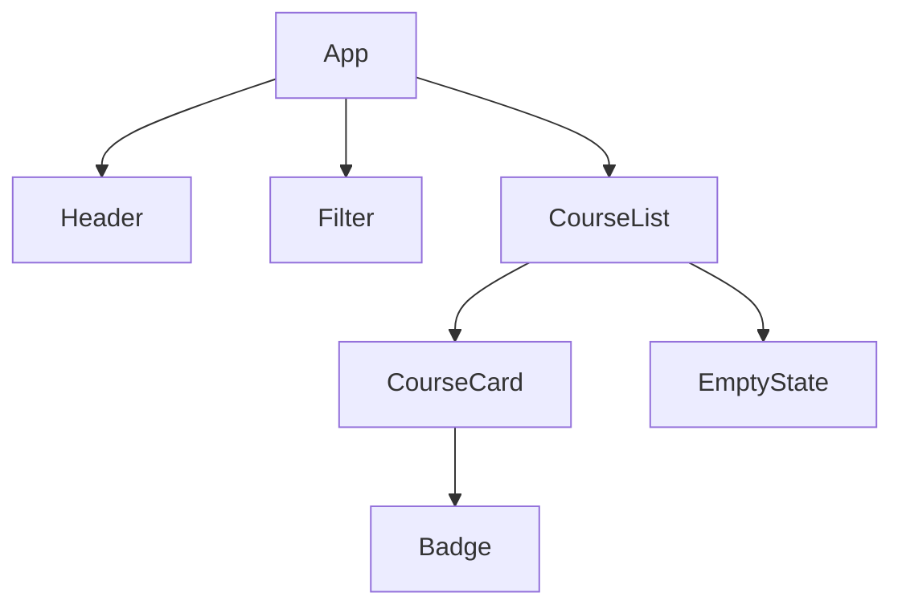

# Створення компонентного інтерфейсу на React

> [!abstract] Коротко
> Ви розіб'єте сторінку каталогу на компоненти й збудуєте її на React з TypeScript: картка товару, список із ключами, фільтр, повідомлення про порожній результат. Дані рухатимуться тільки згори вниз через пропси, а події – знизу вгору через функції зворотного виклику. Окремо поставите експеримент, що показує, чому індекс масиву є поганим ключем, і розглянете застосунок у React Developer Tools.

## Мета і результати навчання

Після виконання роботи ви вмієте:

- [ ] створити проєкт React з Vite і пояснити його структуру;
- [ ] розбивати макет на компоненти й проєктувати дерево компонентів перед кодом;
- [ ] типізувати пропси та передавати дані й функції через них;
- [ ] відображати списки зі стабільними ключами та пояснювати наслідки неправильних;
- [ ] реалізовувати умовне відображення в JSX;
- [ ] перевіряти дерево, пропси й повторні відтворення в React Developer Tools.

## Професійні компетентності

Після виконання лабораторної роботи здобувач освіти повинен навчитися розбивати інтерфейс на компоненти, передавати дані через пропси та відображати списки з ключами.

Відповідно до освітньої програми робота формує компетентності:

- СК03. Здатність застосовувати теоретичні та емпіричні знання для розроблення, тестування, впровадження та супроводу програмного забезпечення.
- СК07. Здатність розробляти модулі і компоненти програмного забезпечення за допомогою типових алгоритмів та інструментів.

## Перелік необхідного обладнання та програмного забезпечення

- Персональний комп'ютер, редактор коду (VS Code).
- Node.js 20 LTS або новіший.
- Chrome або Firefox з розширенням **React Developer Tools** (з офіційного магазину розширень).

## Теоретична частина

### Компонент як функція

Компонент React – звичайна функція, що приймає об'єкт пропсів і повертає опис інтерфейсу мовою JSX. JSX виглядає як HTML, але це вираз JavaScript: усередині фігурних дужок можна писати довільний код. Назва компонента починається з великої літери, інакше React вважатиме її звичайним HTML-тегом. Інтерфейс складається з дерева таких функцій: одні відповідають за сторінку, другі за список, треті за окрему картку.

### Односпрямований потік даних

Дані течуть **згори вниз**. Батьківський компонент передає дочірньому пропси, а дочірній лише читає їх і не змінює. Якби змінював, батьківський компонент та інші споживачі тих самих даних вказували б на змінений об'єкт, не знаючи про це, і поведінку застосунку стало б неможливо прогнозувати. Якщо ж дочірньому компоненту потрібно повідомити про подію (клік, вибір), батько передає йому **функцію** як проп, а дитина викликає її. Таким чином, дані рухаються вниз, події піднімаються вгору.

> [!definition] Пропси (props)
> Вхідні параметри компонента. Вони належать батьківському компоненту, тому компонент-споживач лише читає їх. Зміни даних відбуваються в тому місці, де дані «живуть» (у стані власника).

### Ключі у списках

Коли ви відображаєте масив, React має зіставити нові елементи зі старими й оновити лише те, що змінилося. Атрибут `key` – це ідентичність елемента: за ним React визначає, який саме елемент додали, видалили чи пересунули. Ключ має бути **стабільним** (не змінюватися між відтвореннями) та **унікальним серед сусідів**. Ідентифікатор із бази даних – ідеальний ключ. Індекс масиву – ні: після видалення першого елемента всі наступні змінюють індекси, і React зіставляє їх зі «чужими» старими елементами, а разом з тим переносить на них і внутрішній стан (введений текст, прапорці).

### Умовне відображення

В JSX немає `if`, але є вирази: `condition ? <A /> : <B />` і `condition && <A />`. Остання форма має пастку: якщо `condition` дорівнює `0`, React відобразить цифру `0`, бо `0 && …` дорівнює `0`. Тому з числами пишіть `count > 0 && …`.

## Підготовка

```bash
npm create vite@latest lab04-catalog -- --template react-ts
cd lab04-catalog
npm install
npm run dev
```

Відкрийте адресу з консолі (зазвичай `http://localhost:5173`). Видаліть вміст `src/App.css` та `src/index.css`, а в `src/App.tsx` залиште мінімальний компонент:

```tsx
export default function App() {
  return <h1>Каталог</h1>;
}
```

У файлі `src/main.tsx` лишається `StrictMode`. У режимі розробки він навмисно відтворює компоненти двічі, щоб виявити приховані побічні ефекти; це нормально і зникне у збірці.

## Варіанти завдання

Предметна область каталогу – за номером у журналі (номер за модулем 5).

| Варіант | Каталог | Поля картки |
|---|---|---|
| 1 | Книги | назва, автор, рік, жанр, ціна |
| 2 | Фільми | назва, режисер, рік, жанр, рейтинг |
| 3 | Курси | назва, викладач, години, рівень, ціна |
| 4 | Смартфони | модель, бренд, обсяг пам'яті, рік, ціна |
| 0 | Страви | назва, кухня, калорії, час, ціна |

Нижче приклад для варіанта «Курси».

## Хід роботи

### Етап 1. Планування дерева компонентів

Перш ніж писати код, накресліть дерево. Це найдешевший спосіб помилитися на папері, а не в коді. Зверніть увагу, де житиме стан: обраний фільтр потрібен і фільтру, і списку, тому зберігається в їхньому спільному предку `App`.



Таблиця «компонент – відповідальність – пропси» стане першою частиною звіту. Заповніть її для кожного вузла дерева.

### Етап 2. Типи й дані

Створіть `src/types.ts` та `src/data.ts`.

```ts
// src/types.ts
export type Level = 'початковий' | 'середній' | 'просунутий';

export interface Course {
  id: number;
  title: string;
  teacher: string;
  hours: number;
  level: Level;
  price: number;
}
```

```ts
// src/data.ts
import type { Course } from './types';

export const courses: Course[] = [
  { id: 1, title: 'HTML і CSS з нуля',       teacher: 'Олена Коваль',  hours: 24, level: 'початковий', price: 1200 },
  { id: 2, title: 'JavaScript для початківців', teacher: 'Ігор Мельник', hours: 36, level: 'початковий', price: 1800 },
  { id: 3, title: 'TypeScript на практиці',  teacher: 'Марія Шевчук',  hours: 20, level: 'середній',   price: 1500 },
  { id: 4, title: 'React: компоненти й стан', teacher: 'Петро Бондар', hours: 32, level: 'середній',   price: 2400 },
  { id: 5, title: 'Node.js і Express',       teacher: 'Ігор Мельник',  hours: 30, level: 'середній',   price: 2200 },
  { id: 6, title: 'Бази даних і ORM',        teacher: 'Марія Шевчук',  hours: 28, level: 'просунутий', price: 2600 },
  { id: 7, title: 'Безпека вебзастосунків',  teacher: 'Петро Бондар',  hours: 16, level: 'просунутий', price: 2000 },
  { id: 8, title: 'CI/CD та розгортання',    teacher: 'Олена Коваль',  hours: 18, level: 'просунутий', price: 1900 },
];
```

Щонайменше шість записів, і хоча б у двох повинен збігатися один показник (рівень або викладач).

### Етап 3. Компонент картки

Картка отримує одну сутність і нічого не знає про те, звідки вона взялася: це робить її придатною до повторного використання.

```tsx
// src/components/CourseCard.tsx
import type { Course } from '../types';
import './CourseCard.css';

interface CourseCardProps {
  course: Course;
}

export function CourseCard({ course }: CourseCardProps) {
  const { title, teacher, hours, level, price } = course;
  return (
    <article className="card">
      <h3>{title}</h3>
      <p className="card__meta">{teacher} · {hours} год.</p>
      <p>
        <span className={`badge badge--${level}`}>{level}</span>
      </p>
      <p className="card__price">{price.toLocaleString('uk-UA')} грн</p>
    </article>
  );
}
```

```css
/* src/components/CourseCard.css */
.card {
  display: flex;
  flex-direction: column;
  gap: .4rem;
  padding: 1rem;
  border: 1px solid #d5dae3;
  border-radius: 12px;
  background: #fff;
}
.card h3 { margin: 0; }
.card__meta { margin: 0; color: #4a5568; }
.card__price { margin: 0; font-weight: 700; }
.badge { padding: .1rem .6rem; border-radius: 999px; font-size: .85rem; }
.badge--початковий { background: #e3f6e8; color: #14532d; }
.badge--середній   { background: #fef3c7; color: #78350f; }
.badge--просунутий { background: #fee2e2; color: #7f1d1d; }
```

> [!warning] Типова помилка
> У JSX використовують `className`, а не `class`, та `htmlFor`, а не `for`. Усе, що в HTML є атрибутом з дефісом, у JSX пишеться camelCase (`tabIndex`, `onClick`). Закривати треба всі теги, навіть `` та `<input />`.

### Етап 4. Список із ключами та порожній стан

```tsx
// src/components/EmptyState.tsx
interface EmptyStateProps {
  message?: string;
}

export function EmptyState({ message = 'Нічого не знайдено' }: EmptyStateProps) {
  return <p role="status" className="empty">{message}</p>;
}
```

```tsx
// src/components/CourseList.tsx
import type { Course } from '../types';
import { CourseCard } from './CourseCard';
import { EmptyState } from './EmptyState';

interface CourseListProps {
  courses: Course[];
}

export function CourseList({ courses }: CourseListProps) {
  if (courses.length === 0) {
    return <EmptyState message="За обраним фільтром курсів немає" />;
  }
  return (
    <div className="grid">
      {courses.map(course => (
        <CourseCard key={course.id} course={course} />
      ))}
    </div>
  );
}
```

Ключ ставиться на **найвищий елемент**, який повертає `map`, і дорівнює `course.id`. Роль `status` у порожнього стану змушує програми екранного доступу озвучити повідомлення, коли воно з'являється.

Тепер зберіть `App`. Поки фільтра немає, передайте весь масив.

```tsx
// src/App.tsx
import { courses } from './data';
import { CourseList } from './components/CourseList';
import './App.css';

export default function App() {
  return (
    <main className="page">
      <h1>Каталог курсів</h1>
      <CourseList courses={courses} />
    </main>
  );
}
```

```css
/* src/App.css */
.page { max-width: 64rem; margin: 0 auto; padding: 1.5rem 1rem; font-family: system-ui, sans-serif; }
.grid { display: grid; gap: 1rem; grid-template-columns: repeat(auto-fit, minmax(16rem, 1fr)); }
.empty { padding: 2rem; text-align: center; color: #4a5568; border: 1px dashed #aab4c5; border-radius: 12px; }
```

**Контрольна точка 1.** Сторінка показує вісім карток. Тимчасово передайте `courses={[]}`: має з'явитися порожній стан. Поверніть масив.

### Етап 5. Експеримент: чому індекс – поганий ключ

Додайте тимчасовий компонент, що зробить проблему видимою. Кожна картка отримує поле введення «Нотатка» (нехай це неконтрольоване поле з власним внутрішнім станом) і кнопку «Видалити».

```tsx
// src/components/KeyExperiment.tsx
import { useState } from 'react';
import { courses as initial } from '../data';

export function KeyExperiment({ useIndexAsKey }: { useIndexAsKey: boolean }) {
  const [items, setItems] = useState(initial.slice(0, 4));

  return (
    <ul>
      {items.map((c, i) => (
        <li key={useIndexAsKey ? i : c.id}>
          {c.title} <input placeholder="нотатка" />
          <button onClick={() => setItems(items.filter(x => x.id !== c.id))}>Видалити</button>
        </li>
      ))}
    </ul>
  );
}
```

Підключіть у `App` дві копії: `<KeyExperiment useIndexAsKey />` та `<KeyExperiment useIndexAsKey={false} />`. У кожній введіть різний текст у поля перших чотирьох рядків («A», «B», «C», «D»), а потім видаліть **перший** елемент. У копії з ключем-індексом текст «A» залишиться в першому рядку, який тепер належить іншому курсу, тобто нотатки «з'їхали». У копії зі справжнім ключем текст видалився разом зі своїм елементом. Опишіть спостереження у звіті та зробіть знімок кожного стану. Після експерименту видаліть компонент.

> [!example] Приклад
> Ключ потрібен, щоб React розпізнавав елемент, а не позицію. Якщо у списку ніколи нічого не переставляють, не додають і не видаляють, ключ-індекс безпечний, але такі списки в реальних застосунках рідкість.

### Етап 6. Фільтр і піднесення стану

Фільтр і список мають працювати з одним значенням. Власником стану є найближчий спільний предок – `App`.

```tsx
// src/components/Filter.tsx
import type { Level } from '../types';

export type LevelFilter = Level | 'всі';

interface FilterProps {
  value: LevelFilter;
  onChange: (value: LevelFilter) => void;
}

const options: LevelFilter[] = ['всі', 'початковий', 'середній', 'просунутий'];

export function Filter({ value, onChange }: FilterProps) {
  return (
    <div role="group" aria-label="Фільтр за рівнем" className="filter">
      {options.map(option => (
        <button
          key={option}
          type="button"
          aria-pressed={option === value}
          className={option === value ? 'filter__btn filter__btn--active' : 'filter__btn'}
          onClick={() => onChange(option)}
        >
          {option}
        </button>
      ))}
    </div>
  );
}
```

```tsx
// src/App.tsx
import { useState } from 'react';
import { courses } from './data';
import { CourseList } from './components/CourseList';
import { Filter, type LevelFilter } from './components/Filter';
import './App.css';

export default function App() {
  const [level, setLevel] = useState<LevelFilter>('всі');

  const visible = level === 'всі' ? courses : courses.filter(c => c.level === level);

  return (
    <main className="page">
      <h1>Каталог курсів</h1>
      <Filter value={level} onChange={setLevel} />
      <p>Знайдено: {visible.length}</p>
      <CourseList courses={visible} />
    </main>
  );
}
```

```css
.filter { display: flex; flex-wrap: wrap; gap: .5rem; margin: 1rem 0; }
.filter__btn { padding: .4rem 1rem; border: 1px solid #1a56db; border-radius: 999px; background: #fff; color: #1a56db; cursor: pointer; }
.filter__btn--active { background: #1a56db; color: #fff; }
```

Фільтр **не змінює** масив `courses` і не зберігає власної копії значення: він отримує поточне значення пропсом `value` і повідомляє про вибір викликом `onChange`. Список теж не знає про існування фільтра: йому достатньо відфільтрованого масиву. Це і є слабка зв'язаність, яку дає односпрямований потік даних.

Важливий момент: `visible` **не зберігається у стані**, а обчислюється під час кожного відтворення з `level` і `courses`. Зберігати похідні дані в стані – типова початкова помилка: з'являється два джерела істини, які розходяться.

### Етап 7. React Developer Tools

Відкрийте DevTools, вкладку **Components**.

1. Знайдіть `App` і виберіть її. У правій панелі видно стан (`level`) і хуки. Змініть значення вручну: інтерфейс оновиться.
2. Виберіть `CourseCard` будь-якої картки: перевірте значення пропсу `course` та `key`.
3. Увімкніть в налаштуваннях (шестірня) параметр **Highlight updates when components render**. Натисніть на різні фільтри й подивіться, які компоненти підсвічуються рамкою. Чи відтворюються картки, що були й до фільтра?
4. На вкладці **Profiler** запишіть клік по фільтру та подивіться, скільки часу забрало відтворення.

Знімок вкладки Components із вибраною карткою та знімок з підсвічуванням додайте в звіт.

## Завдання для самостійного виконання

Додайте компонент фільтра, що отримує функцію зворотного виклику через пропси й повідомляє батьківський компонент про вибір користувача.

У цій версії фільтр рівня вже є, тому розширте його: додайте **текстовий пошук за назвою** як окремий компонент `SearchBox` з пропсами `value` та `onChange` (стан живе в `App`), а також **сортування** (за ціною зростання і спадання, за годинами). Результат має враховувати всі три умови одночасно. Поясніть, чому порядок «спочатку фільтр, потім сортування» дає той самий результат, що й навпаки, але перший ефективніший.

## Завдання підвищеної складності

> [!example] Рівень «добре» (необов'язково)
> Додайте компонент `Badge` з універсальними пропсами (`children`, `tone`) і використайте його в картці та у фільтрі. Передайте вміст через `children`, а не рядковим пропсом. Поясніть різницю.

> [!example] Рівень «відмінно» (необов'язково)
> Оберніть `CourseCard` у `React.memo` і виміряйте у Profiler, скільки карток відтворюється під час зміни фільтра до та після. Поясніть, чому `memo` не допоможе, якщо передавати новий об'єкт або нову функцію в пропсах на кожне відтворення батька.

## Типові помилки

> [!warning] Типова помилка
> - Пропущений `key` або ключ-індекс (див. експеримент).
> - Прямий запис у пропс: `props.course.price = 0`. TypeScript зупинить це, лише якщо ви позначили поле `readonly`; тому звикайте не змінювати пропси ніколи.
> - Виклик функції замість передачі: `onClick={handle()}` викликається під час відтворення, треба `onClick={handle}` або `onClick={() => handle(id)}`.
> - Копія пропсу у стан (`useState(props.value)`): значення перестає оновлюватися разом із пропсом.
> - Умовний запис `{count && <List />}` виводить `0`, коли `count` дорівнює нулю.

## Вимоги до звіту

1. Титульна сторінка, варіант.
2. Дерево компонентів (діаграма) і таблиця відповідальностей.
3. Лістинги `CourseCard`, `CourseList`, `Filter`, `App`.
4. Опис експерименту з ключами: знімки до й після, висновок.
5. Знімки React Developer Tools (Components і підсвічування оновлень).
6. Відповіді на 3 контрольні питання на ваш вибір.
7. Висновки.

Код здається у вигляді репозиторію з `README.md` (команди запуску).

## Критерії оцінювання

| Критерій | Балів |
|---|---|
| Дерево компонентів, розбиття на компоненти | 15 |
| Типізовані пропси, односпрямований потік даних | 20 |
| Список зі стабільними ключами, експеримент з індексом | 15 |
| Умовне відображення, порожній стан | 10 |
| Фільтр, піднесення стану, похідні дані без дублювання | 20 |
| React Developer Tools: знімки й аналіз | 5 |
| Звіт | 5 |
| Захист | 10 |
| **Разом** | **100** |

## Контрольні питання

> [!question] Перевірте себе
> 1. Чим пропси відрізняються від стану?
> 2. Чому не можна змінювати пропси всередині компонента?
> 3. Навіщо потрібні ключі у списках і чому індекс – поганий ключ?
> 4. Як реалізувати умовне відображення в JSX?
> 5. Що означає односпрямований потік даних?
> 6. Як дочірній компонент повідомляє батьківський про подію?
> 7. Чому відфільтрований масив не варто зберігати у стані?
> 8. Чим небезпечний вираз `{count && <List />}`?

> [!exam] На іспиті
> Задача: «У списку з трьох елементів видалили перший, а введений у другому рядку текст чомусь перейшов до першого. Поясніть причину і виправте». Відповідь: ключами були індекси, потрібен стабільний ідентифікатор.

## Далі

Далі застосунок отримає сторінки й форми: [[courses/web-programming/labs/05-marshrutyzatsiia-ta-formy-v-odnostorinkovomu|Лабораторна робота 5. Маршрутизація та форми в односторінковому застосунку]]. Щоб зрозуміти, що саме відтворює `useState`, прочитайте [[courses/web-programming/lectures/06-react-khuky-ta-keruvannia-stanom|лекцію 6]] і статтю глосарія про [[courses/web-programming/glossary/khuk|Хук]]; про загальну ідею компонента – [[courses/web-programming/glossary/komponent|Компонент]].

## Література

- react.dev: Quick Start, Describing the UI, Rendering Lists (react.dev)
- Vite Guide (vite.dev/guide)
- React Developer Tools: документація (react.dev/learn/react-developer-tools)
