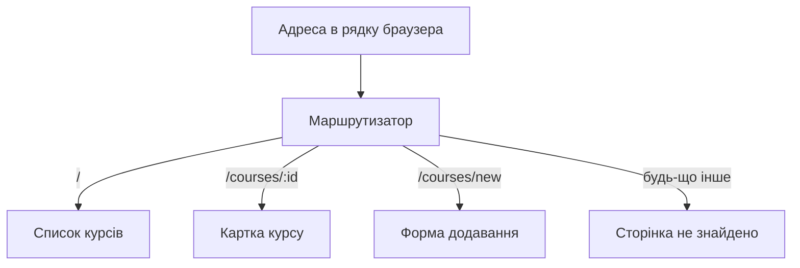

# Маршрутизація та форми в односторінковому застосунку

> [!abstract] Коротко
> Ви перетворите каталог із попередньої роботи на застосунок із трьома сторінками: список, картка за адресою `/courses/:id` і сторінка «не знайдено». Потім збудуєте форму додавання запису з керованими полями, перевіркою на льоту, блокуванням кнопки та програмним переходом після успіху. Наприкінці з'ясуєте, чому перевірки на клієнті недостатньо, і підготуєте застосунок до зв'язку з сервером.

## Мета і результати навчання

Після виконання роботи ви вмієте:

- [ ] налаштовувати клієнтську маршрутизацію з вкладеними маршрутами та спільним макетом;
- [ ] передавати й читати параметри маршруту, обробляти неіснуючі адреси та ресурси;
- [ ] будувати керовані форми й описувати їхній стан одним об'єктом;
- [ ] перевіряти введені дані та показувати помилки доступним способом;
- [ ] виконувати програмну навігацію та передавати результат на сторінку призначення.

## Професійні компетентності

Після виконання лабораторної роботи здобувач освіти повинен навчитися налаштовувати клієнтську маршрутизацію, працювати з керованими полями форм і перевіряти введені дані.

Відповідно до освітньої програми робота формує компетентності:

- СК03. Здатність застосовувати теоретичні та емпіричні знання для розроблення, тестування, впровадження та супроводу програмного забезпечення.
- СК07. Здатність розробляти модулі і компоненти програмного забезпечення за допомогою типових алгоритмів та інструментів.

## Перелік необхідного обладнання та програмного забезпечення

- Персональний комп'ютер, редактор коду (VS Code).
- Node.js 20 LTS або новіший.
- Проєкт із [[courses/web-programming/labs/04-stvorennia-komponentnoho-interfeisu-na-react|лабораторної роботи 4]] (React + Vite + TypeScript). Якщо його немає, створіть новий: `npm create vite@latest lab05 -- --template react-ts`.
- Бібліотека **React Router** версії 6 або новішої: `npm install react-router-dom`.

## Теоретична частина

### Односторінковий застосунок і клієнтська маршрутизація

У класичному вебсайті кожне натискання посилання змушує браузер надіслати запит і завантажити нову HTML-сторінку. В односторінковому застосунку (SPA) HTML завантажується один раз, а перехід між «сторінками» відбувається в JavaScript: бібліотека перехоплює клік, змінює адресу в рядку браузера через History API (без перезавантаження) та показує компонент, що відповідає новій адресі. Таблиця відповідності «адреса – компонент» називається **маршрутами**.

Це дає плавний інтерфейс без миготіння, але має наслідок, про який часто забувають: сервер про `/courses/5` нічого не знає. Якщо користувач оновить сторінку або відкриє таке посилання напряму, браузер запитає в сервера саме цю адресу. Тому сервер (або хостинг) налаштовують так, щоб на будь-яку адресу віддавати `index.html`. У Vite під час розробки це вже зроблено.



### Динамічні сегменти

Шаблон `/courses/:id` описує цілу родину адрес: `/courses/1`, `/courses/42`. Значення сегмента `:id` бібліотека передає компоненту через хук `useParams`. Важливо пам'ятати, що це завжди **рядок**: `'5'`, а не число `5`, і порівняння `course.id === id` буде хибним.

### Кероване поле форми

Звичайне поле `<input>` саме тримає своє значення в DOM. У **керованому** полі значення зберігає React-стан, а поле лише відображає його й повідомляє про зміни: `value={name}` і `onChange={e => setName(e.target.value)}`. Перевага: програма в кожну мить знає, що введено, і може перевіряти, блокувати, форматувати значення.

### Клієнтська перевірка не замінює серверну

Перевірку на клієнті роблять для зручності користувача: миттєвий відгук без очікування сервера. Але захистом вона не є: будь-хто може вимкнути JavaScript, змінити код сторінки в DevTools чи надіслати запит напряму через `curl`. Тому сервер **завжди** повторно перевіряє все, що отримує. Ця різниця буде продемонстрована в лабораторній [[courses/web-programming/labs/07-avtentyfikatsiia-korystuvachiv-za-tokenamy-jwt|Лабораторна робота 7. Автентифікація користувачів за токенами JWT]].

## Підготовка

```bash
npm install react-router-dom
```

Структура, до якої ми прийдемо:

```
src/
  main.tsx
  router.tsx
  data.ts
  types.ts
  store.tsx
  layouts/
    RootLayout.tsx
  pages/
    CoursesPage.tsx
    CoursePage.tsx
    NewCoursePage.tsx
    NotFoundPage.tsx
  components/
    CourseCard.tsx
    CourseForm.tsx
```

Файли `data.ts`, `types.ts` і `components/CourseCard.tsx` візьміть із лабораторної 4.

## Хід роботи

### Етап 1. Спільне джерело даних

Список курсів тепер потрібен трьом сторінкам: переглядові, картці та формі, що його доповнює. Зберігатимемо його в контексті React на рівні всього застосунку.

```tsx
// src/store.tsx
import { createContext, useContext, useState, type ReactNode } from 'react';
import { courses as initial } from './data';
import type { Course } from './types';

interface Store {
  courses: Course[];
  addCourse: (input: Omit<Course, 'id'>) => Course;
}

const StoreContext = createContext<Store | null>(null);

export function StoreProvider({ children }: { children: ReactNode }) {
  const [courses, setCourses] = useState<Course[]>(initial);

  const addCourse: Store['addCourse'] = input => {
    const course = { ...input, id: Math.max(0, ...courses.map(c => c.id)) + 1 };
    setCourses(prev => [...prev, course]);
    return course;
  };

  return <StoreContext value={{ courses, addCourse }}>{children}</StoreContext>;
}

export function useStore(): Store {
  const store = useContext(StoreContext);
  if (!store) throw new Error('useStore потрібно викликати всередині StoreProvider');
  return store;
}
```

> [!info] Для допитливих
> Запис `<StoreContext value={…}>` без `.Provider` працює у React 19. Якщо у вашому проєкті React 18, пишіть `<StoreContext.Provider value={…}>`. Версію можна подивитися командою `npm ls react`.

### Етап 2. Маршрути

Сучасний спосіб оголошення – об'єкт маршрутів. Вкладений маршрут отримує спільний макет (меню, підвал), а `<Outlet />` показує дочірню сторінку.

```tsx
// src/router.tsx
import { createBrowserRouter } from 'react-router-dom';
import RootLayout from './layouts/RootLayout';
import CoursesPage from './pages/CoursesPage';
import CoursePage from './pages/CoursePage';
import NewCoursePage from './pages/NewCoursePage';
import NotFoundPage from './pages/NotFoundPage';

export const router = createBrowserRouter([
  {
    path: '/',
    element: <RootLayout />,
    children: [
      { index: true, element: <CoursesPage /> },
      { path: 'courses/new', element: <NewCoursePage /> },
      { path: 'courses/:id', element: <CoursePage /> },
      { path: '*', element: <NotFoundPage /> },
    ],
  },
]);
```

```tsx
// src/main.tsx
import { StrictMode } from 'react';
import { createRoot } from 'react-dom/client';
import { RouterProvider } from 'react-router-dom';
import { router } from './router';
import { StoreProvider } from './store';

createRoot(document.getElementById('root')!).render(
  <StrictMode>
    <StoreProvider>
      <RouterProvider router={router} />
    </StoreProvider>
  </StrictMode>,
);
```

```tsx
// src/layouts/RootLayout.tsx
import { NavLink, Outlet } from 'react-router-dom';

export default function RootLayout() {
  return (
    <>
      <header className="bar">
        <strong>Каталог курсів</strong>
        <nav aria-label="Основне меню">
          <NavLink to="/" end>Каталог</NavLink>
          <NavLink to="/courses/new">Додати курс</NavLink>
        </nav>
      </header>
      <main className="page">
        <Outlet />
      </main>
    </>
  );
}
```

`NavLink` відрізняється від `Link` тим, що додає клас `active` активному посиланню (для головної ставимо `end`, інакше вона вважалася б активною завжди, бо `/` є початком будь-якої адреси). Додайте стиль `.bar a.active { font-weight: 700; text-decoration: underline; }`.

> [!warning] Типова помилка
> Звичайний `<a href="/courses/1">` перезавантажує всю сторінку, і стан застосунку (включно зі списком, який ми додали) втрачається. Для внутрішніх переходів завжди використовуйте `Link` або `NavLink`.

### Етап 3. Сторінки: список і картка

```tsx
// src/pages/CoursesPage.tsx
import { Link } from 'react-router-dom';
import { useStore } from '../store';

export default function CoursesPage() {
  const { courses } = useStore();
  return (
    <>
      <h1>Каталог курсів</h1>
      <ul className="list">
        {courses.map(c => (
          <li key={c.id}>
            <Link to={`/courses/${c.id}`}>{c.title}</Link>
            <span> – {c.level}, {c.price} грн</span>
          </li>
        ))}
      </ul>
    </>
  );
}
```

```tsx
// src/pages/CoursePage.tsx
import { Link, useParams } from 'react-router-dom';
import { useStore } from '../store';
import NotFoundPage from './NotFoundPage';

export default function CoursePage() {
  const { id } = useParams();
  const { courses } = useStore();

  const course = courses.find(c => c.id === Number(id));
  if (!course) return <NotFoundPage what="Курс" />;

  return (
    <article>
      <h1>{course.title}</h1>
      <dl>
        <dt>Викладач</dt><dd>{course.teacher}</dd>
        <dt>Тривалість</dt><dd>{course.hours} год.</dd>
        <dt>Рівень</dt><dd>{course.level}</dd>
        <dt>Вартість</dt><dd>{course.price} грн</dd>
      </dl>
      <Link to="/">← До каталогу</Link>
    </article>
  );
}
```

```tsx
// src/pages/NotFoundPage.tsx
import { Link } from 'react-router-dom';

export default function NotFoundPage({ what = 'Сторінку' }: { what?: string }) {
  return (
    <section>
      <h1>404</h1>
      <p>{what} не знайдено.</p>
      <Link to="/">Повернутися на головну</Link>
    </section>
  );
}
```

Зверніть увагу на два різні випадки «не знайдено»: адреса, якої немає в таблиці маршрутів (`/xyz`, її ловить `path: '*'`), та адреса, що відповідає маршруту, але ресурсу не існує (`/courses/999`, це перевіряє сама сторінка). Для користувача результат однаковий, а для коду причини різні.

**Контрольна точка 1.** Перевірте вручну сім адрес: `/`, `/courses/1`, `/courses/999`, `/courses/abc`, `/courses/new`, `/xyz`, `/courses/1/extra`. Для кожної запишіть у таблицю звіту, що показано і чому. Оновіть сторінку (F5) на `/courses/3`: сторінка має працювати.

### Етап 4. Форма з керованими полями

Весь стан форми зберігаємо **одним об'єктом**, а не п'ятьма окремими змінними. Це спрощує перевірку та скидання.

```tsx
// src/components/CourseForm.tsx
import { useState, type ChangeEvent, type FocusEvent, type FormEvent } from 'react';
import type { Course, Level } from '../types';

type FormValues = {
  title: string;
  teacher: string;
  hours: string;
  level: Level | '';
  price: string;
  email: string;
};

type Errors = Partial<Record<keyof FormValues, string>>;

const empty: FormValues = { title: '', teacher: '', hours: '', level: '', price: '', email: '' };

const EMAIL_RE = /^[^\s@]+@[^\s@]+\.[^\s@]+$/;

export function validate(v: FormValues): Errors {
  const errors: Errors = {};
  if (v.title.trim().length < 3) errors.title = 'Назва має містити щонайменше 3 символи';
  if (!v.teacher.trim()) errors.teacher = 'Вкажіть викладача';
  const hours = Number(v.hours);
  if (!v.hours || !Number.isInteger(hours) || hours < 1 || hours > 500) {
    errors.hours = 'Тривалість – ціле число від 1 до 500';
  }
  if (!v.level) errors.level = 'Оберіть рівень';
  const price = Number(v.price);
  if (!v.price || Number.isNaN(price) || price < 0) errors.price = 'Вартість – невід\'ємне число';
  if (!EMAIL_RE.test(v.email)) errors.email = 'Вкажіть коректну адресу електронної пошти';
  return errors;
}

interface CourseFormProps {
  onSubmit: (course: Omit<Course, 'id'>) => void;
}

export function CourseForm({ onSubmit }: CourseFormProps) {
  const [values, setValues] = useState<FormValues>(empty);
  const [touched, setTouched] = useState<Partial<Record<keyof FormValues, boolean>>>({});

  const errors = validate(values);
  const hasErrors = Object.keys(errors).length > 0;

  function handleChange(e: ChangeEvent<HTMLInputElement | HTMLSelectElement>) {
    const { name, value } = e.target;
    setValues(prev => ({ ...prev, [name]: value }));
  }

  function handleBlur(e: FocusEvent<HTMLInputElement | HTMLSelectElement>) {
    setTouched(prev => ({ ...prev, [e.target.name]: true }));
  }

  function handleSubmit(e: FormEvent) {
    e.preventDefault();
    if (hasErrors) return;
    onSubmit({
      title: values.title.trim(),
      teacher: values.teacher.trim(),
      hours: Number(values.hours),
      level: values.level as Level,
      price: Number(values.price),
    });
  }

  function field(name: keyof FormValues, label: string, type = 'text') {
    const showError = touched[name] && errors[name];
    return (
      <div className="field">
        <label htmlFor={name}>{label}</label>
        <input
          id={name} name={name} type={type}
          value={values[name]}
          onChange={handleChange} onBlur={handleBlur}
          aria-invalid={showError ? true : undefined}
          aria-describedby={showError ? `${name}-error` : undefined}
        />
        {showError && <p id={`${name}-error`} className="error" role="alert">{errors[name]}</p>}
      </div>
    );
  }

  return (
    <form onSubmit={handleSubmit} noValidate>
      {field('title', 'Назва курсу')}
      {field('teacher', 'Викладач')}
      {field('hours', 'Тривалість, год.', 'number')}
      <div className="field">
        <label htmlFor="level">Рівень</label>
        <select id="level" name="level" value={values.level} onChange={handleChange} onBlur={handleBlur}>
          <option value="">– оберіть –</option>
          <option value="початковий">початковий</option>
          <option value="середній">середній</option>
          <option value="просунутий">просунутий</option>
        </select>
        {touched.level && errors.level && <p className="error" role="alert">{errors.level}</p>}
      </div>
      {field('price', 'Вартість, грн', 'number')}
      {field('email', 'Електронна пошта для зв\'язку', 'email')}
      <button type="submit" disabled={hasErrors}>Додати курс</button>
    </form>
  );
}
```

Розберімо рішення, які варто пояснити на захисті.

Помилки **обчислюються** під час кожного відтворення функцією `validate`, а не зберігаються у стані. Так вони завжди відповідають поточним значенням. Прапорець `touched` потрібен лише для зручності: ми не лаємо користувача за порожнє поле, поки він його не залишив. Атрибут `noValidate` вимикає вбудовані спливні підказки браузера, щоб показувати власні. Зв'язок `aria-describedby` і `role="alert"` допомагають програмам екранного доступу озвучити помилку одразу, а `aria-invalid` позначає поле неправильним.

Кнопка заблокована (`disabled={hasErrors}`), доки є хоч одна помилка. Однак перевірка в `handleSubmit` дублює це навмисно: заблокована кнопка не захищає від надсилання клавішею Enter у деяких конфігураціях, і ми не хочемо покладатися лише на стан інтерфейсу.

> [!warning] Типова помилка
> `useState('')` для числових полів – нормальна практика: значення з поля завжди рядок. Перетворюйте на число **в момент надсилання**, а не в `onChange`, інакше користувач не зможе стерти останню цифру (порожній рядок стане `0` і повернеться в поле).

### Етап 5. Сторінка форми й програмна навігація

Після додавання користувача має перенести на картку нового курсу. Для цього є хук `useNavigate`.

```tsx
// src/pages/NewCoursePage.tsx
import { useNavigate } from 'react-router-dom';
import { CourseForm } from '../components/CourseForm';
import { useStore } from '../store';

export default function NewCoursePage() {
  const { addCourse } = useStore();
  const navigate = useNavigate();

  return (
    <>
      <h1>Новий курс</h1>
      <CourseForm
        onSubmit={input => {
          const course = addCourse(input);
          navigate(`/courses/${course.id}`, { replace: true });
        }}
      />
    </>
  );
}
```

Параметр `replace: true` замінює запис форми в історії записом картки: кнопка «Назад» не поверне користувача на порожню форму, з якої він щойно пішов.

**Контрольна точка 2.** Заповніть форму: вона має підсвічувати помилки під полями після виходу з поля; кнопка заблокована, доки форма не коректна; після надсилання відкривається картка нового курсу, а в списку він присутній. Таблиця «значення – очікувана помилка» (не менше восьми рядків, у тому числі `a@b`, `1.5` для годин, `-100` для вартості) – у звіт.

### Етап 6. Чому серверна перевірка обов'язкова

Відкрийте DevTools, виберіть на формі кнопку «Додати курс» і в панелі Elements **видаліть атрибут `disabled`** (або поставте його значення порожнім). Заповніть форму неправильно й натисніть кнопку. Спостереження: завдяки перевірці в `handleSubmit` форма все одно не надіслалася. Тепер уявіть, що замість нашого коду там `fetch('/api/courses', …)` без перевірки: запит пішов би. Той самий результат дає команда:

```bash
curl -X POST http://localhost:3000/api/courses \
  -H "Content-Type: application/json" \
  -d '{"title":"x","hours":-5}'
```

Висновок для звіту: клієнтська перевірка – це інтерфейс, а не захист. У лабораторній 6 і 7 ви напишете сервер, який перевіряє дані самостійно.

## Завдання для самостійного виконання

Додайте збереження чернетки форми в локальному сховищі, щоб дані не втрачалися після перезавантаження сторінки.

Вимоги до виконання:

1. Створіть власний хук `useDraft(key, initialValue)`, що повертає `[value, setValue, clear]`. Початкове значення читається з `localStorage` у **лінивому ініціалізаторі** `useState(() => …)`, а не в ефекті.
2. Усі звернення до `localStorage` обгорніть у `try/catch`: у приватному вікні браузера або за вимкнених даних сайту вони кидають виняток. Застосунок повинен працювати і без збереження.
3. Запис виконуйте з **відкладенням** (debounce) 300 мс, щоб не писати на кожен символ.
4. Після успішного надсилання чернетку очищайте.
5. Додайте на форму напис «Чернетку збережено о 14:32», що з'являється після запису.
6. Поясніть у звіті, чому в `localStorage` не можна зберігати паролі й токени доступу (підказка: будь-який скрипт на сторінці має до нього доступ).

## Завдання підвищеної складності

> [!example] Рівень «добре» (необов'язково)
> Додайте до `CoursesPage` синхронізацію фільтра з рядком адреси: `/?level=середній&q=react`. Використайте `useSearchParams`. Поясніть, чому така адреса зручніша за стан у пам'яті (її можна надіслати другу, вона переживає оновлення сторінки).

> [!example] Рівень «відмінно» (необов'язково)
> Перейдіть на **data router**: додайте `loader` для `/courses/:id`, що завантажує курс (імітуйте затримкою `await new Promise(r => setTimeout(r, 500))`), і `action` для форми через `<Form method="post">`. Додайте `errorElement` для сторінки з помилкою. Порівняйте обсяг коду в обох підходах.

## Типові помилки

> [!warning] Типова помилка
> - Порівняння `c.id === id` без перетворення: `1 === '1'` хибне.
> - `<a href>` замість `<Link>` – повне перезавантаження.
> - Відсутній `path: '*'` – на невідомій адресі користувач бачить порожню сторінку.
> - Забутий `e.preventDefault()` – браузер перезавантажує сторінку при надсиланні форми.
> - `onChange` без `value` або `value` без `onChange` – поле «замерзає» або стає некерованим.
> - Спроба скинути форму присвоєнням нових значень вручну: простіше змінити `key` компонента форми, і React створить її заново.
> - Хуки викликаються в умовах чи циклах, а не на верхньому рівні компонента.

## Вимоги до звіту

1. Титульна сторінка, варіант.
2. Схема маршрутів та таблиця перевірених адрес (сім рядків) з поясненням.
3. Лістинг `router.tsx` та `CourseForm.tsx`.
4. Таблиця перевірки форми (≥ 8 рядків).
5. Експеримент з обходом `disabled`: знімок і висновок.
6. Опис хука `useDraft` та пояснення вибору лінивого ініціалізатора.
7. Висновки.

## Критерії оцінювання

| Критерій | Балів |
|---|---|
| Маршрути: список, картка з параметром, 404 для маршруту й ресурсу | 20 |
| Спільний макет, `NavLink`, `Outlet` | 10 |
| Кероване поле, єдиний об'єкт стану форми | 15 |
| Перевірка, повідомлення, доступність (`aria-*`), блокування кнопки | 20 |
| Програмна навігація після надсилання | 5 |
| Хук `useDraft` і безпечна робота зі сховищем | 10 |
| Звіт | 10 |
| Захист | 10 |
| **Разом** | **100** |

## Контрольні питання

> [!question] Перевірте себе
> 1. Чим клієнтська маршрутизація відрізняється від серверної?
> 2. Як передати й прочитати параметр маршруту?
> 3. Що таке кероване поле форми?
> 4. Чому перевірку не можна залишати лише на клієнті?
> 5. Як виконати перехід програмно, без натискання посилання?
> 6. Чому `useParams` повертає рядок і до чого це призводить?
> 7. Чим `Link` відрізняється від звичайного `<a>`?
> 8. Для чого потрібні `aria-invalid` та `aria-describedby` у формі?

> [!exam] На іспиті
> Питання: «Користувач оновив сторінку `/courses/3`, і сервер повернув 404. Що не так і як виправити?» Відповідь: сервер не налаштований на віддачу `index.html` для всіх маршрутів SPA (так званий fallback).

## Далі

Дані поки живуть у пам'яті браузера й зникають після оновлення. У наступній лабораторній вони потраплять у справжню базу даних: [[courses/web-programming/labs/06-robota-z-bazoiu-danykh-cherez-orm|Лабораторна робота 6. Робота з базою даних через ORM]]. Про взаємодію з сервером і формат запитів – [[courses/web-programming/glossary/rest|REST]] та [[courses/web-programming/lectures/07-react-marshrutyzatsiia-formy-ta-robota-z-api|лекція 7]].

## Література

- React Router: Tutorial, Data Router (reactrouter.com)
- react.dev: Reacting to Input with State, Sharing State Between Components (react.dev)
- MDN: History API, Web Storage API (developer.mozilla.org)
- W3C WAI: Forms Tutorial (w3.org/WAI/tutorials/forms)
