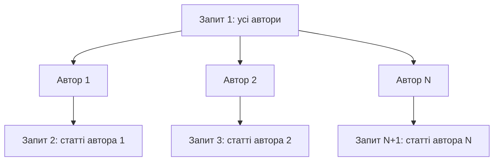

# Робота з базою даних через ORM: моделі, міграції, запити

> [!abstract] Коротко
> Ви підключите реляційну базу до Node.js через ORM **Prisma**, опишете дві пов'язані моделі «автор і стаття», застосуєте міграції й виконаєте повний набір операцій створення, читання, оновлення та вилучення. Потім самі побачите проблему N+1 запитів, виміряєте її, виправите одним запитом і подивитеся, як індекс змінює план виконання пошуку на двадцяти тисячах рядків. Окремо переконаєтеся, чому параметризовані запити захищають від впровадження SQL-коду.

## Мета і результати навчання

Після виконання роботи ви вмієте:

- [ ] налаштувати підключення до бази й зберігати параметри у змінних середовища;
- [ ] описувати моделі та зв'язки «один до багатьох» у схемі;
- [ ] створювати, застосовувати й перевіряти міграції;
- [ ] виконувати CRUD та вибірки зі зв'язаними даними;
- [ ] виявляти проблему N+1 за журналом запитів і усувати її;
- [ ] пояснювати за планом виконання, коли індекс допомагає, а коли ні;
- [ ] відрізняти параметризований запит від злитого з рядків.

## Професійні компетентності

Після виконання лабораторної роботи здобувач освіти повинен навчитися описувати моделі даних, застосовувати міграції та виконувати запити до бази через об'єктно-реляційне відображення.

Відповідно до освітньої програми робота формує компетентності:

- СК03. Здатність застосовувати теоретичні та емпіричні знання для розроблення, тестування, впровадження та супроводу програмного забезпечення.
- СК07. Здатність розробляти модулі і компоненти програмного забезпечення за допомогою типових алгоритмів та інструментів.

## Перелік необхідного обладнання та програмного забезпечення

- Персональний комп'ютер, редактор коду (VS Code).
- Node.js 20 LTS або новіший.
- Бібліотека Prisma версії 6 (`prisma@6`, `@prisma/client@6`). Ми закріплюємо версію, бо способи конфігурації змінюються між мажорними випусками.
- База даних **SQLite**: окремого сервера не потрібно, вся база – один файл. Усе, що ви робитимете, переноситься на PostgreSQL зміною двох рядків схеми.

## Теоретична частина

### Навіщо ORM

Реляційна база думає таблицями й рядками, мова програмування – об'єктами. Розрив між цими моделями називають імпедансом невідповідності. Об'єктно-реляційне відображення (ORM) вирішує його: таблиця стає класом чи схемою, рядок – об'єктом, а запити SQL бібліотека будує сама. Ви пишете `prisma.post.findMany({ where: { published: true } })`, а в базу летить `SELECT … WHERE published = 1`.

Це скорочує код і зменшує кількість помилок, зокрема захищає від впровадження SQL-коду, бо значення передаються окремо від тексту запиту. Але ORM – не магія. Він ховає SQL, а разом із ним і ціну: один гарно виглядаючий рядок може породити сотню запитів. Умінню бачити, що насправді відбувається під капотом, присвячена половина цієї лабораторної.

> [!definition] Міграція
> Версійований опис зміни структури бази даних. Міграції зберігаються у файлах у репозиторії, застосовуються у визначеному порядку й дозволяють привести базу будь-якого середовища (розробника, тестову, виробничу) до одного й того самого стану.

### Міграції і «крок назад»

Навіщо міграції, якщо структуру можна змінити вручну? Бо вручну змінену базу неможливо відтворити на сервері, у колеги чи через пів року. Міграція – це «історія» схеми, така ж як `git` для коду.

Традиційно кожна міграція має два кроки: `up` (застосувати) і `down` (скасувати). Prisma йде іншим шляхом: вона генерує лише SQL застосування, а відкат робиться **наступною міграцією вперед**. Це свідомий вибір, адже скасувати міграцію, яка видалила стовпець із даними, неможливо, і «down» створює хибне відчуття безпеки. Тому в завданні для самостійної роботи ви опишете, як би скасували зміну для вашого ORM.

### Зв'язки та проблема N+1

Автор має багато статей, стаття належить одному автору – зв'язок «один до багатьох». Щоб показати список авторів зі своїми статтями, наївний код робить так: один запит за авторами, а потім у циклі для кожного автора окремий запит за його статтями.



На 50 авторів це 51 запит; на 5000 – 5001. Кожен окремо швидкий, разом – повільно, і база навантажена даремно. Лікується завантаженням зв'язаних даних разом (`include` або `JOIN`): два запити замість N+1 або навіть один.

### Індекси

Без індексу пошук за полем означає прочитати всю таблицю рядок за рядком (full scan). Індекс – окрема впорядкована структура (зазвичай B-дерево) із посиланнями на рядки; пошук за ним логарифмічний. Але індекс не безкоштовний: він займає місце і уповільнює запис, бо його теж треба оновлювати. Тому індекс має сенс для полів, за якими часто шукають або поєднують таблиці, і не дає виграшу на малих таблицях, на полях з малою кількістю різних значень (наприклад, булеві) та коли запит усе одно читає більшу частину таблиці.

## Підготовка

```bash
mkdir lab06-orm && cd lab06-orm
npm init -y
npm install prisma@6 --save-dev
npm install @prisma/client@6
npx prisma init --datasource-provider sqlite
```

Команда створить `prisma/schema.prisma` і файл `.env`. Перевірте, що в `.env` є рядок:

```
DATABASE_URL="file:./dev.db"
```

Допишіть у `package.json` рядок `"type": "module"` та скрипти:

```json
{
  "type": "module",
  "scripts": {
    "seed": "node src/seed.js",
    "crud": "node src/crud.js",
    "nplus1": "node src/nplus1.js",
    "bench": "node src/bench.js"
  }
}
```

Додайте у `.gitignore` рядки `node_modules`, `.env` і `prisma/dev.db*`.

> [!warning] Типова помилка
> Файл `.env` з параметрами підключення **ніколи** не потрапляє в репозиторій. У репозиторії тримають `.env.example` з вигаданими значеннями, а справжні лежать лише на машині розробника та в налаштуваннях сервера. Параметри підключення до виробничої бази – це секрет такого самого рівня, як пароль.

## Варіанти завдання

Тема предметної області – за номером у журналі (номер за модулем 5). Структура схеми однакова, змінюються назви.

| Варіант | Головна сутність | Залежна сутність |
|---|---|---|
| 1 | Автор | Стаття |
| 2 | Лектор | Курс |
| 3 | Режисер | Фільм |
| 4 | Клієнт | Замовлення |
| 0 | Виконавець | Альбом |

Приклад нижче – для варіанта «Автор і Стаття».

## Хід роботи

### Етап 1. Опис моделей

Відкрийте `prisma/schema.prisma` і замініть вміст моделями. Рядок `provider = "prisma-client-js"` має лишитися у блоці `generator`.

```prisma
generator client {
  provider = "prisma-client-js"
}

datasource db {
  provider = "sqlite"
  url      = env("DATABASE_URL")
}

model Author {
  id    Int     @id @default(autoincrement())
  name  String
  email String  @unique
  posts Post[]
}

model Post {
  id        Int      @id @default(autoincrement())
  title     String
  body      String
  published Boolean  @default(false)
  createdAt DateTime @default(now())
  author    Author   @relation(fields: [authorId], references: [id], onDelete: Cascade)
  authorId  Int
}
```

Розберімо ключові позначки. `@id` – первинний ключ, `@default(autoincrement())` – база сама нумерує рядки. `@unique` забороняє дві адреси однієї пошти. Рядок `author Author @relation(...)` описує зв'язок: поле `authorId` у статті посилається на `id` автора. Це **зовнішній ключ**. Правило `onDelete: Cascade` означає, що з видаленням автора видаляються і його статті; без нього база не дозволила б видалити автора, у якого є статті. Поле `posts Post[]` в автора – зворотний бік зв'язку, у базі такого стовпця немає, це лише зручність ORM.

### Етап 2. Перша міграція

```bash
npx prisma migrate dev --name init
```

Команда робить одразу три речі: створює теку `prisma/migrations/<мітка>_init/` із файлом `migration.sql`, застосовує його до бази й генерує клієнт `@prisma/client`. Відкрийте `migration.sql` і прочитайте його: це звичайний SQL, `CREATE TABLE "Author" …`, `CREATE TABLE "Post" …`, `CREATE UNIQUE INDEX …`. ORM не вигадує нічого, чого ви не могли б написати вручну.

Подивіться на базу очима: `npx prisma studio` відкриє графічний перегляд на `http://localhost:5555`. Переконайтеся, що обидві таблиці створені та порожні. Знімок структури таблиць (стовпці, ключі) – у звіт.

**Контрольна точка 1.** У теці `prisma/migrations` є міграція `init`. Скопіюйте з `migration.sql` оператор створення таблиці `Post` у звіт і підпишіть кожен рядок: за що відповідає.

### Етап 3. Наповнення тестовими даними

Для експериментів з N+1 та індексом потрібен великий обсяг. Скрипт створить 50 авторів і 20 000 статей. Вставляємо пачками, бо одна транзакція з двадцятьма тисячами окремих `create` тривала б хвилинами.

```js
// src/db.js
import { PrismaClient } from '@prisma/client';

export const prisma = new PrismaClient();
```

```js
// src/seed.js
import { prisma } from './db.js';

const AUTHORS = 50;
const POSTS = 20_000;

await prisma.post.deleteMany();
await prisma.author.deleteMany();

await prisma.author.createMany({
  data: Array.from({ length: AUTHORS }, (_, i) => ({
    name: `Автор ${i + 1}`,
    email: `author${i + 1}@example.com`,
  })),
});

const authors = await prisma.author.findMany({ select: { id: true } });

const BATCH = 1000;
for (let start = 0; start < POSTS; start += BATCH) {
  await prisma.post.createMany({
    data: Array.from({ length: BATCH }, (_, j) => {
      const n = start + j + 1;
      return {
        title: `Стаття номер ${n}`,
        body: 'Текст статті. '.repeat(10),
        published: n % 3 !== 0,
        authorId: authors[n % authors.length].id,
      };
    }),
  });
}

console.log('Авторів:', await prisma.author.count(), '| Статей:', await prisma.post.count());
await prisma.$disconnect();
```

Запустіть: `npm run seed`. Очікуваний вивід: `Авторів: 50 | Статей: 20000`.

### Етап 4. CRUD

Створіть `src/crud.js` і виконайте чотири операції, виводячи результат кожної.

```js
import { prisma } from './db.js';

// Create: автор з двома статтями одним викликом (вкладене створення)
const author = await prisma.author.create({
  data: {
    name: 'Тетяна Лисенко',
    email: 'tetiana@example.com',
    posts: {
      create: [
        { title: 'Вступ до ORM', body: '...', published: true },
        { title: 'Чернетка про індекси', body: '...' },
      ],
    },
  },
  include: { posts: true },
});
console.log('Створено:', author.name, author.posts.length, 'стат.');

// Read: фільтрування, впорядкування, вибір полів, пагінація
const page = await prisma.post.findMany({
  where: { published: true, title: { contains: 'ORM' } },
  orderBy: { createdAt: 'desc' },
  select: { id: true, title: true, author: { select: { name: true } } },
  take: 5,
  skip: 0,
});
console.log('Знайдено:', page);

// Update
const updated = await prisma.post.update({
  where: { id: author.posts[1].id },
  data: { title: 'Індекси: вступ', published: true },
});
console.log('Оновлено:', updated.title, updated.published);

// Delete: статтю, потім автора (каскад)
await prisma.post.delete({ where: { id: author.posts[0].id } });
const del = await prisma.author.delete({ where: { id: author.id } });
console.log('Видалено автора', del.id, '; залишилось його статей:',
  await prisma.post.count({ where: { authorId: author.id } }));

await prisma.$disconnect();
```

Передбачте результат на папері до запуску, потім запустіть `npm run crud` і порівняйте. Кінцеве число статей автора після видалення має бути `0`: це спрацював каскад.

> [!example] Приклад
> Помилки, які легко спровокувати й корисно побачити: повторно створити автора з тим самим `email` (помилка `P2002`, порушення унікальності), оновити запис з неіснуючим `id` (помилка `P2025`, запис не знайдено). У ORM є коди помилок, за якими код може відрізнити «такий запис уже є» від «база недоступна».

**Контрольна точка 2.** Зробіть обробку цих двох помилок: у `try/catch` перевіряйте `error.code === 'P2002'` і виводьте користувацьке повідомлення. Знімок виводу – у звіт.

### Етап 5. Проблема N+1

Створіть `src/nplus1.js`. Спочатку навчимо клієнт повідомляти про кожен запит.

```js
import { PrismaClient } from '@prisma/client';

const prisma = new PrismaClient({
  log: [{ emit: 'event', level: 'query' }],
});

let queries = 0;
prisma.$on('query', () => { queries++; });

async function measure(label, fn) {
  queries = 0;
  const t0 = performance.now();
  const result = await fn();
  const ms = (performance.now() - t0).toFixed(1);
  console.log(`${label.padEnd(18)} запитів: ${String(queries).padStart(3)}  час: ${ms} мс`);
  return result;
}

// Погано: N+1
await measure('N+1 (цикл)', async () => {
  const authors = await prisma.author.findMany();
  for (const a of authors) {
    a.posts = await prisma.post.findMany({ where: { authorId: a.id, published: true } });
  }
  return authors;
});

// Добре: include
await measure('include', () =>
  prisma.author.findMany({
    include: { posts: { where: { published: true } } },
  }),
);

// Ще краще для підсумків: агрегація на стороні бази
await measure('_count', () =>
  prisma.author.findMany({
    select: { name: true, _count: { select: { posts: true } } },
  }),
);

await prisma.$disconnect();
```

Запустіть `npm run nplus1`. Ви побачите приблизно таке (числа залежать від комп'ютера):

```
N+1 (цикл)         запитів:  51  час: 180.4 мс
include            запитів:   2  час:  40.2 мс
_count             запитів:   2  час:   3.1 мс
```

Занотуйте у звіт три рядки. Зверніть увагу: перший варіант не «неправильний» за результатом, він повертає ті самі дані; помилка в ціні. На локальній SQLite без мережі різниця невелика, але додайте до кожного запиту хоча б 1 мс мережевої затримки до віддаленої бази, і 51 запит коштуватиме понад 50 мс лише на затримках. Порахуйте в звіті, у скільки разів збільшиться час для 5000 авторів.

> [!warning] Типова помилка
> Проблема N+1 дуже підступна, бо код у нових розробників виглядає цілком невинно: цикл і звернення до зв'язаного поля. Коли в проєкті є журнал запитів у розробці, вона помітна одразу. Коли немає, її виявляють у виробництві за кількістю запитів у моніторингу. Залишайте `log: ['query']` увімкненим у розробці.

### Етап 6. Індекс

Створіть `src/bench.js`, щоб виміряти пошук за назвою статті до й після індексу.

```js
import { prisma } from './db.js';

async function time(label, fn, repeat = 200) {
  const t0 = performance.now();
  for (let i = 0; i < repeat; i++) await fn();
  const avg = ((performance.now() - t0) / repeat).toFixed(3);
  console.log(`${label.padEnd(22)} середній час: ${avg} мс`);
}

const target = 'Стаття номер 15000';

await time('пошук за title', () => prisma.post.findFirst({ where: { title: target } }));

const plan = await prisma.$queryRaw`EXPLAIN QUERY PLAN SELECT * FROM "Post" WHERE "title" = ${target}`;
console.log('План виконання:', plan.map(r => r.detail));

await prisma.$disconnect();
```

Запустіть `npm run bench` і запишіть результат. У плані ви побачите щось на кшталт `SCAN Post` – повне сканування таблиці. Тепер додайте індекс. У `schema.prisma` у модель `Post` вставте рядок:

```prisma
  @@index([title])
```

і створіть міграцію:

```bash
npx prisma migrate dev --name add_post_title_index
```

Повторіть `npm run bench`. Тепер план має містити `SEARCH Post USING INDEX Post_title_idx (title=?)`, а середній час має впасти в десятки разів. Занесіть обидва результати й обидва плани в таблицю звіту.

Тепер перевірте, коли індекс **не** допомагає. Виконайте і порівняйте плани та час для запитів:

1. `where: { published: true }`: стовпець має лише два значення, і запит і так повертає більшу частину таблиці;
2. `where: { title: { contains: '15' } }`: пошук підрядка не може скористатися звичайним індексом, бо шаблон починається не з фіксованого префікса.

Для кожного напишіть у звіті, чому індекс не допоміг.

### Етап 7. Захист від впровадження SQL-коду

Продемонструємо, як ORM захищає і що буде, якщо його обійти. Додайте у `src/crud.js` або окремий файл:

```js
import { prisma } from './db.js';

const hostile = "x' OR '1'='1";

// Безпечно: ORM передає значення окремо від тексту запиту
const safe = await prisma.post.findMany({ where: { title: hostile } });
console.log('ORM, ворожий ввід:', safe.length);

// Безпечно: тегований шаблон теж параметризує значення
const safe2 = await prisma.$queryRaw`SELECT id FROM "Post" WHERE title = ${hostile}`;
console.log('$queryRaw з шаблоном:', safe2.length);

// НЕБЕЗПЕЧНО: злиття рядків
const unsafe = await prisma.$queryRawUnsafe(`SELECT id FROM "Post" WHERE title = '${hostile}'`);
console.log('$queryRawUnsafe зі злиттям:', unsafe.length);

await prisma.$disconnect();
```

Очікуваний результат: перші два дають `0`, третій повертає **всі** 20 000 рядків, бо вираз `'1'='1'` став частиною умови запиту. Ось що таке впровадження SQL-коду. Не копіюйте цей прийом у справжні проєкти: небезпечний варіант тут існує лише для демонстрації.

> [!warning] Типова помилка
> «Я ж використовую ORM, отже, я захищений». Ні: достатньо один раз написати `$queryRawUnsafe` або злити рядок у `query()` старого драйвера. Захист дає не слово «ORM», а те, що значення передаються окремо від тексту запиту.

## Завдання для самостійного виконання

Напишіть міграцію, що додає нове поле з непорожнім значенням за замовчуванням для наявних рядків, і опишіть, як скасувати цю зміну.

Покроково:

1. Додайте у модель `Post` поле `status String @default("draft")` і створіть міграцію `add_post_status`.
2. Відкрийте `migration.sql` і поясніть кожен рядок. Зверніть увагу, як SQLite додає стовпець із значенням за замовчуванням і чому наявні рядки не залишаються з порожнім значенням.
3. Напишіть скрипт, що за допомогою `updateMany` переносить значення: опубліковані статті отримують `status = 'published'`.
4. Опишіть, як би ви скасували цю зміну: Prisma не створює міграцію «down», тому у звіті поясніть два сценарії.
   - У середовищі розробки: `npx prisma migrate reset` (видаляє базу й заново застосовує всі міграції) або видалення теки останньої міграції та її повторне створення.
   - У виробництві: **нова міграція вперед**, що видаляє стовпець. Додайте її, застосуйте та переконайтеся, що поле зникло. Поясніть, чому відкат зі втратою даних у виробництві не можна довірити автоматиці.
5. Порівняйте цей підхід з інструментом, що має пару `up`/`down`: Knex чи Sequelize. Коротко опишіть різницю.

## Завдання підвищеної складності

> [!example] Рівень «добре» (необов'язково)
> Додайте модель `Tag` і зв'язок «багато до багатьох» зі `Post` (у Prisma – неявна таблиця зв'язку: `tags Tag[]` у `Post`, `posts Post[]` у `Tag`). Реалізуйте вибірку статей за назвою тегу та підрахунок статей за тегами. Поясніть, яку таблицю створила міграція.

> [!example] Рівень «відмінно» (необов'язково)
> Обгорніть переказ «створити статтю і збільшити лічильник у автора» в транзакцію `prisma.$transaction([...])`. Змоделюйте збій після першої операції і доведіть, що жодна зміна не збереглась. Поясніть, що таке атомарність і чому без транзакції база могла б опинитися в суперечливому стані.

## Вимоги до звіту

1. Титульна сторінка, варіант.
2. Схема (`schema.prisma`) і зображення зв'язку (діаграма сутність-зв'язок).
3. SQL створеної міграції з поясненням.
4. Результати CRUD і обробка двох кодів помилок.
5. Таблиця експерименту N+1: три підходи, кількість запитів, час.
6. Таблиця експерименту з індексом: час і план до й після; два випадки, коли індекс не допоміг.
7. Результат демонстрації впровадження SQL-коду та висновок.
8. Опис міграції із завдання для самостійної роботи й відкату.
9. Висновки.

## Критерії оцінювання

| Критерій | Балів |
|---|---|
| Схема, зв'язок, міграція; підключення через змінні середовища | 15 |
| Коректний CRUD, обробка помилок за кодами | 20 |
| Експеримент N+1: вимірювання і виправлення | 20 |
| Індекс: вимірювання, плани, випадки без виграшу | 15 |
| Демонстрація і пояснення захисту від SQL-ін'єкції | 5 |
| Міграція із завдання для самостійної роботи, опис відкату | 10 |
| Звіт | 5 |
| Захист | 10 |
| **Разом** | **100** |

## Контрольні питання

> [!question] Перевірте себе
> 1. Які переваги й недоліки має ORM порівняно з написанням запитів вручну?
> 2. Навіщо потрібні міграції, якщо структуру можна змінити вручну?
> 3. Що таке проблема N+1 запитів і як її виявити?
> 4. Як ORM захищає від впровадження SQL-коду?
> 5. Коли додавання індексу не дає виграшу?
> 6. Що означає `onDelete: Cascade` і чим небезпечний каскад?
> 7. Чому `.env` не потрапляє до репозиторію?
> 8. Чим відрізняється `include` від `select`?

> [!exam] На іспиті
> Типове завдання: «Сторінка списку замовлень відкривається 4 секунди. У журналі 801 запит. Назвіть причину та виправлення». Очікується відповідь: проблема N+1; завантажити зв'язані дані разом (`include`/`JOIN`) або агрегувати на стороні бази.

## Далі

Базу даних буде захищено в [[courses/web-programming/labs/07-avtentyfikatsiia-korystuvachiv-za-tokenamy-jwt|Лабораторна робота 7. Автентифікація користувачів за токенами JWT]]: до користувачів додасться пароль у вигляді хешу. Про теорію зв'язків, нормалізацію й транзакції читайте в [[courses/web-programming/lectures/10-bazy-danykh-ta-orm|лекції 10]] та статті глосарія про [[courses/web-programming/glossary/orm|ORM]]. Про те, як ці дані стануть REST-ресурсами, – [[courses/web-programming/glossary/rest|REST]].

## Література

- Prisma Docs: Schema, Migrate, Relations, Raw queries (prisma.io/docs)
- SQLite Documentation: Query Planning, EXPLAIN QUERY PLAN (sqlite.org)
- Markus Winand, Use The Index, Luke! (use-the-index-luke.com)
- OWASP: SQL Injection Prevention Cheat Sheet (cheatsheetseries.owasp.org)
