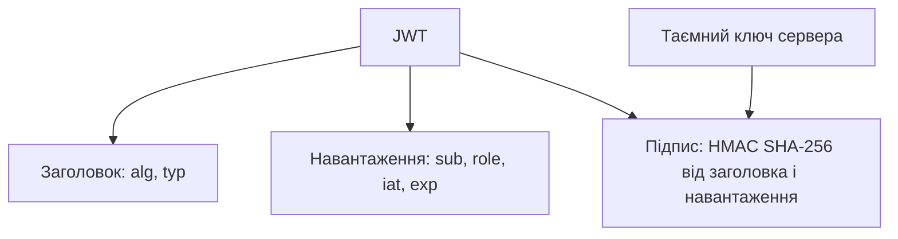

# Автентифікація користувачів за токенами JWT

> [!abstract] Коротко
> Завершальна лабораторна курсу. Ви збудуєте на Express сервер, у якому користувач реєструється, входить і отримує підписаний токен, а частина маршрутів відкрита лише власникам дійсного токена, і ще частина – лише адміністраторам. Паролі зберігатимуться у вигляді хешів bcrypt. Ви випробуєте чотири сценарії (без токена, з підробленим, із простроченим, із коректним), власноруч спробуєте підробити роль у токені й побачите, чому підпис це викриває, а потім додасте поновлення токена та вихід.

## Мета і результати навчання

Після виконання роботи ви вмієте:

- [ ] зберігати паролі як хеші з «сіллю» та перевіряти їх без розшифрування;
- [ ] видавати й перевіряти токени JWT, фіксуючи алгоритм та час життя;
- [ ] будувати middleware автентифікації та авторизації за роллю;
- [ ] розрізняти статуси 401 і 403 та не розкривати зайвого у відповідях про помилки;
- [ ] тестувати захищені маршрути автоматично;
- [ ] пояснювати, що в JWT захищено, а що ні.

## Професійні компетентності

Після виконання лабораторної роботи здобувач освіти повинен навчитися безпечно зберігати паролі, видавати й перевіряти токени доступу та розмежовувати права користувачів.

Відповідно до освітньої програми робота формує компетентності:

- СК03. Здатність застосовувати теоретичні та емпіричні знання для розроблення, тестування, впровадження та супроводу програмного забезпечення.
- СК07. Здатність розробляти модулі і компоненти програмного забезпечення за допомогою типових алгоритмів та інструментів.

## Перелік необхідного обладнання та програмного забезпечення

- Персональний комп'ютер, редактор коду (VS Code).
- Node.js 20.6 LTS або новіший (потрібен прапорець `--env-file`).
- Бібліотеки: `express` (версія 5), `bcryptjs`, `jsonwebtoken`, `cookie-parser`.
- Програма для надсилання запитів: `curl`, Postman або Insomnia.

## Теоретична частина

### Чому пароль не зберігають, а «хешують»

Якщо база з паролями у відкритому вигляді потрапить до зловмисника, він отримає доступ до всіх акаунтів, а з огляду на те, що люди повторюють паролі в різних сервісах, і до чужих також. Тому зберігають не пароль, а його **хеш**: результат односторонньої функції, з якого пароль не відновити. Під час входу сервер хешує введений пароль і порівнює результати.

Звичайні швидкі хеші (MD5, SHA-256) для цього не годяться: сучасна відеокарта перебирає мільярди варіантів на секунду. Для паролів застосовують **навмисно повільні** алгоритми з параметром складності: bcrypt, scrypt, Argon2. Окрім того, до кожного пароля додається випадкова **сіль** (salt), унікальна для запису. Через неї однакові паролі дають різні хеші, а заздалегідь обчислені таблиці («райдужні») втрачають сенс. bcrypt вбудовує сіль у сам хеш, тому окремого стовпця для неї не потрібно.

> [!definition] Сіль (salt)
> Випадкове значення, яке додається до пароля перед хешуванням. Зберігається поряд із хешем, не є таємницею, але змушує зловмисника рахувати хеші для кожного користувача окремо.

### Структура токена JWT

JSON Web Token – рядок із трьох частин, відокремлених крапками: `заголовок.навантаження.підпис`. Перші дві – це JSON, закодований у Base64URL; третя – підпис, обчислений за допомогою таємного ключа сервера над двома першими.



Сервер видає токен під час входу й надалі лише **перевіряє підпис** та термін дії. Йому не потрібно зберігати сесії: усе, що треба знати про користувача, лежить у самому токені. Це зручно для масштабування, але має цінову відмінність.

### Що JWT захищає, а що ні

Підпис гарантує **цілісність**: ніхто, не знаючи ключа, не зможе змінити навантаження так, щоб підпис лишився правильним. Але він **не шифрує** вміст. Навантаження може прочитати будь-хто, хто має токен: достатньо декодувати Base64. Тому класти в нього пароль, номер картки чи персональні дані не можна, а лише мінімум: ідентифікатор, роль, час.

Друга ціна безстанності: токен неможливо «відкликати» до закінчення терміну дії, адже сервер його не пам'ятає. Звідси практика **короткоживучого токена доступу** (хвилини) разом із довшим **токеном оновлення**, який зберігається окремо й може бути відкликаний.

### 401 чи 403

Це два різні питання. **401 Unauthorized** (за змістом «не автентифікований») означає: сервер не знає, хто ви, – токена немає, він недійсний або прострочений. **403 Forbidden** означає: сервер знає, хто ви, але вам це не дозволено. Типова помилка – повертати 403 на запит без токена або 401 звичайному користувачеві на адмінський маршрут.

> [!exam] На іспиті
> Запитання: «Користувач увійшов, але відкриває адмінську сторінку. Який статус?» – 403. «Користувач не надіслав токен?» – 401.

## Підготовка

```bash
mkdir lab07-auth && cd lab07-auth
npm init -y
npm install express bcryptjs jsonwebtoken cookie-parser
```

У `package.json` додайте `"type": "module"` і скрипти:

```json
"scripts": {
  "start": "node --env-file=.env src/server.js",
  "test": "node --test"
}
```

Створіть файл `.env` (його не додають до репозиторію!) і `.env.example` без реальних значень:

```
PORT=3000
JWT_SECRET=замініть-на-довгий-випадковий-рядок-мінімум-32-символи
ACCESS_TTL=15m
ADMIN_EMAIL=admin@example.com
ADMIN_PASSWORD=ChangeMe-Admin-123
```

Випадковий секрет згенеруйте командою `node -e "console.log(require('crypto').randomBytes(48).toString('base64url'))"` і вставте у `.env`. Структура проєкту:

```
lab07-auth/
  .env  .env.example  .gitignore
  src/
    app.js        # створення застосунку (без listen)
    server.js     # запуск
    users.js      # сховище користувачів і хешування
    auth.js       # middleware authenticate, requireRole
    routes.js     # маршрути
  test/
    auth.test.js
```

Розділення `app.js` і `server.js` потрібне, щоб тести могли запускати застосунок на довільному порту, не займаючи 3000.

> [!warning] Типова помилка
> Секрет у коді (`const SECRET = 'secret'`) – вразливість. Той, хто знає ключ, видасть собі токен будь-якого користувача, включно з адміністратором. Ключ береться зі змінних середовища, довгий і випадковий, і ніколи не потрапляє до репозиторію.

## Хід роботи

### Етап 1. Сховище користувачів і хешування

Для спрощення використаємо пам'ять. У справжньому застосунку це таблиця, як у [[courses/web-programming/labs/06-robota-z-bazoiu-danykh-cherez-orm|лабораторній 6]]; перенесення на неї – завдання підвищеної складності.

```js
// src/users.js
import bcrypt from 'bcryptjs';

const ROUNDS = Number(process.env.BCRYPT_ROUNDS ?? 12);
const users = new Map();      // email -> user
let nextId = 1;

// Фіктивний хеш: порівнюємо з ним, коли користувача не знайдено,
// щоб час відповіді не видавав, чи існує така пошта.
const DUMMY_HASH = bcrypt.hashSync('dummy-password', ROUNDS);

export async function createUser({ email, password, role = 'user' }) {
  const key = email.trim().toLowerCase();
  if (users.has(key)) return null;
  const user = {
    id: nextId++,
    email: key,
    role,
    passwordHash: await bcrypt.hash(password, ROUNDS),
    createdAt: new Date().toISOString(),
  };
  users.set(key, user);
  return user;
}

export async function verifyCredentials(email, password) {
  const user = users.get(email.trim().toLowerCase());
  const ok = await bcrypt.compare(password, user ? user.passwordHash : DUMMY_HASH);
  return ok && user ? user : null;
}

export const findById = id => [...users.values()].find(u => u.id === id) ?? null;
export const listUsers = () => [...users.values()].map(publicUser);

export function publicUser({ id, email, role, createdAt }) {
  return { id, email, role, createdAt };
}
```

Зверніть увагу на три деталі. Складність `ROUNDS = 12` означає 2¹² ітерацій; на сучасному комп'ютері це приблизно чверть секунди, чого досить, щоб перебір став дорогим, і не заважає людині при вході. Функція `publicUser` гарантує, що хеш пароля **ніколи не потрапить у відповідь**. А фіктивний хеш закриває тонкий канал витоку: якби для неіснуючої пошти ми відповідали миттєво, а для існуючої з затримкою 250 мс, зловмисник перебирав би пошти за часом відповіді.

### Етап 2. Реєстрація

```js
// src/routes.js
import { Router } from 'express';
import jwt from 'jsonwebtoken';
import { createUser, verifyCredentials, findById, listUsers, publicUser } from './users.js';
import { authenticate, requireRole } from './auth.js';

export const router = Router();

const EMAIL_RE = /^[^\s@]+@[^\s@]+\.[^\s@]+$/;

router.post('/auth/register', async (req, res) => {
  const { email, password } = req.body ?? {};
  const errors = {};
  if (typeof email !== 'string' || !EMAIL_RE.test(email)) errors.email = 'Некоректна адреса пошти';
  if (typeof password !== 'string' || password.length < 8) errors.password = 'Пароль має містити щонайменше 8 символів';
  if (Object.keys(errors).length) return res.status(400).json({ error: 'Некоректні дані', details: errors });

  const user = await createUser({ email, password });      // роль завжди 'user'
  if (!user) return res.status(409).json({ error: 'Користувач з такою поштою вже існує' });
  res.status(201).json(publicUser(user));
});
```

Роль користувача **не береться з тіла запиту**: інакше хто завгодно надіслав би `{"role":"admin"}` і став адміністратором. Це вразливість, відома як *mass assignment*. Адміністратор створюється лише сервером під час запуску.

### Етап 3. Вхід і видача токена

```js
const ACCESS_TTL = process.env.ACCESS_TTL ?? '15m';

export function signAccessToken(user) {
  return jwt.sign(
    { sub: String(user.id), role: user.role },
    process.env.JWT_SECRET,
    { algorithm: 'HS256', expiresIn: ACCESS_TTL },
  );
}

router.post('/auth/login', async (req, res) => {
  const { email, password } = req.body ?? {};
  if (typeof email !== 'string' || typeof password !== 'string') {
    return res.status(400).json({ error: 'Потрібні email і password' });
  }
  const user = await verifyCredentials(email, password);
  if (!user) return res.status(401).json({ error: 'Невірна пошта або пароль' });

  res.json({ accessToken: signAccessToken(user), tokenType: 'Bearer', expiresIn: ACCESS_TTL });
});
```

Помилка входу однакова і для «такої пошти немає», і для «пароль невірний»: окремі повідомлення підказували б зловмиснику, які адреси зареєстровані.

У навантаженні токена лише `sub` (ідентифікатор користувача, поле зі стандарту) і `role`. Бібліотека сама додає `iat` (час видачі) та `exp` (час закінчення).

### Етап 4. Middleware автентифікації та авторизації

```js
// src/auth.js
import jwt from 'jsonwebtoken';

export function authenticate(req, res, next) {
  const header = req.get('Authorization') ?? '';
  const [scheme, token] = header.split(' ');
  if (scheme !== 'Bearer' || !token) {
    return res.status(401).json({ error: 'Потрібна автентифікація' });
  }
  try {
    const payload = jwt.verify(token, process.env.JWT_SECRET, { algorithms: ['HS256'] });
    req.user = { id: Number(payload.sub), role: payload.role };
    next();
  } catch (err) {
    const message = err.name === 'TokenExpiredError' ? 'Термін дії токена минув' : 'Недійсний токен';
    res.status(401).json({ error: message });
  }
}

export const requireRole = (...roles) => (req, res, next) =>
  roles.includes(req.user?.role)
    ? next()
    : res.status(403).json({ error: 'Недостатньо прав' });
```

Опція `algorithms: ['HS256']` – не декорація. Без неї бібліотека довіряла б алгоритму, який вказано в **заголовку токена**, що відкривало історичну атаку зі значенням `none` («без підпису»). Сервер завжди має сам указувати, які алгоритми приймає.

Порядок має значення: `requireRole` читає `req.user`, який виставляє `authenticate`, тому вони завжди йдуть у цьому порядку.

### Етап 5. Захищені маршрути

```js
router.get('/me', authenticate, (req, res) => {
  const user = findById(req.user.id);
  if (!user) return res.status(401).json({ error: 'Користувача більше не існує' });
  res.json(publicUser(user));
});

router.get('/admin/users', authenticate, requireRole('admin'), (req, res) => {
  res.json(listUsers());
});

router.get('/health', (req, res) => res.json({ status: 'ok' }));   // відкритий
```

І збірка застосунку:

```js
// src/app.js
import express from 'express';
import cookieParser from 'cookie-parser';
import { router } from './routes.js';

export const app = express();
app.disable('x-powered-by');
app.use(express.json({ limit: '10kb' }));
app.use(cookieParser());
app.use(router);

app.use((req, res) => res.status(404).json({ error: 'Маршрут не знайдено' }));

// Централізований обробник помилок (див. практичну роботу 3)
app.use((err, req, res, next) => {
  console.error(err);
  res.status(err.status ?? 500).json({ error: err.status ? err.message : 'Внутрішня помилка сервера' });
});
```

```js
// src/server.js
import { app } from './app.js';
import { createUser } from './users.js';

if (!process.env.JWT_SECRET || process.env.JWT_SECRET.length < 32) {
  console.error('JWT_SECRET не заданий або занадто короткий (потрібно ≥ 32 символи)');
  process.exit(1);
}

await createUser({
  email: process.env.ADMIN_EMAIL,
  password: process.env.ADMIN_PASSWORD,
  role: 'admin',
});

const port = Number(process.env.PORT ?? 3000);
app.listen(port, () => console.log(`Сервер: http://localhost:${port}`));
```

Серверу, який стартує без секрету або зі слабким секретом, краще **не стартувати зовсім**. Запустіть `npm start`.

### Етап 6. Ручна перевірка чотирьох сценаріїв

```bash
# Реєстрація і вхід
curl -s -X POST localhost:3000/auth/register -H 'Content-Type: application/json' \
  -d '{"email":"anna@example.com","password":"StrongPass-1"}'

TOKEN=$(curl -s -X POST localhost:3000/auth/login -H 'Content-Type: application/json' \
  -d '{"email":"anna@example.com","password":"StrongPass-1"}' | node -pe 'JSON.parse(require("fs").readFileSync(0)).accessToken')

# Сценарій 1: без токена -> 401
curl -i localhost:3000/me

# Сценарій 2: з недійсним токеном -> 401
curl -i localhost:3000/me -H "Authorization: Bearer abc.def.ghi"

# Сценарій 3: прострочений токен -> 401 (див. нижче)

# Сценарій 4: коректний токен -> 200
curl -i localhost:3000/me -H "Authorization: Bearer $TOKEN"

# Роль: звичайний користувач на адмінський маршрут -> 403
curl -i localhost:3000/admin/users -H "Authorization: Bearer $TOKEN"
```

Щоб отримати прострочений токен без очікування, змініть у `.env` `ACCESS_TTL=2s`, перезапустіть сервер, увійдіть, зачекайте три секунди й повторіть запит. Відповідь: `401` з повідомленням «Термін дії токена минув». Поверніть `15m`.

Тепер увійдіть як адміністратор (дані з `.env`) і переконайтеся, що `/admin/users` повертає 200 із переліком користувачів **без** полів `passwordHash`.

**Контрольна точка 1.** Таблиця у звіті: сценарій, запит, очікуваний і фактичний статус, повідомлення. Мінімум сім рядків: без токена, недійсний, прострочений, коректний, користувач на `/admin/users`, адмін на `/admin/users`, неправильний пароль.

### Етап 7. Розбір токена і спроба підробки

Токен – не секрет. Подивіться на нього очима зловмисника:

```bash
echo $TOKEN | cut -d. -f2 | tr '_-' '/+' | base64 -d 2>/dev/null; echo
```

Ви побачите `{"sub":"2","role":"user","iat":…,"exp":…}` відкритим текстом. (Те саме показує сайт jwt.io; **не вставляйте туди токени з робочих систем**.)

Тепер спроба підробки. Запишіть скрипт `forge.mjs`, що змінює роль на `admin`, але залишає старий підпис:

```js
const [h, p, s] = process.argv[2].split('.');
const payload = JSON.parse(Buffer.from(p, 'base64url').toString());
payload.role = 'admin';
const forged = [h, Buffer.from(JSON.stringify(payload)).toString('base64url'), s].join('.');
console.log(forged);
```

```bash
FORGED=$(node forge.mjs $TOKEN)
curl -i localhost:3000/admin/users -H "Authorization: Bearer $FORGED"
```

Відповідь: `401 Недійсний токен`. Підпис не збігся з навантаженням, бо без ключа новий підпис не обчислити. Підтверджуємо в звіті: **навантаження можна прочитати, але не змінити**.

### Етап 8. Автоматичні тести

```js
// test/auth.test.js
import { test, before, after } from 'node:test';
import assert from 'node:assert/strict';
import jwt from 'jsonwebtoken';

process.env.JWT_SECRET = 'test-secret-test-secret-test-secret-123';
process.env.BCRYPT_ROUNDS = '4';          // швидше в тестах

const { app } = await import('../src/app.js');
const { createUser } = await import('../src/users.js');

let server, base;
before(async () => {
  await createUser({ email: 'admin@test.io', password: 'admin-pass-123', role: 'admin' });
  server = app.listen(0);
  base = `http://localhost:${server.address().port}`;
});
after(() => server.close());

const json = (path, body, headers = {}) =>
  fetch(base + path, {
    method: 'POST',
    headers: { 'Content-Type': 'application/json', ...headers },
    body: JSON.stringify(body),
  });

async function loginAs(email, password) {
  const res = await json('/auth/login', { email, password });
  return (await res.json()).accessToken;
}

test('реєстрація: 201 без хешу пароля; повтор -> 409; слабкий пароль -> 400', async () => {
  const ok = await json('/auth/register', { email: 'u1@test.io', password: 'password-1' });
  assert.equal(ok.status, 201);
  const body = await ok.json();
  assert.equal(body.passwordHash, undefined);
  assert.equal(body.role, 'user');

  assert.equal((await json('/auth/register', { email: 'u1@test.io', password: 'password-1' })).status, 409);
  assert.equal((await json('/auth/register', { email: 'u2@test.io', password: '123' })).status, 400);
});

test('реєстрація ігнорує role з тіла запиту', async () => {
  const res = await json('/auth/register', { email: 'sneaky@test.io', password: 'password-1', role: 'admin' });
  assert.equal((await res.json()).role, 'user');
});

test('вхід: неправильний пароль і невідомий користувач дають однакову відповідь', async () => {
  const a = await json('/auth/login', { email: 'u1@test.io', password: 'wrong-password' });
  const b = await json('/auth/login', { email: 'nobody@test.io', password: 'wrong-password' });
  assert.equal(a.status, 401);
  assert.equal(b.status, 401);
  assert.deepEqual(await a.json(), await b.json());
});

test('без токена -> 401', async () => {
  assert.equal((await fetch(base + '/me')).status, 401);
});

test('недійсний токен -> 401', async () => {
  const res = await fetch(base + '/me', { headers: { Authorization: 'Bearer abc.def.ghi' } });
  assert.equal(res.status, 401);
});

test('прострочений токен -> 401', async () => {
  const expired = jwt.sign(
    { sub: '1', role: 'user', exp: Math.floor(Date.now() / 1000) - 10 },
    process.env.JWT_SECRET,
  );
  const res = await fetch(base + '/me', { headers: { Authorization: `Bearer ${expired}` } });
  assert.equal(res.status, 401);
  assert.match((await res.json()).error, /Термін/);
});

test('токен, підписаний чужим ключем -> 401', async () => {
  const foreign = jwt.sign({ sub: '1', role: 'admin' }, 'another-secret-another-secret-12345');
  const res = await fetch(base + '/admin/users', { headers: { Authorization: `Bearer ${foreign}` } });
  assert.equal(res.status, 401);
});

test('коректний токен -> 200; користувач на адмінському маршруті -> 403', async () => {
  const token = await loginAs('u1@test.io', 'password-1');
  const me = await fetch(base + '/me', { headers: { Authorization: `Bearer ${token}` } });
  assert.equal(me.status, 200);
  const admin = await fetch(base + '/admin/users', { headers: { Authorization: `Bearer ${token}` } });
  assert.equal(admin.status, 403);
});

test('адміністратор бачить список користувачів без хешів', async () => {
  const token = await loginAs('admin@test.io', 'admin-pass-123');
  const res = await fetch(base + '/admin/users', { headers: { Authorization: `Bearer ${token}` } });
  assert.equal(res.status, 200);
  const list = await res.json();
  assert.ok(list.length >= 2);
  assert.ok(list.every(u => u.passwordHash === undefined));
});
```

Запустіть `npm test`. Усі тести мають пройти. Потім навмисно зламайте `authenticate`, прибравши `algorithms: ['HS256']` чи замінивши 401 на 403 для відсутнього токена, і подивіться, який тест упаде.

**Контрольна точка 2.** Знімок виводу `npm test` (не менше дев'яти тестів, усі зелені) і короткий опис одного «зламаного» експерименту.

## Завдання для самостійного виконання

Додайте механізм поновлення токена та вихід із застосунку. Опишіть у звіті, чому корисне навантаження токена не можна вважати таємним.

**Схема.** Токен доступу живе 15 хвилин. Окремий **токен оновлення** живе 7 днів, лежить у cookie з прапорцями `HttpOnly` (недоступний скриптам сторінки, тож XSS його не вкраде), `SameSite=Strict` (не надсилається з чужих сайтів) та `Secure` (лише HTTPS, у виробництві). Сервер пам'ятає ідентифікатори виданих токенів оновлення, тому може їх відкликати.

```js
// у routes.js
import { randomUUID } from 'node:crypto';

const REFRESH_TTL_MS = 7 * 24 * 3600 * 1000;
const refreshStore = new Map();                   // jti -> { userId, expires }

function issueRefresh(res, user) {
  const jti = randomUUID();
  refreshStore.set(jti, { userId: user.id, expires: Date.now() + REFRESH_TTL_MS });
  const token = jwt.sign({ sub: String(user.id), jti }, process.env.JWT_SECRET,
    { algorithm: 'HS256', expiresIn: '7d' });
  res.cookie('refresh', token, {
    httpOnly: true,
    sameSite: 'strict',
    secure: process.env.NODE_ENV === 'production',
    path: '/auth',
    maxAge: REFRESH_TTL_MS,
  });
}

router.post('/auth/refresh', (req, res) => {
  const token = req.cookies.refresh;
  if (!token) return res.status(401).json({ error: 'Немає токена оновлення' });
  try {
    const { sub, jti } = jwt.verify(token, process.env.JWT_SECRET, { algorithms: ['HS256'] });
    const record = refreshStore.get(jti);
    if (!record || record.expires < Date.now()) throw new Error('відкликано');
    refreshStore.delete(jti);                        // ротація: старий більше не діє
    const user = findById(Number(sub));
    if (!user) throw new Error('користувача немає');
    issueRefresh(res, user);
    res.json({ accessToken: signAccessToken(user), tokenType: 'Bearer', expiresIn: ACCESS_TTL });
  } catch {
    res.status(401).json({ error: 'Недійсний токен оновлення' });
  }
});

router.post('/auth/logout', (req, res) => {
  try {
    const { jti } = jwt.verify(req.cookies.refresh ?? '', process.env.JWT_SECRET, { algorithms: ['HS256'] });
    refreshStore.delete(jti);
  } catch { /* вже недійсний: нічого відкликати */ }
  res.clearCookie('refresh', { path: '/auth' });
  res.status(204).end();
});
```

Видача cookie має додатися до `/auth/login`: після `verifyCredentials` викличте `issueRefresh(res, user)`.

**Вимоги.**

1. Реалізуйте код вище, додайте виклик у `login` і перевірте через `curl -c cookies.txt -b cookies.txt`.
2. Покажіть, що **старий** токен оновлення після ротації більше не працює (повторне використання → 401).
3. Покажіть, що після `logout` оновлення неможливе, хоч сам токен ще не прострочений.
4. Додайте щонайменше три тести (оновлення, повторне використання, вихід). Підказка: заголовки `Set-Cookie` читаються через `res.headers.getSetCookie()`.
5. У звіті відповідь на питання: чому корисне навантаження токена не можна вважати таємним і що це означає для вибору полів. Додайте результат декодування токена з етапу 7.
6. У звіті поясніть, чому токен оновлення зберігаємо в `HttpOnly` cookie, а токен доступу повертаємо в тілі відповіді й тримаємо в пам'яті сторінки, а не в `localStorage`.

## Завдання підвищеної складності

> [!example] Рівень «добре» (необов'язково)
> Підключіть користувачів до бази з [[courses/web-programming/labs/06-robota-z-bazoiu-danykh-cherez-orm|лабораторної 6]]: модель `User` з унікальним `email` і полем `passwordHash`. Додайте обмеження частоти спроб входу (не більше п'яти за хвилину з однієї адреси) пакетом `express-rate-limit` і поясніть, від якої атаки це захищає.

> [!example] Рівень «відмінно» (необов'язково)
> Реалізуйте у React-застосунку з лабораторної 5 сторінку входу, збереження токена доступу в пам'яті (контекст), автоматичне поновлення при 401 і захищений маршрут `<RequireAuth>`, що перенаправляє на `/login`. Опишіть, як поводитиметься застосунок після оновлення сторінки (токен у пам'яті зникає, тому потрібен виклик `/auth/refresh` під час старту).

## Типові помилки

> [!warning] Типова помилка
> - Секрет у коді чи репозиторії, короткий або передбачуваний.
> - Відсутній параметр `algorithms` при перевірці.
> - Повернення 403 замість 401 (і навпаки).
> - Різні повідомлення «пошту не знайдено» і «пароль невірний».
> - Хеш пароля або повний об'єкт користувача у відповіді API.
> - Токен доступу з терміном життя в місяць «щоб було зручно».
> - Довіра полю `role` з тіла запиту реєстрації.
> - Токен у параметрах адреси (`?token=…`): адреси потрапляють у журнали та історію браузера.

## Вимоги до звіту

1. Титульна сторінка.
2. Схема: послідовність «реєстрація – вхід – запит із токеном – відповідь», діаграма послідовності в будь-якому редакторі діаграм (draw.io, Mermaid Live, Excalidraw).
3. Лістинг `users.js`, `auth.js`, ключових маршрутів із поясненням.
4. Таблиця сценаріїв (сім і більше рядків) зі статусами.
5. Результат розбору й підробки токена.
6. Знімок `npm test`.
7. Опис механізму оновлення й виходу, відповіді на питання завдання.
8. Висновки: що саме в застосунку лишається вразливим (наприклад, відсутність HTTPS у розробці, обмеження частоти спроб) і як це виправити.

## Критерії оцінювання

| Критерій | Балів |
|---|---|
| Реєстрація й хешування пароля (bcrypt, сіль), відсутність хешів у відповідях | 15 |
| Вхід, токен з обмеженим часом життя, секрет зі змінних середовища | 15 |
| Middleware автентифікації та ролей, коректні 401 і 403 | 20 |
| Автоматичні тести (≥ 9) і ручні сценарії | 15 |
| Поновлення токена, ротація, вихід | 15 |
| Звіт, розбір токена, підробка | 10 |
| Захист | 10 |
| **Разом** | **100** |

## Контрольні питання

> [!question] Перевірте себе
> 1. Чому пароль зберігають у вигляді хешу і навіщо потрібна «сіль»?
> 2. З яких частин складається JWT і що саме захищає підпис?
> 3. Чим код 401 відрізняється від 403?
> 4. Чому токен доступу роблять короткоживучим?
> 5. Які дані неприпустимо вміщувати в корисне навантаження токена?
> 6. Для чого в `jwt.verify` явно вказують `algorithms`?
> 7. Чому bcrypt краще за SHA-256 для паролів?
> 8. Що таке `HttpOnly` cookie і від якої атаки воно допомагає?

## Далі

Це остання лабораторна курсу. Тепер вам залишилося розгорнути результат: [[courses/web-programming/practicals/06-konveier-bezperervnoi-intehratsii-ta|практична робота 6]] показує, як налаштувати автоматичну перевірку та публікацію проєкту. Про загальну картину безпеки читайте в [[courses/web-programming/lectures/12-avtentyfikatsiia-ta-bezpeka-vebdodatkiv|лекції 12]], термінологію – у статтях [[courses/web-programming/glossary/jwt|JWT]] та [[courses/web-programming/glossary/middleware|Middleware]].

## Література

- OWASP: Password Storage Cheat Sheet, JSON Web Token Cheat Sheet (cheatsheetseries.owasp.org)
- RFC 7519: JSON Web Token (datatracker.ietf.org/doc/html/rfc7519)
- MDN: HTTP authentication, Set-Cookie (developer.mozilla.org)
- Документація Express: Security best practices (expressjs.com)
