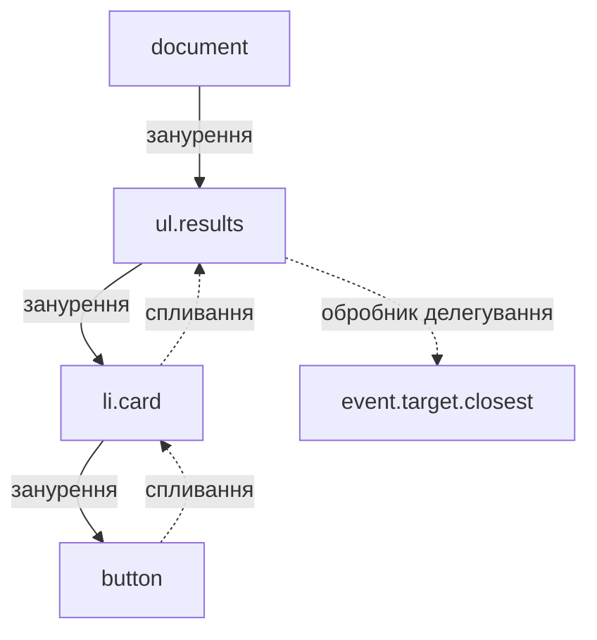

# Обробка подій та асинхронні запити до зовнішнього API

> [!abstract] Коротко
> Ви побудуєте без жодного фреймворка застосунок «Пошук міста і погоди» на відкритих сервісах Open-Meteo (ключ не потрібен). Форма пошуку, асинхронні запити через `fetch`, три стани інтерфейсу (очікування, результат, помилка), безпечне створення елементів DOM і делегування подій на списку результатів. Потім на власні очі побачите «гонитву відповідей», коли старий запит перезаписує новий, і виправите її за допомогою відкладеного виклику та `AbortController`.

## Мета і результати навчання

Після виконання роботи ви вмієте:

- [ ] реєструвати обробники подій, скасовувати типову поведінку, розрізняти спливання й занурення;
- [ ] застосовувати делегування подій для динамічно створюваних елементів;
- [ ] виконувати запити через `fetch` з `async/await` і коректно обробляти помилки мережі та статуси;
- [ ] будувати інтерфейс як функцію стану (очікування, успіх, помилка);
- [ ] будувати DOM безпечно, без `innerHTML` з даними ззовні;
- [ ] скасовувати застарілі запити і відкладати виклики (debounce);
- [ ] перевіряти мережеву взаємодію у вкладці «Мережа» (Network).

## Професійні компетентності

Після виконання практичної роботи здобувач освіти повинен навчитися обробляти події інтерфейсу, виконувати асинхронні запити до зовнішнього програмного інтерфейсу та відображати отримані дані на сторінці.

Відповідно до освітньої програми робота формує компетентності:

- СК03. Здатність застосовувати теоретичні та емпіричні знання для розроблення, тестування, впровадження та супроводу програмного забезпечення.
- СК07. Здатність розробляти модулі і компоненти програмного забезпечення за допомогою типових алгоритмів та інструментів.

## Перелік необхідного обладнання та програмного забезпечення

- Персональний комп'ютер з операційною системою Windows, Linux або macOS.
- Сучасний вебпереглядач із вбудованими інструментами розробника (Chrome або Firefox).
- Редактор коду (Visual Studio Code або аналогічний).
- Стабільне підключення до мережі Інтернет.
- Локальний вебсервер: розширення Live Server для VS Code або команда `python3 -m http.server 5500` у теці проєкту. Модулі ES (`<script type="module">`) не працюють, якщо відкрити файл подвійним клацанням (`file://`).

## Теоретична частина

### Модель подій

Кожна дія користувача породжує **подію**: браузер створює об'єкт `Event` і передає його зареєстрованому обробникові, який приєднують методом `addEventListener(тип, функція, параметри)`. Подія проходить три фази: **занурення** (capturing) від кореня документа до елемента-цілі, сама ціль, а потім **спливання** (bubbling) назад до кореня. За замовчуванням обробники працюють на фазі спливання, тому клік по кнопці в картці всередині списку відчують і кнопка, і картка, і список, і `body`.

Це поведінка, а не вада, і на ній будується **делегування**: замість того, щоб вішати обробник на кожну з сотні карток, ви вішаєте один на контейнер і по `event.target` з'ясовуєте, куди клацнули. Переваги очевидні: менше пам'яті, працює для елементів, створених пізніше, не потрібно знімати обробники при видаленні.



Дві корисні команди: `event.preventDefault()` скасовує типову дію браузера (надсилання форми, перехід за посиланням), а `event.stopPropagation()` зупиняє спливання. Другу застосовуйте обережно: решта коду на сторінці (наприклад, аналітика) може покладатися на спливання.

### Асинхронність і `fetch`

JavaScript виконується в одному потоці. Якщо запит до сервера «чекати» синхронно, вся сторінка завмре. Тому мережеві операції асинхронні: ви запускаєте запит і отримуєте об'єкт-обіцянку (`Promise`), який у майбутньому або виконається зі значенням, або відхилиться з помилкою. Обіцянка перебуває в одному з трьох станів: очікує (pending), виконана (fulfilled), відхилена (rejected), і перейти з кінцевого стану вже не може.

Конструкція `async/await` дозволяє записати це послідовно: `const response = await fetch(url)` призупиняє *функцію* (не сторінку) до відповіді. Блок `try/catch` ловить відхилення.

Тут є важлива особливість `fetch`, на якій спотикаються навіть досвідчені: **обіцянка відхиляється лише за мережевих збоїв** (немає з'єднання, DNS, скасування). Відповідь із кодом 404 чи 500 для `fetch` – цілком успішна. Тому перевіряти `response.ok` (статус 200–299) потрібно вручну.

> [!warning] Типова помилка
> ```js
> try {
>   const data = await (await fetch(url)).json();   // 404 не потрапить у catch!
> } catch (e) { showError(e); }
> ```
> Якщо сервер поверне 404 з тілом-HTML, `json()` кине помилку розбору, і ви побачите незрозуміле «Unexpected token <». Перевіряйте `response.ok` перед `json()`.

### Гонитва відповідей і скасування

Користувач вводить «Од», потім «Оде», потім «Одес». Кожен ввід породжує запит, і відповіді не зобов'язані приходити в порядку відправлення. Якщо відповідь на старий запит прийде після відповіді на новий, вона перезапише результат застарілими даними. Це **стан гонитви** (race condition). Два способи боротьби, які ми використаємо разом: **debounce** (відкласти запит, поки користувач не зробить паузу) і **скасування** попереднього запиту через `AbortController`.

> [!definition] Debounce
> Прийом, за якого виклик функції відкладається на певний час після останньої події. Якщо подія повторилася раніше, ніж спливла затримка, таймер скидається. Зменшує кількість запитів під час швидкого введення.

## Підготовка

Структура проєкту:

```
lab-p01-weather/
  index.html
  styles.css
  src/
    api.js
    dom.js
    main.js
```

Створіть теку й запустіть сервер: `python3 -m http.server 5500`, відкрийте `http://localhost:5500`.

## Хід роботи

### Етап 0. Розминка: спливання й занурення

Перш ніж писати застосунок, розберіться з подіями на мінімальному прикладі. Створіть `warmup.html`:

```html
<!DOCTYPE html>
<html lang="uk"><meta charset="UTF-8"><title>Події</title>
<div id="outer" style="padding:30px;background:#cde">outer
  <div id="middle" style="padding:30px;background:#bdc">middle
    <button id="inner">inner</button>
  </div>
</div>
<pre id="log"></pre>
<script>
  const log = msg => document.getElementById('log').append(msg + '\n');
  for (const id of ['outer', 'middle', 'inner']) {
    const el = document.getElementById(id);
    el.addEventListener('click', () => log(`${id}: спливання`));
    el.addEventListener('click', () => log(`${id}: занурення`), { capture: true });
  }
</script>
```

Клацніть по кнопці й запишіть порядок рядків. Очікувано: спочатку три «занурення» (outer → middle → inner), потім три «спливання» (inner → middle → outer). Далі: додайте в обробник спливання `middle` виклик `e.stopPropagation()` і опишіть, що змінилося. Потім замініть `{capture: true}` на `{ once: true }` і поясніть різницю. Результати – у звіт.

### Етап 1. Розмітка

```html
<!-- index.html -->
<!DOCTYPE html>
<html lang="uk">
<head>
  <meta charset="UTF-8">
  <meta name="viewport" content="width=device-width, initial-scale=1">
  <title>Пошук міста і погоди</title>
  <link rel="stylesheet" href="styles.css">
</head>
<body>
  <main class="app">
    <h1>Пошук міста і погоди</h1>

    <form id="search-form" role="search" autocomplete="off">
      <label for="query">Назва міста</label>
      <div class="row">
        <input id="query" name="query" type="search" minlength="2" required placeholder="Наприклад, Одеса">
        <button type="submit">Пошук</button>
      </div>
    </form>

    <p id="status" role="status" aria-live="polite"></p>
    <ul id="results" class="results"></ul>
  </main>
  <script type="module" src="src/main.js"></script>
</body>
</html>
```

```css
/* styles.css */
:root { font-family: system-ui, sans-serif; color: #1d2433; }
body { margin: 0; background: #f6f7fb; }
.app { max-width: 42rem; margin: 0 auto; padding: 1.5rem 1rem; }
.row { display: flex; gap: .5rem; }
input { flex: 1; padding: .6rem .8rem; border: 1px solid #aab4c5; border-radius: 10px; font: inherit; }
button { padding: .6rem 1rem; border: 0; border-radius: 10px; background: #1a56db; color: #fff; font: inherit; cursor: pointer; }
button:disabled { opacity: .6; cursor: progress; }
.results { list-style: none; padding: 0; display: grid; gap: .75rem; }
.card { padding: 1rem; background: #fff; border: 1px solid #d5dae3; border-radius: 12px; cursor: pointer; }
.card:hover, .card:focus-within { border-color: #1a56db; }
.card h2 { margin: 0 0 .25rem; font-size: 1.1rem; }
.card p { margin: 0; color: #4a5568; }
.weather { margin-top: .5rem; font-weight: 600; color: #14532d; }
.error { color: #b91c1c; }
.spinner::before { content: ''; display: inline-block; width: .9em; height: .9em; margin-right: .5em; border: 2px solid #aab4c5; border-top-color: #1a56db; border-radius: 50%; animation: spin .8s linear infinite; vertical-align: -.1em; }
@keyframes spin { to { transform: rotate(360deg); } }
@media (prefers-reduced-motion: reduce) { .spinner::before { animation: none; } }
```

Елемент з `role="status"` і `aria-live="polite"` змушує програми екранного доступу озвучувати зміни тексту (очікування, кількість знайденого, помилку), не відриваючи користувача від поля введення.

### Етап 2. Шар мережі (`api.js`)

Всі звернення до сервера винесемо в окремий модуль, щоб решта коду не знала нічого про URL і формати. Відповіді сервісів: пошук міст `geocoding-api.open-meteo.com/v1/search`, прогноз `api.open-meteo.com/v1/forecast`.

```js
// src/api.js
const GEO_URL = 'https://geocoding-api.open-meteo.com/v1/search';
const FORECAST_URL = 'https://api.open-meteo.com/v1/forecast';

export class HttpError extends Error {
  constructor(status, statusText) {
    super(`Сервер відповів: ${status} ${statusText}`.trim());
    this.name = 'HttpError';
    this.status = status;
  }
}

async function getJson(url, { signal } = {}) {
  const response = await fetch(url, { signal });
  if (!response.ok) throw new HttpError(response.status, response.statusText);
  return response.json();
}

export async function searchCities(name, options) {
  const url = new URL(GEO_URL);
  url.search = new URLSearchParams({ name, count: '10', language: 'uk', format: 'json' });
  const data = await getJson(url, options);
  return data.results ?? [];             // якщо нічого не знайдено, ключа results у відповіді немає
}

export async function getWeather({ latitude, longitude }, options) {
  const url = new URL(FORECAST_URL);
  url.search = new URLSearchParams({
    latitude, longitude,
    current: 'temperature_2m,wind_speed_10m',
    timezone: 'auto',
  });
  const data = await getJson(url, options);
  return data.current;
}
```

`URLSearchParams` сам кодує спеціальні символи (кирилицю, пробіли), і вам не доведеться склеювати рядок вручну й помилятися. Перевірте відповіді вручну: відкрийте в браузері `https://geocoding-api.open-meteo.com/v1/search?name=Одеса&count=3&language=uk` і зафіксуйте в звіті, які поля є в кожному елементі `results` (потрібні `id`, `name`, `country`, `admin1`, `latitude`, `longitude`).

### Етап 3. Безпечне створення DOM (`dom.js`)

Інтерфейс будуємо методами DOM, а не рядками `innerHTML`. Назва міста приходить із чужого сервера, і якщо вона колись міститиме ``, `innerHTML` виконає чужий код (XSS). Властивість `textContent` та `createElement` сприймають дані лише як текст.

```js
// src/dom.js
export function el(tag, props = {}, ...children) {
  const node = document.createElement(tag);
  for (const [key, value] of Object.entries(props)) {
    if (key === 'dataset') Object.assign(node.dataset, value);
    else if (key in node) node[key] = value;
    else node.setAttribute(key, value);
  }
  node.append(...children);
  return node;
}

export function renderCity(city) {
  const place = [city.admin1, city.country].filter(Boolean).join(', ');
  return el('li', { className: 'card', tabIndex: 0, dataset: { id: city.id } },
    el('h2', {}, city.name),
    el('p', {}, place || 'без уточнення'),
    el('p', { className: 'weather', hidden: true }),
  );
}
```

> [!warning] Типова помилка
> `list.innerHTML = cities.map(c => `<li>${c.name}</li>`).join('')` – найкоротший шлях до XSS. Використовуйте `innerHTML` лише з рядками, які повністю контролюєте самі.

### Етап 4. Стан інтерфейсу (`main.js`)

Усі три стани опишемо однією функцією `render(state)`, а не розкиданими по коду `if`. Інтерфейс стає функцією стану: однаковий стан дає однаковий вигляд.

```js
// src/main.js
import { searchCities, getWeather, HttpError } from './api.js';
import { renderCity } from './dom.js';

const form = document.querySelector('#search-form');
const input = document.querySelector('#query');
const button = form.querySelector('button');
const statusEl = document.querySelector('#status');
const list = document.querySelector('#results');

let state = { status: 'idle', cities: [], message: '' };
const cityById = new Map();

function setState(patch) {
  state = { ...state, ...patch };
  render();
}

function render() {
  const { status, cities, message } = state;

  button.disabled = status === 'loading';
  statusEl.className = status === 'error' ? 'error' : status === 'loading' ? 'spinner' : '';

  if (status === 'loading') statusEl.textContent = 'Шукаю…';
  else if (status === 'error') statusEl.textContent = message;
  else if (status === 'success') statusEl.textContent = cities.length ? `Знайдено: ${cities.length}` : 'Нічого не знайдено';
  else statusEl.textContent = '';

  list.replaceChildren(...cities.map(renderCity));
}

form.addEventListener('submit', async event => {
  event.preventDefault();                         // не перезавантажувати сторінку
  const name = input.value.trim();
  if (name.length < 2) {
    setState({ status: 'error', cities: [], message: 'Введіть щонайменше 2 символи' });
    return;
  }

  setState({ status: 'loading', cities: [] });
  try {
    const cities = await searchCities(name);
    cityById.clear();
    cities.forEach(c => cityById.set(String(c.id), c));
    setState({ status: 'success', cities });
  } catch (error) {
    const message = error instanceof HttpError
      ? error.message
      : 'Не вдалося з\'єднатися з сервером. Перевірте мережу.';
    setState({ status: 'error', cities: [], message });
  }
});
```

**Контрольна точка 1.** Введіть «Одеса»: з'являється спінер, потім список міст зі склеєним рядком «область, країна». Введіть «Qwertyuiop»: повідомлення «Нічого не знайдено». Введіть один символ: повідомлення про помилку. У вкладці Network (див. етап 6) переконайтеся, що на кожне надсилання форми йде рівно один запит.

### Етап 5. Делегування подій: погода по кліку

Додайте в кінець `main.js` **один** обробник на весь список. Картки з'являються й зникають при кожному пошуку, але обробник живе, бо вішаємо його на `ul`.

```js
async function showWeather(card) {
  const city = cityById.get(card.dataset.id);
  const out = card.querySelector('.weather');
  out.hidden = false;
  out.textContent = 'Завантажую погоду…';
  try {
    const w = await getWeather(city);
    out.textContent = `${w.temperature_2m} °C, вітер ${w.wind_speed_10m} км/год`;
  } catch (error) {
    out.textContent = 'Погоду отримати не вдалося';
  }
}

list.addEventListener('click', event => {
  const card = event.target.closest('.card');
  if (card && list.contains(card)) showWeather(card);
});

list.addEventListener('keydown', event => {
  if (event.key !== 'Enter' && event.key !== ' ') return;
  const card = event.target.closest('.card');
  if (card) {
    event.preventDefault();
    showWeather(card);
  }
});
```

Метод `event.target.closest('.card')` піднімається вгору від елемента, по якому клацнули (це може бути `<h2>` усередині картки), до найближчого предка з класом `card`. Без нього клік по заголовку не спрацював би. Обробник `keydown` робить картки доступними з клавіатури (вони мають `tabIndex: 0`): без нього користувач без миші не отримав би погоди.

**Контрольна точка 2.** Клацніть по трьох картках: в кожній з'являється температура. У звіті поясніть: скільки обробників `click` зареєстровано на сторінці і скільки б їх було без делегування для 10 знайдених міст.

### Етап 6. Перевірка у вкладці «Мережа»

Відкрийте DevTools (F12) → Network. Увімкніть фільтр **Fetch/XHR**.

1. Виконайте пошук. Знайдіть запит `search?name=…`. На вкладці Headers перевірте метод (`GET`), статус (`200`) і повну адресу з закодованою кирилицею; на вкладці Response – тіло JSON. Скільки запитів пішло? Має бути один.
2. Клацніть по картці: з'являється другий запит `forecast?…`.
3. Змоделюйте повільну мережу: в списку «No throttling» виберіть **Slow 4G** і повторіть пошук. Зверніть увагу на колонку Time і на стан кнопки та спінера.
4. Змоделюйте помилку мережі: виберіть **Offline** і виконайте пошук. Має з'явитися повідомлення «Не вдалося з'єднатися…», а не нескінченний спінер.
5. Змоделюйте відповідь 404: тимчасово змініть у `api.js` адресу на `…/v1/serch` (помилка в слові) і зробіть пошук. Переконайтеся, що повідомлення звучить як «Сервер відповів: 404» і що `response.ok` саме це і виявив. Поверніть правильну адресу.

Знімок вкладки Network для кроку 1 і текст повідомлень для кроків 4–5 – у звіт.

## Завдання для самостійного виконання

Додайте до застосунку захист від зайвих запитів: відкладений виклик (debounce) із затримкою 400 мс та скасування попереднього запиту за допомогою `AbortController`. Поясніть у звіті, як це впливає на навантаження сервера.

**Крок 1. Побачте проблему.** Увімкніть Slow 4G. Додайте обробник `input`, що викликає пошук на кожне натискання клавіші (поки без захисту). Швидко введіть слово «Одеса» й подивіться на вкладку Network: скільки запитів пішло? Як змінюється список? Іноді він показує результат для «Оде», хоча в полі вже «Одеса», це і є гонитва.

**Крок 2. Debounce.**

```js
export function debounce(fn, delay = 400) {
  let timer;
  const debounced = (...args) => {
    clearTimeout(timer);
    timer = setTimeout(() => fn(...args), delay);
  };
  debounced.cancel = () => clearTimeout(timer);
  return debounced;
}
```

**Крок 3. Скасування.**

```js
let controller;

async function search(name) {
  controller?.abort();                         // скасувати попередній запит
  controller = new AbortController();
  const { signal } = controller;

  setState({ status: 'loading', cities: [] });
  try {
    const cities = await searchCities(name, { signal });
    cityById.clear();
    cities.forEach(c => cityById.set(String(c.id), c));
    setState({ status: 'success', cities });
  } catch (error) {
    if (error.name === 'AbortError') return;   // це не помилка: ми самі скасували
    setState({ status: 'error', cities: [], message: 'Не вдалося виконати пошук' });
  }
}

const debouncedSearch = debounce(search, 400);

input.addEventListener('input', () => {
  const name = input.value.trim();
  if (name.length < 2) { debouncedSearch.cancel(); controller?.abort(); setState({ status: 'idle', cities: [] }); return; }
  debouncedSearch(name);
});
```

Тепер форма й живий пошук використовують одну функцію `search`. Змініть обробник `submit` так, щоб він викликав `search(name)` без відкладення.

**Крок 4. Виміряйте.** Повторіть швидке введення «Одеса» зі Slow 4G і порахуйте запити: має бути один (або два, якщо ви зробили паузу). Скасовані запити в Network мають статус `(canceled)`.

**Крок 5. Поясніть у звіті:**

- чим debounce відрізняється від скасування запиту і чому потрібні обидва (debounce зменшує *кількість* запитів, скасування гарантує, що вціліє *останній*);
- як це впливає на навантаження сервера при тисячі користувачів, що вводять запит;
- чому `AbortError` обробляють окремо й не показують користувачу.

## Завдання підвищеної складності

> [!example] Рівень «добре» (необов'язково)
> Додайте кнопку «Порівняти обране»: користувач відмічає кілька міст, а застосунок одночасно завантажує погоду для всіх через `Promise.allSettled`. Покажіть таблицю, де міста з помилкою позначені окремо. Поясніть, чому тут `allSettled`, а не `Promise.all` (один збій не повинен зіпсувати решту).

> [!example] Рівень «відмінно» (необов'язково)
> Додайте кеш відповідей за ключем `name` із терміном придатності 5 хвилин (`Map` + мітка часу), історію п'яти останніх пошуків у `localStorage` (обгорніть у `try/catch`) та повторну спробу з експоненційною затримкою (1, 2, 4 с) для мережевих помилок і статусів 5xx. Покажіть у Network, що повторний запит у межах 5 хвилин не йде в мережу.

## Типові помилки

> [!warning] Типова помилка
> - Модулі не працюють з `file://`: потрібен локальний сервер.
> - Забутий `preventDefault()` у `submit`: сторінка перезавантажується, і стан зникає.
> - `await` в обробнику, що не позначений `async`: синтаксична помилка.
> - Відсутня перевірка `response.ok`.
> - Користувацький ввід у `innerHTML`.
> - Обробник вішається на кожну картку окремо, а після нового пошуку картки нові, обробників на них немає.
> - `AbortError` показується як помилка.
> - Кнопка не блокується під час запиту: подвійне натискання дає два запити.

## Вимоги до звіту

1. Титульна сторінка.
2. Результати розминки (порядок подій, дія `stopPropagation`, різниця `capture` і `once`).
3. Перелік полів відповіді сервісу пошуку (знімок JSON або таблиця).
4. Лістинг `api.js`, `dom.js`, `main.js` (ключові фрагменти), опис трьох станів.
5. Знімки вкладки Network для чотирьох сценаріїв (успіх, Slow 4G, Offline, 404).
6. Експеримент із гонитвою відповідей: до і після (кількість запитів).
7. Відповіді на питання з кроку 5 завдання для самостійного виконання.
8. Висновки.

## Критерії оцінювання

| Критерій | Балів |
|---|---|
| Форма, `preventDefault`, валідація введення | 10 |
| Асинхронний запит, перевірка `response.ok`, `try/catch` | 20 |
| Три стани інтерфейсу, блокування кнопки, `aria-live` | 15 |
| Безпечне створення DOM (без `innerHTML` з даними) | 10 |
| Делегування подій, доступність з клавіатури | 15 |
| Debounce та `AbortController`, вимірювання | 15 |
| Звіт | 5 |
| Захист | 10 |
| **Разом** | **100** |

## Контрольні питання

> [!question] Перевірте себе
> 1. Чим спливання події відрізняється від занурення і як зупинити поширення події?
> 2. У чому перевага делегування подій перед призначенням обробника кожному елементу?
> 3. Які стани може мати обіцянка і як вони змінюються?
> 4. Чому відповідь зі статусом 404 не спричиняє переходу в блок `catch`?
> 5. Для чого застосовують `AbortController`?
> 6. Що таке стан гонитви і за яких умов він виникає під час пошуку «на льоту»?
> 7. Чому не можна вставляти текст із чужого сервера через `innerHTML`?
> 8. Чим `Promise.all` відрізняється від `Promise.allSettled`?

> [!exam] На іспиті
> Класичне запитання: «Що виведе код і в якому порядку: `console.log(1); setTimeout(()=>console.log(2),0); Promise.resolve().then(()=>console.log(3)); console.log(4)`?» Відповідь: 1, 4, 3, 2 (мікрозавдання обіцянок виконуються раніше за макрозавдання таймера).

## Далі

Наступна практична переходить від браузерного JavaScript до React: [[courses/web-programming/practicals/02-keruvannia-stanom-zastosunku-za-dopomohoiu|Практична робота 2. Керування станом застосунку за допомогою хуків]]. Теорію подій, DOM і подієвого циклу пояснює [[courses/web-programming/lectures/03-dom-podii-ta-asynkhronnist|лекція 3]], терміни – у статтях глосарія [[courses/web-programming/glossary/dom|DOM]], [[courses/web-programming/glossary/promise|Promise]] та [[courses/web-programming/glossary/http|HTTP]].

## Література

- MDN: Event bubbling, Using the Fetch API, AbortController, Promise (developer.mozilla.org)
- javascript.info: Events, Promises, async/await, Fetch (javascript.info)
- Open-Meteo: Geocoding API, Weather Forecast API (open-meteo.com/en/docs)
