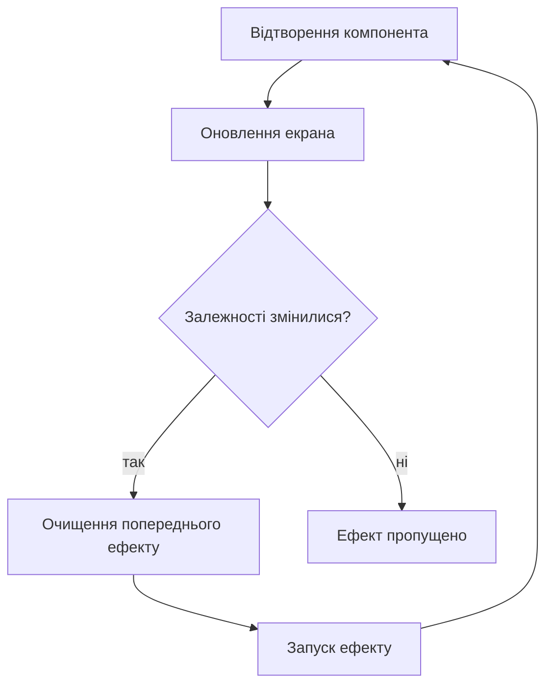
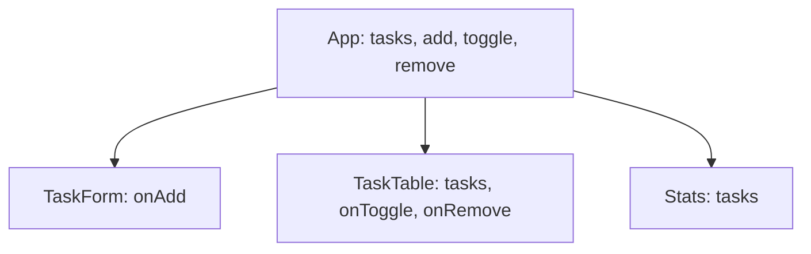

# Керування станом застосунку за допомогою хуків

> [!abstract] Коротко
> Ви збудуєте на React менеджер завдань і пройдете весь шлях роботи зі станом: від лічильника з `useState` до списку, чий стан піднято в батьківський компонент, збережений у `localStorage` через `useEffect` і, нарешті, винесений у власний хук `useTasks`. По дорозі виконаєте три експерименти, що показують, чому оновлення стану асинхронне, що відбувається без масиву залежностей і навіщо ефекту функція очищення.

## Мета і результати навчання

Після виконання роботи ви вмієте:

- [ ] використовувати `useState`, розуміти «знімок» стану та застосовувати функційну форму оновлення;
- [ ] піднімати стан до найближчого спільного предка;
- [ ] відрізняти стан від похідних даних і не дублювати їх;
- [ ] застосовувати `useEffect` з правильним масивом залежностей і функцією очищення;
- [ ] синхронізувати стан із `localStorage` безпечно;
- [ ] виносити логіку у власні хуки та пояснювати, чим вони відрізняються від компонентів.

## Професійні компетентності

Після виконання практичної роботи здобувач освіти повинен навчитися зберігати й змінювати стан компонента, виносити спільний стан на рівень батьківського компонента та застосовувати побічні ефекти.

Відповідно до освітньої програми робота формує компетентності:

- СК03. Здатність застосовувати теоретичні та емпіричні знання для розроблення, тестування, впровадження та супроводу програмного забезпечення.
- СК07. Здатність розробляти модулі і компоненти програмного забезпечення за допомогою типових алгоритмів та інструментів.

## Перелік необхідного обладнання та програмного забезпечення

- Персональний комп'ютер з операційною системою Windows, Linux або macOS.
- Середовище виконання Node.js версії 20 або новішої та менеджер пакунків npm.
- Редактор коду та сучасний вебпереглядач з розширенням React Developer Tools.

## Теоретична частина

### Стан як «знімок»

Компонент React – функція, яка викликається щоразу, коли треба перемалювати інтерфейс. Змінні всередині неї на кожен виклик створюються заново, тож щоб значення пережило виклик, його зберігає React поза функцією: це і є **стан**. Хук `useState(початкове)` повертає пару `[значення, функціяОновлення]`.

Ключова ідея, яку легко пропустити: значення стану всередині одного відтворення – це **знімок**. Воно не змінюється, скільки б разів ви не викликали функцію оновлення. Виклик `setCount(5)` не змінює змінну `count` у поточній функції; він просить React запланувати нове відтворення, у якому `count` вже дорівнюватиме 5. Через це оновлення називають асинхронними: після `setCount(count + 1)` змінна `count` ще має старе значення.

Звідси функційна форма `setCount(c => c + 1)`: замість готового значення ви передаєте *правило*, що отримує найсвіжіший стан у черзі оновлень. Її застосовують, коли нове значення залежить від попереднього.

> [!definition] Функційна форма оновлення
> Виклик функції оновлення зі стрілкою `prev => next`. React викликає її з актуальним значенням, навіть якщо в черзі кілька оновлень поспіль. Безпечна форма для всіх залежних від попереднього стану змін.

### Не змінюйте стан напряму

Присвоєння `tasks[0].done = true` або `tasks.push(x)` не повідомляє React, що щось змінилось: він порівнює посилання, і той самий масив для нього не новий. Тому стан оновлюють **незмінно**: створюють нову копію з потрібною зміною (`[...tasks, x]`, `tasks.map(...)`, `tasks.filter(...)`). Це ті самі «чисті» операції, що й у [[courses/web-programming/labs/02-robota-z-masyvamy-obiektamy-ta-moduliamy|лабораторній 2]].

### Піднесення стану

Якщо два сусідні компоненти (форма та таблиця) мають залежати від одного й того самого значення, воно не може жити в котромусь із них. Його переносять до найближчого спільного предка, який передає значення вниз пропсами, а функції зміни – теж пропсами. Це не обмеження, а механізм: у кожного значення в застосунку рівно один власник («єдине джерело істини»).

### Ефекти

Рендер має бути чистим: за однакових пропсів і стану компонент повертає однаковий результат і нічого не робить «збоку». Усе, що виходить за межі обчислення інтерфейсу, – запити до сервера, таймери, підписки на події браузера, запис у сховище, – називають побічними ефектами й виконують у `useEffect`. Він запускається **після** того, як React оновив екран.

Другий аргумент – **масив залежностей** – визначає, коли ефект повторюється: без масиву – після кожного відтворення; `[]` – лише після першого; `[a, b]` – після першого та щоразу, коли змінилося `a` або `b`. Ефект може повернути **функцію очищення**, яку React викличе перед наступним запуском ефекту та при видаленні компонента. Вона скасовує підписки й таймери, інакше вони накопичуються й спричиняють витоки пам'яті.



### Власний хук

Хук – це функція, ім'я якої починається з `use` і яка викликає інші хуки. Власний хук дозволяє винести повторювану *логіку зі станом* в окрему функцію й використовувати в багатьох компонентах. Він не є компонентом: не повертає JSX, не відображається в дереві, може повертати що завгодно (масив, об'єкт, число). Кожен виклик хука створює **власну окрему копію стану**; два компоненти, що викликають `useTasks()`, не діляться даними.

## Підготовка

```bash
npm create vite@latest practice02-hooks -- --template react-ts
cd practice02-hooks
npm install
npm run dev
```

Видаліть вміст `src/App.css` та `src/index.css` і залиште в `src/main.tsx` обгортку `StrictMode`. У режимі розробки вона **навмисно** викликає ефекти двічі (монтування, очищення, повторне монтування), щоб виявити ефекти без правильного очищення. Це корисна функція, а не помилка, і вона не діє у виробничій збірці.

Структура:

```
src/
  App.tsx
  types.ts
  components/
    Counter.tsx
    TaskForm.tsx
    TaskTable.tsx
    Stats.tsx
    Timer.tsx
  hooks/
    useTasks.ts
    useOnlineStatus.ts
```

## Хід роботи

### Етап 1. Лічильник і «знімок» стану

```tsx
// src/components/Counter.tsx
import { useState } from 'react';

export function Counter() {
  const [count, setCount] = useState(0);

  function addTwoWrong() {
    setCount(count + 1);
    setCount(count + 1);
  }

  function addTwoRight() {
    setCount(c => c + 1);
    setCount(c => c + 1);
  }

  return (
    <section>
      <h2>Лічильник: {count}</h2>
      <button onClick={() => setCount(c => c - 1)}>−1</button>
      <button onClick={() => setCount(c => c + 1)}>+1</button>
      <button onClick={addTwoWrong}>+2 (наївно)</button>
      <button onClick={addTwoRight}>+2 (функційна форма)</button>
      <button onClick={() => setCount(0)}>Скинути</button>
    </section>
  );
}
```

Підключіть `<Counter />` в `App`. Натисніть «+2 (наївно)» три рази й «+2 (функційна форма)» три рази. Записати у звіт: яке значення отримали в кожному випадку, поясніть чому. У наївному варіанті обидва виклики бачать один знімок `count`, наприклад 0, і двічі просять «встановити 1». У функційному кожен наступний виклик отримує результат попереднього. Додайте `console.log(count)` після `setCount` і переконайтеся, що там усе ще *старе* значення.

### Етап 2. Список завдань: перша версія в одному компоненті

Спочатку все в одному місці, щоб побачити потребу в піднесенні стану.

```ts
// src/types.ts
export interface Task {
  id: string;
  title: string;
  done: boolean;
  createdAt: number;
}
```

Створіть тимчасово `TasksNaive.tsx`: поле введення, кнопка «Додати», список із прапорцем «виконано» та кнопкою «Видалити». Правила, яких потрібно дотриматись:

- стан – масив об'єктів `Task[]`;
- **додавання:** `setTasks(prev => [...prev, newTask])`;
- **перемикання:** `setTasks(prev => prev.map(t => t.id === id ? { ...t, done: !t.done } : t))`;
- **видалення:** `setTasks(prev => prev.filter(t => t.id !== id))`;
- ідентифікатор – `crypto.randomUUID()`;
- порожню або складену з пропусків назву не додавати.

> [!warning] Типова помилка
> `tasks.push(newTask); setTasks(tasks);` – не працює: посилання на масив те саме, React вважає, що нічого не змінилося. Інша типова помилка: `tasks[i].done = !tasks[i].done`. Це мутація стану: працює «випадково» лише коли поруч є інше оновлення, що запускає відтворення. Завжди створюйте нову копію.

### Етап 3. Піднесення стану: форма та таблиця як окремі компоненти

Розділіть застосунок на три компоненти, що повинні працювати з *одним* списком. Власником стану стає `App`.



```tsx
// src/components/TaskForm.tsx
import { useState, type FormEvent } from 'react';

interface TaskFormProps {
  onAdd: (title: string) => void;
}

export function TaskForm({ onAdd }: TaskFormProps) {
  const [title, setTitle] = useState('');

  function handleSubmit(e: FormEvent) {
    e.preventDefault();
    const trimmed = title.trim();
    if (!trimmed) return;
    onAdd(trimmed);
    setTitle('');
  }

  return (
    <form onSubmit={handleSubmit}>
      <label htmlFor="new-task">Нове завдання</label>{' '}
      <input id="new-task" value={title} onChange={e => setTitle(e.target.value)} />{' '}
      <button type="submit" disabled={!title.trim()}>Додати</button>
    </form>
  );
}
```

```tsx
// src/components/TaskTable.tsx
import type { Task } from '../types';

interface TaskTableProps {
  tasks: Task[];
  onToggle: (id: string) => void;
  onRemove: (id: string) => void;
}

export function TaskTable({ tasks, onToggle, onRemove }: TaskTableProps) {
  if (tasks.length === 0) return <p role="status">Завдань ще немає</p>;
  return (
    <table>
      <thead>
        <tr><th>Виконано</th><th>Завдання</th><th>Створено</th><th></th></tr>
      </thead>
      <tbody>
        {tasks.map(task => (
          <tr key={task.id}>
            <td>
              <input type="checkbox" checked={task.done} onChange={() => onToggle(task.id)}
                     aria-label={`Виконано: ${task.title}`} />
            </td>
            <td style={{ textDecoration: task.done ? 'line-through' : 'none' }}>{task.title}</td>
            <td>{new Date(task.createdAt).toLocaleString('uk-UA')}</td>
            <td><button onClick={() => onRemove(task.id)}>Видалити</button></td>
          </tr>
        ))}
      </tbody>
    </table>
  );
}
```

```tsx
// src/components/Stats.tsx
import type { Task } from '../types';

export function Stats({ tasks }: { tasks: Task[] }) {
  const done = tasks.filter(t => t.done).length;
  return <p>Усього: {tasks.length}, виконано: {done}, залишилось: {tasks.length - done}</p>;
}
```

Зверніть увагу на `Stats`: числа **обчислюються** з `tasks` під час кожного відтворення, а не зберігаються у стані. Якби ви тримали `doneCount` у `useState`, то мали б синхронізувати його з масивом при кожній зміні та рано чи пізно розійшлися б із ним. Правило: якщо значення можна вивести з наявного стану, не заводьте для нього новий стан.

```tsx
// src/App.tsx
import { useState } from 'react';
import type { Task } from './types';
import { TaskForm } from './components/TaskForm';
import { TaskTable } from './components/TaskTable';
import { Stats } from './components/Stats';
import { Counter } from './components/Counter';

export default function App() {
  const [tasks, setTasks] = useState<Task[]>([]);

  const add = (title: string) =>
    setTasks(prev => [...prev, { id: crypto.randomUUID(), title, done: false, createdAt: Date.now() }]);

  const toggle = (id: string) =>
    setTasks(prev => prev.map(t => (t.id === id ? { ...t, done: !t.done } : t)));

  const remove = (id: string) =>
    setTasks(prev => prev.filter(t => t.id !== id));

  return (
    <main style={{ maxWidth: '44rem', margin: '0 auto', fontFamily: 'system-ui, sans-serif' }}>
      <h1>Менеджер завдань</h1>
      <Counter />
      <TaskForm onAdd={add} />
      <Stats tasks={tasks} />
      <TaskTable tasks={tasks} onToggle={toggle} onRemove={remove} />
    </main>
  );
}
```

**Контрольна точка 1.** Додайте три завдання, відмітьте одне виконаним, видаліть одне: `Stats` оновлюється сам, без жодного додаткового коду. Накресліть у звіті потік даних (які пропси йдуть вниз, які функції зворотного виклику піднімаються вгору). Через React Developer Tools змініть стан `tasks` у `App` вручну й переконайтеся, що обидва дочірні компоненти оновилися.

### Етап 4. Збереження у `localStorage`: ефект

Мета: після оновлення сторінки список має зберегтися. Два кроки: **прочитати** при старті і **записувати** при зміні.

```tsx
// у App.tsx
import { useEffect, useState } from 'react';

const STORAGE_KEY = 'practice02.tasks';

function loadTasks(): Task[] {
  try {
    const raw = localStorage.getItem(STORAGE_KEY);
    const parsed = raw ? JSON.parse(raw) : [];
    return Array.isArray(parsed) ? parsed : [];
  } catch {
    return [];                                  // сховище недоступне або дані пошкоджено
  }
}

export default function App() {
  const [tasks, setTasks] = useState<Task[]>(loadTasks);   // лінива ініціалізація: функція, а не її виклик

  useEffect(() => {
    try {
      localStorage.setItem(STORAGE_KEY, JSON.stringify(tasks));
    } catch {
      /* квота вичерпана або приватний режим: застосунок працює без збереження */
    }
  }, [tasks]);
  // ...
}
```

Два тонкі моменти, які мають бути у вашому звіті. По-перше, `useState(loadTasks)` передає *функцію*: React викличе її лише один раз, під час першого відтворення. Якби ви написали `useState(loadTasks())`, читання зі сховища (повільна синхронна операція) виконувалося б при кожному відтворенні, а результат відкидався. По-друге, читаємо в ініціалізаторі, а не в `useEffect(() => {…}, [])`: у другому варіанті перше відтворення показало б порожній список (блимання), а потім з'явилися б дані.

> [!warning] Типова помилка
> Звернення до `localStorage` без `try/catch`. У приватному вікні деяких браузерів, за заблокованих cookie або повного сховища доступ кидає виняток, і застосунок «падає» білим екраном. Дані з сховища також ненадійні: їх міг змінити користувач або стара версія застосунку, тому перевірка `Array.isArray` обов'язкова.

### Етап 5. Експеримент з масивом залежностей

Додайте в ефект запису `console.log('збереження', tasks.length)` і виконайте три варіанти. Для кожного додайте два завдання, відмітьте одне виконаним, введіть кілька символів у поле і запишіть кількість рядків у консолі.

| Варіант | Код | Що очікуєте | Що отримали |
|---|---|---|---|
| А | `useEffect(() => { … })` (без масиву) | після кожного відтворення | |
| Б | `useEffect(() => { … }, [])` | лише один раз | |
| В | `useEffect(() => { … }, [tasks])` | лише при зміні `tasks` | |

Варіант Б – наочна помилка: зміни перестають зберігатися, бо ефект не реагує на `tasks`. Варіант А працює, але пише у сховище навіть коли `tasks` не змінювався.

Тепер другий експеримент. Тимчасово перенесіть стан поля введення (`title`) з `TaskForm` в `App` (передавайте `value` і `onChange` пропсами). Повторіть введення символів. З варіантом А тепер кожне натискання клавіші запускає запис, а з варіантом В – ні. У звіті поясніть: чому в початковій версії (стан поля у `TaskForm`) батьківський `App` не відтворюється під час введення, а в зміненій відтворюється. Поверніть стан у `TaskForm`.

> [!info] Для допитливих
> У режимі розробки, завдяки `StrictMode`, ефекти запускаються двічі при першому монтуванні, тому в консолі ви побачите «зайвий» перший запис. Це перевірка на стійкість ефекту; у виробничій збірці (`npm run build && npm run preview`) повторного запуску немає.

### Етап 6. Функція очищення: таймер і підписка

Створіть компонент, що показує, скільки секунд застосунок відкритий. Спочатку **без** очищення, навмисно.

```tsx
// src/components/Timer.tsx (версія 1: з помилкою)
import { useEffect, useState } from 'react';

export function Timer() {
  const [seconds, setSeconds] = useState(0);

  useEffect(() => {
    setInterval(() => setSeconds(s => s + 1), 1000);
  }, []);

  return <p>Відкрито: {seconds} с</p>;
}
```

У режимі розробки секунди йдуть вдвічі швидше. Поясніть: `StrictMode` змонтував компонент, відразу «знищив» і змонтував знову, а перший інтервал ніхто не зупинив. Тепер їх два. У реальному застосунку це виглядало б так: сторінка з таймером відкривається, закривається, відкривається, і щоразу додається ще один живий інтервал.

Виправлення:

```tsx
  useEffect(() => {
    const id = setInterval(() => setSeconds(s => s + 1), 1000);
    return () => clearInterval(id);          // очищення
  }, []);
```

Повторіть підрахунок: тепер лічильник іде з правильною швидкістю. Зафіксуйте обидві поведінки.

Друга ситуація, де потрібне очищення, – підписка на подію браузера. Власний хук:

```ts
// src/hooks/useOnlineStatus.ts
import { useEffect, useState } from 'react';

export function useOnlineStatus(): boolean {
  const [online, setOnline] = useState(navigator.onLine);

  useEffect(() => {
    const goOnline = () => setOnline(true);
    const goOffline = () => setOnline(false);
    window.addEventListener('online', goOnline);
    window.addEventListener('offline', goOffline);
    return () => {
      window.removeEventListener('online', goOnline);
      window.removeEventListener('offline', goOffline);
    };
  }, []);

  return online;
}
```

Покажіть у `App` рядок «Мережа: є / немає» та перевірте режимом **Offline** у DevTools → Network. Перегляньте через вкладку Performance Monitor (або `getEventListeners(window)` у консолі Chrome), що після видалення компонента підписок не лишається.

**Контрольна точка 2.** Знімок консолі та таблиці з етапу 5, обидві версії таймера з поясненням, робота `useOnlineStatus` у режимі Offline.

## Завдання для самостійного виконання

Винесіть логіку роботи зі списком у власний хук `useTasks`. Опишіть у звіті, які переваги дає такий винос і чому власний хук не є компонентом.

Мінімальний інтерфейс хука:

```ts
// src/hooks/useTasks.ts
import { useCallback, useEffect, useMemo, useState } from 'react';
import type { Task } from '../types';

const STORAGE_KEY = 'practice02.tasks';

function load(): Task[] {
  try {
    const parsed = JSON.parse(localStorage.getItem(STORAGE_KEY) ?? '[]');
    return Array.isArray(parsed) ? parsed : [];
  } catch {
    return [];
  }
}

export function useTasks() {
  const [tasks, setTasks] = useState<Task[]>(load);

  useEffect(() => {
    try { localStorage.setItem(STORAGE_KEY, JSON.stringify(tasks)); } catch { /* ігноруємо */ }
  }, [tasks]);

  const add = useCallback((title: string) => {
    setTasks(prev => [...prev, { id: crypto.randomUUID(), title, done: false, createdAt: Date.now() }]);
  }, []);

  const toggle = useCallback((id: string) => {
    setTasks(prev => prev.map(t => (t.id === id ? { ...t, done: !t.done } : t)));
  }, []);

  const remove = useCallback((id: string) => {
    setTasks(prev => prev.filter(t => t.id !== id));
  }, []);

  const clearDone = useCallback(() => {
    setTasks(prev => prev.filter(t => !t.done));
  }, []);

  const stats = useMemo(() => {
    const done = tasks.filter(t => t.done).length;
    return { total: tasks.length, done, left: tasks.length - done };
  }, [tasks]);

  return { tasks, add, toggle, remove, clearDone, stats };
}
```

Тоді `App` скоротиться до `const { tasks, add, toggle, remove, clearDone, stats } = useTasks();`.

**Вимоги.**

1. Перенесіть логіку з `App` у `useTasks`, додайте дію «Очистити виконані» з кнопкою.
2. Поясніть у звіті, навіщо тут `useCallback` та `useMemo`, і зазначте, що без них застосунок працював би так само, тобто вони лише допомагають уникнути зайвих відтворень, коли функції передаються у `memo`-компоненти. Не вживайте їх «про всяк випадок».
3. Відповідь на питання «Чому власний хук не є компонентом?»: не повертає JSX і не з'являється в дереві компонентів; може повертати що завгодно; використовується *всередині* компонентів; дві копії виклику мають окремі стани. Підтвердіть експериментом: викличте `useTasks()` у двох місцях і покажіть, що списки незалежні.
4. Як тепер ділитися списком між двома компонентами, що викликають хук? (Підняти виклик хука вище й передати пропси або використати контекст.)
5. Правила хуків: чому їх не можна викликати в умовах і циклах? Продемонструйте помилку, яку видає ESLint-правило `react-hooks/rules-of-hooks`.

## Завдання підвищеної складності

> [!example] Рівень «добре» (необов'язково)
> Замініть `useState` в `useTasks` на `useReducer` з діями `added`, `toggled`, `removed`, `cleared`. Порівняйте обидва підходи: у яких випадках редуктор простіший (багато взаємопов'язаних переходів) і як він спрощує тестування, адже редуктор – це чиста функція.

> [!example] Рівень «відмінно» (необов'язково)
> Додайте тести на Vitest і React Testing Library: `renderHook(() => useTasks())` перевіряє `add`, `toggle`, `remove`, збереження у `localStorage` (замокайте його), а тест компонента `TaskForm` – що кнопка заблокована для порожнього вводу. Запускайте командою `npm test` і додайте знімок результату у звіт.

## Типові помилки

> [!warning] Типова помилка
> - Прямий запис у стан (`state.push`, `state[i] = …`, `obj.field = …`).
> - Залежність від попереднього стану без функційної форми.
> - Дублювання похідних даних у стані.
> - Ефект без очищення таймерів і підписок.
> - Ефект зі «звичайним» запитом без обробки скасування (гонитва відповідей, див. [[courses/web-programming/practicals/01-obrobka-podii-ta-asynkhronni-zapyty-do|практичну 1]]).
> - Пропущена залежність у масиві: застарілі значення всередині ефекту. Дотримуйтесь підказок ESLint (`react-hooks/exhaustive-deps`).
> - Виклик хука в умові або в циклі.
> - `useState(expensive())` замість `useState(expensive)`.

## Вимоги до звіту

1. Титульна сторінка.
2. Результати експерименту з лічильником і пояснення «знімка».
3. Схема потоку даних (піднесення стану).
4. Таблиця експерименту з масивом залежностей і висновок про стан поля введення.
5. Дві версії таймера, поведінка до й після очищення.
6. Лістинг `useTasks` і відповіді на питання завдання.
7. Висновки.

Код – у репозиторії з `README.md`.

## Критерії оцінювання

| Критерій | Балів |
|---|---|
| Лічильник, функційна форма оновлення, пояснення знімка | 10 |
| Список із незмінними оновленнями, без мутацій | 15 |
| Піднесення стану, похідні дані без дублювання | 15 |
| Збереження у `localStorage` (лінива ініціалізація, `try/catch`) | 15 |
| Експерименти: залежності, очищення | 15 |
| Власний хук `useTasks`, пояснення | 15 |
| Звіт | 5 |
| Захист | 10 |
| **Разом** | **100** |

## Контрольні питання

> [!question] Перевірте себе
> 1. Чому не можна змінювати стан безпосереднім присвоєнням?
> 2. Коли потрібна функційна форма оновлення стану?
> 3. Що станеться, якщо не вказати масив залежностей ефекту?
> 4. Для чого ефект повертає функцію очищення?
> 5. Що означає «підняти стан» і коли це доречно?
> 6. Чим `useState(fn)` відрізняється від `useState(fn())`?
> 7. Чому власний хук не є компонентом?
> 8. Чому `StrictMode` запускає ефекти двічі і чи впливає це на виробничу збірку?

> [!exam] На іспиті
> Задача: «Лічильник після `setCount(count + 1); setCount(count + 1)` збільшується лише на 1. Поясніть і виправте». Очікується пояснення про знімок значення в межах відтворення та виправлення через `setCount(c => c + 1)`.

## Далі

На наступному кроці ви переходите на серверну сторону: [[courses/web-programming/practicals/03-vlasne-promizhne-prohramne-zabezpechennia-ta|Практична робота 3. Власне проміжне програмне забезпечення та обробник помилок]]. Теорія хуків – у [[courses/web-programming/lectures/06-react-khuky-ta-keruvannia-stanom|лекції 6]], терміни – [[courses/web-programming/glossary/khuk|Хук]] та [[courses/web-programming/glossary/komponent|Компонент]].

## Література

- react.dev: State: A Component's Memory, Synchronizing with Effects, Reusing Logic with Custom Hooks (react.dev/learn)
- react.dev: You Might Not Need an Effect (react.dev/learn/you-might-not-need-an-effect)
- Dan Abramov, A Complete Guide to useEffect (overreacted.io)
