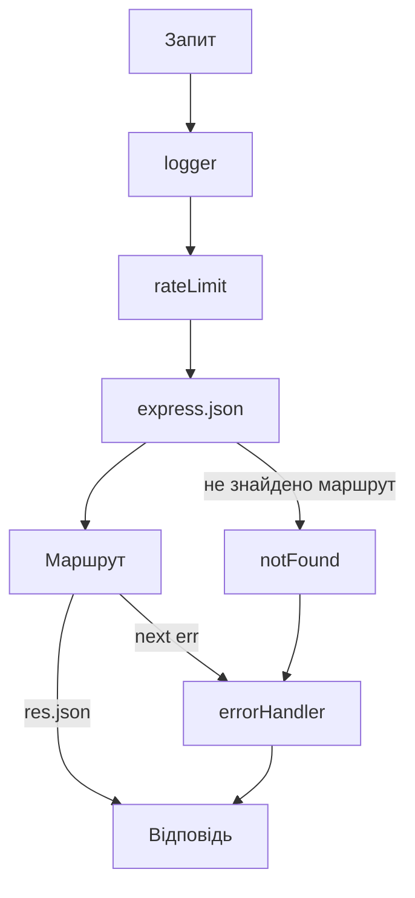

# Власне проміжне програмне забезпечення та обробник помилок

> [!abstract] Коротко
> Ви збудуєте на Express невеликий серверний застосунок і навчитеся мислити «ланцюгом»: запит проходить крізь послідовність проміжних обробників, кожен з яких може змінити його, відповісти сам або передати керування далі. Напишете журналювання з вимірюванням часу, перевірку параметрів, клас помилки із статусом, обробник неіснуючих маршрутів та єдиний централізований обробник помилок. Потім навмисно зламаєте порядок реєстрації, щоб побачити на власні очі, як він визначає поведінку, і додасте обмеження частоти запитів.

## Мета і результати навчання

Після виконання роботи ви вмієте:

- [ ] пояснити контракт `(req, res, next)` і те, що відбувається, якщо `next()` не викликати;
- [ ] писати власне middleware: журналювання, перевірка, обмеження;
- [ ] будувати ієрархію помилок застосунку й централізований обробник із чотирма параметрами;
- [ ] повертати клієнтові узгоджений формат помилок із правильними статусами;
- [ ] проводити помилки з асинхронних маршрутів до центрального обробника;
- [ ] автоматично тестувати успішні та помилкові сценарії.

## Професійні компетентності

Після виконання практичної роботи здобувач освіти повинен навчитися будувати ланцюг проміжних обробників запиту, реалізовувати журналювання та централізовану обробку помилок серверного застосунку.

Відповідно до освітньої програми робота формує компетентності:

- СК03. Здатність застосовувати теоретичні та емпіричні знання для розроблення, тестування, впровадження та супроводу програмного забезпечення.
- СК07. Здатність розробляти модулі і компоненти програмного забезпечення за допомогою типових алгоритмів та інструментів.

## Перелік необхідного обладнання та програмного забезпечення

- Персональний комп'ютер, середовище Node.js (20 LTS і новіше) та менеджер пакунків npm.
- Каркас Express версії 5 (`npm install express`).
- Застосунок для надсилання запитів: Postman, Insomnia або `curl`.

## Теоретична частина

### Конвеєр запиту

Express-застосунок – це **конвеєр функцій**. Кожен запит надходить на вхід першої функції; та або сама завершує обробку, надіславши відповідь, або викликає `next()`, віддаючи керування наступній. Такі функції називають проміжним програмним забезпеченням (*middleware*). Вони мають три параметри: `req` (запит), `res` (відповідь), `next` (виклик наступного обробника).

Що може зробити middleware:

1. змінити `req` або `res` (додати поле, заголовок) і викликати `next()`;
2. завершити запит відповіддю (`res.json(...)`) і **не** викликати `next()`;
3. передати керування далі: `next()`;
4. передати **помилку**: `next(err)`.

Якщо не виконано жодного з трьох: ні відповіді, ні `next()`, – запит «зависає» і клієнт чекає, доки не спливе таймаут. Це одна з найпоширеніших помилок початківців.

Порядок виконання визначається порядком реєстрації: функції, зареєстровані через `app.use()` або маршрути, спрацьовують зверху вниз.



### Обробник помилок

Особливий різновид middleware має **чотири** параметри: `(err, req, res, next)`. Express визначає його за кількістю аргументів (довжиною функції), тому четвертий параметр необхідний, навіть якщо ви ним не користуєтесь. Коли хтось викликає `next(err)` або кидає виняток, Express пропускає всі звичайні обробники й веде запит до найближчого *після* нього обробника помилок.

Користь централізації очевидна: усі помилки застосунку перетворюються на відповідь в одному місці. Маршрути не містять повторюваних `try/catch` із `res.status(500).json(...)`, формат помилки однаковий скрізь, а журналювання помилок можна додати або змінити в одному файлі.

### Класифікація помилок

Не всі помилки однакові. **Операційні** очікувані: клієнт надіслав некоректний ідентифікатор (400), ресурсу немає (404), забагато запитів (429). Їх можна й треба описати користувачеві. **Програмні** – це наші баги, обрив зв'язку з базою тощо: клієнтові повідомляють лише «Внутрішня помилка сервера» (500), а подробиці пишуть у журнал. Ніколи не показуйте клієнтові текст винятку чи стек: це розкриває внутрішню будову й допомагає атакувальнику.

### Узгоджений формат помилки

Клієнт повинен мати змогу обробляти помилки однаково. Фіксуємо формат:

```json
{
  "error": {
    "code": "INVALID_ID",
    "message": "Ідентифікатор має бути додатним цілим числом",
    "requestId": "b0b0b6f2-..."
  }
}
```

Машинозчитуваний `code` – для програми (її можна порівнювати та перекладати), `message` – для людини, `requestId` – щоб користувач міг назвати службі підтримки конкретний запит, а розробник знайшов його в журналі.

## Підготовка

```bash
mkdir practice03-mw && cd practice03-mw
npm init -y
npm install express
```

У `package.json`: `"type": "module"` та скрипти `"start": "node src/server.js"`, `"dev": "node --watch src/server.js"`, `"test": "node --test"`.

Структура:

```
practice03-mw/
  src/
    server.js
    app.js
    errors.js
    data.js
    middleware/
      requestLogger.js
      validateId.js
      notFound.js
      errorHandler.js
      rateLimit.js
  test/
    app.test.js
```

## Хід роботи

### Етап 1. Дані та базовий застосунок

```js
// src/data.js
export const books = [
  { id: 1, title: 'Чистий код', author: 'Роберт Мартін', year: 2008 },
  { id: 2, title: 'Eloquent JavaScript', author: 'Марейн Гавербеке', year: 2018 },
  { id: 3, title: 'Мистецтво програмування', author: 'Дональд Кнут', year: 1968 },
  { id: 4, title: 'Рефакторинг', author: 'Мартін Фаулер', year: 1999 },
];
```

```js
// src/app.js
import express from 'express';
import { books } from './data.js';

export const app = express();

app.get('/api/books', (req, res) => {
  res.json(books);
});

app.get('/api/books/:id', (req, res) => {
  const book = books.find(b => b.id === Number(req.params.id));
  res.json(book);
});
```

```js
// src/server.js
import { app } from './app.js';

const port = Number(process.env.PORT ?? 3000);
app.listen(port, () => console.log(`http://localhost:${port}`));
```

Запустіть `npm run dev` і спробуйте: `curl -i localhost:3000/api/books/2` (працює), `curl -i localhost:3000/api/books/999` (повертає `200` і порожнє тіло, а не `404`!), `curl -i localhost:3000/api/books/abc` (те саме), `curl -i localhost:3000/xyz` (стандартна HTML-сторінка помилки Express). Запишіть ці чотири відповіді: вони показують, чого бракує. Наступні етапи це виправляють.

### Етап 2. Клас помилки застосунку

```js
// src/errors.js
export class AppError extends Error {
  constructor(status, message, { code = 'ERROR', details } = {}) {
    super(message);
    this.name = 'AppError';
    this.status = status;
    this.code = code;
    this.details = details;
  }

  static badRequest(message, opts) { return new AppError(400, message, { code: 'BAD_REQUEST', ...opts }); }
  static notFound(message = 'Ресурс не знайдено', opts) { return new AppError(404, message, { code: 'NOT_FOUND', ...opts }); }
  static tooMany(message = 'Забагато запитів', opts) { return new AppError(429, message, { code: 'RATE_LIMITED', ...opts }); }
}
```

Клас успадковує `Error`, тому стек викликів зберігається, а до стандартного `message` додаються `status` і `code`. Статичні методи-конструктори роблять код маршрутів читабельним: `throw AppError.notFound()`.

### Етап 3. Middleware журналювання

Журнал має показувати метод, шлях, статус і тривалість. Статус відомий лише *після* обробки, тому підписуємося на подію `finish` відповіді.

```js
// src/middleware/requestLogger.js
import { randomUUID } from 'node:crypto';

export function requestLogger(req, res, next) {
  const start = process.hrtime.bigint();
  req.requestId = req.get('X-Request-Id') ?? randomUUID();
  res.setHeader('X-Request-Id', req.requestId);

  res.on('finish', () => {
    const ms = Number(process.hrtime.bigint() - start) / 1e6;
    console.log(`${new Date().toISOString()} ${req.requestId.slice(0, 8)} ` +
      `${req.method} ${req.originalUrl} ${res.statusCode} ${ms.toFixed(1)} мс`);
  });

  next();
}
```

Увага на нюанси. Використано `req.originalUrl`, а не `req.url`: у вкладених маршрутах `url` обрізається. Високоточний таймер `hrtime` не залежить від зміни системного годинника. Ідентифікатор запиту додається в заголовок відповіді, щоб клієнт міг його процитувати.

Підключіть **першим** у `app.js`: `app.use(requestLogger);`. Зробіть кілька запитів і переконайтеся, що кожен залишає рядок у консолі.

### Етап 4. Перевірка параметра

```js
// src/middleware/validateId.js
import { AppError } from '../errors.js';

export function validateId(req, res, next) {
  const id = Number(req.params.id);
  if (!Number.isInteger(id) || id < 1) {
    return next(AppError.badRequest('Ідентифікатор має бути додатним цілим числом', {
      code: 'INVALID_ID',
      details: { received: req.params.id },
    }));
  }
  req.resourceId = id;
  next();
}
```

Типовий патерн: дописати до `req` вже *перевірене* значення (`resourceId`) і далі користуватись ним. Зверніть увагу на `return next(...)`: без `return` після виклику `next(err)` функція продовжила б виконуватись, і ви могли б ненавмисно викликати ще й `next()`.

Підключіть його лише до маршруту з параметром, а не глобально:

```js
app.get('/api/books/:id', validateId, (req, res) => {
  const book = books.find(b => b.id === req.resourceId);
  if (!book) throw AppError.notFound(`Книгу з id=${req.resourceId} не знайдено`);
  res.json(book);
});
```

Тут проявляється ще одна можливість Express: звичайний `throw` у синхронному обробнику автоматично потрапляє в обробник помилок.

### Етап 5. Неіснуючі маршрути та центральний обробник

```js
// src/middleware/notFound.js
import { AppError } from '../errors.js';

export function notFound(req, res, next) {
  next(AppError.notFound(`Маршрут ${req.method} ${req.originalUrl} не існує`));
}
```

```js
// src/middleware/errorHandler.js
import { AppError } from '../errors.js';

export function errorHandler(err, req, res, next) {
  // Якщо відповідь уже почали надсилати, віддаємо справу вбудованому обробникові
  if (res.headersSent) return next(err);

  let status = 500;
  let code = 'INTERNAL_ERROR';
  let message = 'Внутрішня помилка сервера';
  let details;

  if (err instanceof AppError) {
    ({ status, code, message, details } = err);
  } else if (err.type === 'entity.parse.failed') {
    status = 400; code = 'INVALID_JSON'; message = 'Тіло запиту не є коректним JSON';
  } else if (err.type === 'entity.too.large') {
    status = 413; code = 'PAYLOAD_TOO_LARGE'; message = 'Тіло запиту завелике';
  }

  if (status >= 500) {
    console.error(`[${req.requestId}]`, err);          // подробиці лише в журнал
  }

  res.status(status).json({
    error: { code, message, ...(details && { details }), requestId: req.requestId },
  });
}
```

Підключіть **в кінець** `app.js`, після всіх маршрутів, і саме в такому порядку:

```js
app.use(notFound);
app.use(errorHandler);
```

Додайте також два тестові маршрути (потім їх можна залишити для документації або прибрати):

```js
app.get('/api/boom', () => {
  throw new Error('синхронний збій із секретними подробицями');
});

app.get('/api/async-boom', async () => {
  await new Promise(r => setTimeout(r, 50));
  throw new Error('асинхронний збій');
});
```

Тепер повторіть чотири запити з етапу 1 і ще два нових: `/api/boom` та `/api/async-boom`. Для двох останніх переконайтеся, що клієнт бачить лише «Внутрішня помилка сервера», а в консолі сервера – повний стек.

> [!info] Для допитливих
> У Express 4 асинхронна функція, що кидала виняток, **не** передавала його до обробника помилок, і запит зависав. Для цього писали обгортку `asyncHandler = fn => (req, res, next) => fn(req, res, next).catch(next)`. Версія 5 обробляє відхилені обіцянки автоматично, і обгортка не потрібна. Якщо ви працюєте зі старим проєктом на Express 4, обгортку все ще слід застосовувати (див. експеримент нижче).

**Контрольна точка 1.** Таблиця у звіті: запит, статус, тіло відповіді (`code`) для таких шести запитів: `GET /api/books/2`, `/api/books/999`, `/api/books/abc`, `/api/books/-5`, `/xyz`, `/api/boom`. Додайте до цього довільний запит з некоректним JSON: `curl -X POST localhost:3000/api/books -H 'Content-Type: application/json' -d '{bad'` (потрібно, щоб `express.json()` було підключено; додайте також заглушку `app.post('/api/books', express.json(), (req, res) => res.status(201).json(req.body))` перед `notFound`).

### Етап 6. Експерименти з порядком і `next()`

Це серце практичної: зламайте застосунок кількома способами й поясніть, що відбулося. Для кожного експерименту скопіюйте проєкт або використовуйте контроль версій, щоб легко повернутись.

| № | Зміна | Що спостерігаємо | Пояснення |
|---|---|---|---|
| 1 | Перенести `app.use(errorHandler)` **перед** маршрутами | | |
| 2 | Перенести `app.use(requestLogger)` **після** маршрутів | | |
| 3 | У `validateId` прибрати `next()` в кінці | запит висить (`curl --max-time 3`) | |
| 4 | У `validateId` прибрати `return` перед `next(AppError…)` | | |
| 5 | Прибрати четвертий параметр `next` з `errorHandler` | | |
| 6 | Поставити `notFound` **перед** маршрутами | | |

Експеримент 7 (за бажанням): `npm install express@4`, залиште `/api/async-boom` без обгортки. Запит зависає, а в консолі з'являється попередження про необроблену відмову обіцянки. Додайте `asyncHandler` і покажіть, що проблема зникла. Поверніться до `express@5`.

### Етап 7. Автоматичні тести

```js
// test/app.test.js
import { test, before, after } from 'node:test';
import assert from 'node:assert/strict';
import { app } from '../src/app.js';

let server, base;
before(() => {
  server = app.listen(0);
  base = `http://localhost:${server.address().port}`;
});
after(() => server.close());

const get = path => fetch(base + path);

test('GET /api/books повертає список', async () => {
  const res = await get('/api/books');
  assert.equal(res.status, 200);
  assert.ok(Array.isArray(await res.json()));
});

test('GET /api/books/:id повертає книгу', async () => {
  const res = await get('/api/books/2');
  assert.equal(res.status, 200);
  assert.equal((await res.json()).id, 2);
});

test('некоректний id -> 400 INVALID_ID', async () => {
  for (const bad of ['abc', '0', '-5', '1.5']) {
    const res = await get(`/api/books/${bad}`);
    assert.equal(res.status, 400, bad);
    assert.equal((await res.json()).error.code, 'INVALID_ID');
  }
});

test('невідомий id -> 404 NOT_FOUND', async () => {
  const res = await get('/api/books/999');
  assert.equal(res.status, 404);
  assert.equal((await res.json()).error.code, 'NOT_FOUND');
});

test('невідомий маршрут -> 404 у тому самому форматі', async () => {
  const res = await get('/nope');
  assert.equal(res.status, 404);
  const body = await res.json();
  assert.equal(body.error.code, 'NOT_FOUND');
  assert.ok(body.error.requestId);
});

test('неочікуваний збій -> 500 без подробиць у відповіді', async () => {
  const res = await get('/api/boom');
  assert.equal(res.status, 500);
  const text = JSON.stringify(await res.json());
  assert.ok(!text.includes('секретними'));
});

test('асинхронний збій теж потрапляє в обробник', async () => {
  assert.equal((await get('/api/async-boom')).status, 500);
});

test('кожна відповідь має заголовок X-Request-Id', async () => {
  const res = await get('/api/books');
  assert.ok(res.headers.get('x-request-id'));
});

test('некоректний JSON -> 400 INVALID_JSON', async () => {
  const res = await fetch(base + '/api/books', {
    method: 'POST',
    headers: { 'Content-Type': 'application/json' },
    body: '{bad',
  });
  assert.equal(res.status, 400);
  assert.equal((await res.json()).error.code, 'INVALID_JSON');
});
```

Запустіть `npm test`. Навмисно перенесіть `errorHandler` на початок і подивіться, які тести впадуть, це і буде перевірка на корисність набору.

> [!example] Приклад
> Зверніть увагу, що на `/api/boom` у тестах в консоль сервера вивалюється стек помилки: так і має бути (ми журналюємо внутрішні збої). Щоб тестовий вивід не засмічувався, можна встановити `process.env.NODE_ENV = 'test'` і не журналювати в цьому режимі, але обережно: журнал не має мовчати у виробництві.

**Контрольна точка 2.** Знімок виводу `npm test` (не менше 9 зелених тестів), заповнена таблиця експериментів з етапу 6.

## Завдання для самостійного виконання

Додайте обмеження частоти запитів: не більше двадцяти запитів за хвилину з однієї адреси. Поясніть, на якому місці ланцюга має стояти цей обробник і чому.

Реалізація без зовнішніх бібліотек, «фіксоване вікно»:

```js
// src/middleware/rateLimit.js
import { AppError } from '../errors.js';

export function rateLimit({ max = 20, windowMs = 60_000 } = {}) {
  const hits = new Map();                           // ip -> { count, resetAt }

  const timer = setInterval(() => {
    const now = Date.now();
    for (const [ip, rec] of hits) if (rec.resetAt <= now) hits.delete(ip);
  }, windowMs);
  timer.unref();                                    // не заважає процесові завершитись

  return function rateLimitMiddleware(req, res, next) {
    const now = Date.now();
    let rec = hits.get(req.ip);
    if (!rec || rec.resetAt <= now) {
      rec = { count: 0, resetAt: now + windowMs };
      hits.set(req.ip, rec);
    }
    rec.count++;

    res.setHeader('X-RateLimit-Limit', max);
    res.setHeader('X-RateLimit-Remaining', Math.max(0, max - rec.count));

    if (rec.count > max) {
      res.setHeader('Retry-After', Math.ceil((rec.resetAt - now) / 1000));
      return next(AppError.tooMany());
    }
    next();
  };
}
```

**Вимоги.**

1. Підключіть `app.use(rateLimit())`.
2. Перевірте циклом: `for i in $(seq 1 25); do curl -s -o /dev/null -w "%{http_code} " localhost:3000/api/books; done`. Очікується двадцять `200`, потім `429`.
3. Дослідіть заголовки `X-RateLimit-Remaining` та `Retry-After` у відповіді.
4. Напишіть тест. Зверніть увагу: основний набір із етапу 7 робить понад двадцять запитів, тож глобальний обмежувач із `max = 20` зробить його червоним. Перетворіть `app.js` на фабрику `createApp({ rateLimitMax = 20 } = {})` (а `export const app = createApp()` лишіть для сервера), і в основних тестах передавайте `rateLimitMax: Infinity`, а в тесті обмежувача – `rateLimitMax: 3` та перевіряйте, що четвертий запит повертає 429.
5. **Відповідь на питання «на якому місці ланцюга?»** Запишіть у звіті. Орієнтир: обмежувач ставлять *рано*, одразу після журналу й **до** розбору тіла (`express.json()`) та маршрутів: відмовити дешевше, ніж спершу виконати дорогу роботу. Журнал – перед ним, щоб відхилені запити теж потрапляли до журналу. Покажіть експериментально, що змінюється, коли обмежувач стоїть після `express.json()`: запит із великим тілом і так буде розібраний, перш ніж його відхилять.
6. Поясніть обмеження «фіксованого вікна»: на межі вікон клієнт може надіслати 40 запитів за секунду (20 в кінці одного й 20 на початку наступного). Як це виправляє «ковзне вікно» або token bucket?
7. Чому за зворотним проксі `req.ip` є адресою самого проксі і що з цим робити (`app.set('trust proxy', …)`)?

## Завдання підвищеної складності

> [!example] Рівень «добре» (необов'язково)
> Напишіть middleware `validate(schema)`, яке перевіряє `req.body` за описом полів (тип, обов'язковість, довжина) і повертає 400 з масивом `details` для всіх помилок одразу (а не лише першої). Застосуйте до `POST /api/books`. Або підключіть бібліотеку **Zod** і порівняйте обсяг коду.

> [!example] Рівень «відмінно» (необов'язково)
> Реалізуйте таймаут запиту: middleware, що через 5 секунд відповідає 503, якщо обробка не завершилася, і гарантує, що вже запізніла відповідь не буде надіслана повторно (перевірка `res.headersSent`). Додайте маршрут `/api/slow` для перевірки. Поясніть, чому таймаут не припиняє роботу самого обробника.

## Типові помилки

> [!warning] Типова помилка
> - Ні `next()`, ні відповіді: запит висить.
> - Відповідь надіслана двічі (`Cannot set headers after they are sent`): забутий `return` перед `res.json` або `next(err)`.
> - Обробник помилок без четвертого параметра: Express сприймає його як звичайний.
> - Обробник помилок зареєстрований до маршрутів.
> - Клієнту повертають `err.message` і `err.stack` для внутрішніх помилок.
> - Помилку з асинхронного коду не передано в `next` (в Express 4) або загублено у `.then` без `.catch`.
> - Глобальне middleware, що змінює `req`, ставиться після маршрутів, які на нього покладаються.

## Вимоги до звіту

1. Титульна сторінка.
2. Схема конвеєра вашого застосунку (діаграма з порядком middleware).
3. Таблиця «до і після» з етапу 1 та етапу 5.
4. Лістинг `errors.js`, `errorHandler.js`, `validateId.js`, `requestLogger.js`.
5. Заповнена таблиця експериментів з порядком (6 рядків) і пояснення.
6. Знімок `npm test`.
7. Реалізація і вимірювання обмежувача частоти, відповіді на питання 5–7.
8. Висновки.

## Критерії оцінювання

| Критерій | Балів |
|---|---|
| Журналювання: метод, шлях, статус, тривалість, ідентифікатор запиту | 10 |
| Перевірка параметра, `return next(err)` | 10 |
| Клас помилки, централізований обробник, узгоджений формат | 20 |
| Обробка 404 для маршрутів і ресурсів, внутрішніх збоїв без витоку | 15 |
| Експерименти з порядком: таблиця й пояснення | 15 |
| Автоматичні тести (≥ 9) | 10 |
| Обмежувач частоти та пояснення місця в ланцюзі | 10 |
| Звіт | 5 |
| Захист | 5 |
| **Разом** | **100** |

## Контрольні питання

> [!question] Перевірте себе
> 1. Чим обробник помилок відрізняється від звичайного проміжного обробника?
> 2. Що станеться, якщо не викликати `next()`?
> 3. Чому порядок реєстрації обробників має значення?
> 4. Як передати помилку з асинхронного маршруту до централізованого обробника?
> 5. Який формат відповіді про помилку вважається зручним для клієнта?
> 6. Чому клієнтові не можна повертати текст і стек внутрішньої помилки?
> 7. У чому різниця між операційними та програмними помилками?
> 8. Для чого потрібен заголовок `Retry-After`?

> [!exam] На іспиті
> Типове завдання: «Запит на `/api/users/1` повертає HTML-сторінку помилки Express замість JSON. Назвіть найімовірнішу причину й виправлення». Відповідь: не підключено власний обробник `notFound` та/або `errorHandler` (або вони стоять не в кінці ланцюга).

## Далі

Наступна практична піднімається вище: як спроєктувати та описати шляхи, методи й коди відповіді цього сервера – [[courses/web-programming/practicals/04-proiektuvannia-ta-dokumentuvannia-rest-api|Практична робота 4. Проєктування та документування REST API]]. Ці ж middleware ви використаєте для перевірки токенів у [[courses/web-programming/labs/07-avtentyfikatsiia-korystuvachiv-za-tokenamy-jwt|лабораторній 7]]. Теорія – [[courses/web-programming/lectures/09-express-middleware-ta-arkhitektura-zastosunku|лекція 9]], терміни – [[courses/web-programming/glossary/middleware|Middleware]] та [[courses/web-programming/glossary/http|HTTP]].

## Література

- Документація Express: Using middleware, Writing middleware, Error handling (expressjs.com)
- Node.js Documentation: Test runner, `process.hrtime` (nodejs.org)
- MDN: HTTP response status codes, Retry-After (developer.mozilla.org)
- OWASP: Error Handling Cheat Sheet (cheatsheetseries.owasp.org)
