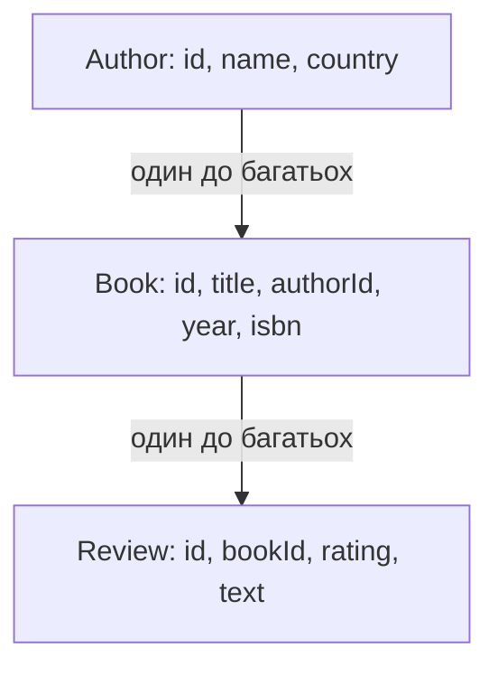

# Проєктування та документування REST API застосунку

> [!abstract] Коротко
> API проєктують до того, як пишуть код: від цього залежить, чи зручно буде ним користуватися й чи не доведеться ламати клієнтів через рік. Ви опишете предметну область, виділите ресурси, складете таблицю маршрутів з методами та кодами відповіді, реалізуєте її на Express, додасте фільтрування, сортування й пагінацію, а потім опишете контракт специфікацією OpenAPI, перевірите її лінтером і підключите інтерактивну документацію. Наприкінці порівняєте REST із GraphQL на одній і тій самій задачі.

## Мета і результати навчання

Після виконання роботи ви вмієте:

- [ ] виділяти ресурси та будувати зрозумілу ієрархію адрес (іменники, множина, вкладення);
- [ ] обирати HTTP-методи з урахуванням безпечності й ідемпотентності;
- [ ] підбирати коди стану, зокрема 201 із `Location`, 204, 400, 404, 409;
- [ ] реалізовувати фільтрування, впорядкування й посторінкове виведення;
- [ ] писати специфікацію OpenAPI 3 і перевіряти її автоматично;
- [ ] порівнювати REST і GraphQL та обґрунтовувати вибір.

## Професійні компетентності

Після виконання практичної роботи здобувач освіти повинен навчитися проєктувати ресурси й маршрути програмного інтерфейсу, добирати методи та коди стану, описувати інтерфейс специфікацією OpenAPI.

Відповідно до освітньої програми робота формує компетентності:

- СК03. Здатність застосовувати теоретичні та емпіричні знання для розроблення, тестування, впровадження та супроводу програмного забезпечення.
- СК07. Здатність розробляти модулі і компоненти програмного забезпечення за допомогою типових алгоритмів та інструментів.

## Перелік необхідного обладнання та програмного забезпечення

- Персональний комп'ютер, середовище Node.js 20 LTS або новіше, каркас Express 5.
- Редактор специфікації OpenAPI: Swagger Editor (editor.swagger.io) або розширення «OpenAPI (Swagger) Editor» для VS Code.
- Інструмент запитів: `curl`, Postman або Insomnia.
- Заготовка middleware з [[courses/web-programming/practicals/03-vlasne-promizhne-prohramne-zabezpechennia-ta|практичної роботи 3]] (`AppError`, `errorHandler`, `notFound`, `requestLogger`) – скопіюйте її в новий проєкт.

## Варіанти завдання

Предметну область обирайте за номером у журналі (номер за модулем 5). У кожному варіанті є головний ресурс (з повним CRUD) і дві допоміжні сутності.

| Варіант | Головний ресурс | Допоміжні |
|---|---|---|
| 1 | Книги | Автори, відгуки |
| 2 | Курси | Викладачі, записи студентів |
| 3 | Фільми | Режисери, сеанси |
| 4 | Замовлення | Клієнти, товари у замовленні |
| 0 | Завдання | Проєкти, коментарі |

Нижче – приклад «Книги – Автори – Відгуки».

## Теоретична частина

### Ресурси замість дій

REST (Representational State Transfer) – архітектурний стиль, у якому одиниця взаємодії – **ресурс**: щось, що має адресу й може бути представлене у вигляді даних. Адреса називає *що*, а метод HTTP – *що з цим робити*. Порівняйте два дизайни:

| Дії у шляху (погано) | Ресурси й методи (добре) |
|---|---|
| `POST /getBooks` | `GET /books` |
| `POST /createBook` | `POST /books` |
| `POST /deleteBook?id=5` | `DELETE /books/5` |
| `GET /books/5/addReview` | `POST /books/5/reviews` |

Правила іменування: іменники, а не дієслова; множина (`/books`, `/books/5`); вкладеність відображає належність (`/authors/3/books`), але не глибше двох рівнів, інакше адреси стають громіздкими (для глибших зв'язків використовуйте параметр `?authorId=3`); нижній регістр і дефіс (`/book-reviews`).

### Методи: безпечність та ідемпотентність

Дві властивості методів визначають, як клієнт і проміжні системи (кеш, балансувальник) можуть із ними поводитись.

> [!definition] Безпечний метод і ідемпотентний метод
> **Безпечний** метод не змінює стан сервера (лише читає). **Ідемпотентний** метод має однаковий *ефект на сервері* після одного і багатьох однакових викликів.

| Метод | Призначення | Безпечний | Ідемпотентний |
|---|---|---|---|
| GET | прочитати | так | так |
| POST | створити ресурс / виконати дію | ні | **ні** |
| PUT | замінити ресурс повністю | ні | так |
| PATCH | змінити частину ресурсу | ні | залежить від реалізації |
| DELETE | видалити | ні | так |

Ідемпотентність має практичне значення: якщо клієнт надіслав `PUT`, а відповідь загубилася через збій мережі, він може безпечно повторити запит. З `POST` так не вийде: повтор створить другий запис, і саме тому у платіжних API застосовують ключі ідемпотентності.

`PUT` і `PATCH` легко сплутати. `PUT /books/5` передає **повне** представлення, і відсутні поля вважаються видаленими чи скинутими. `PATCH /books/5` передає лише ті поля, які треба змінити.

### Коди стану як частина контракту

| Код | Коли |
|---|---|
| 200 OK | успішне читання чи зміна, є тіло |
| 201 Created | ресурс створено; у заголовку `Location` – адреса нового ресурсу |
| 204 No Content | дія виконана, тіла немає (звичайно DELETE) |
| 400 Bad Request | клієнт надіслав некоректні дані |
| 401 / 403 | немає автентифікації / бракує прав |
| 404 Not Found | ресурсу немає |
| 409 Conflict | конфлікт стану (дубль унікального поля) |
| 422 Unprocessable Content | синтаксично коректно, але не пройшло смислову перевірку (багато команд використовують замість 400 для помилок валідації) |
| 429 Too Many Requests | перевищено ліміт |
| 500 | помилка сервера |

Головне – послідовність. Оберіть 400 або 422 для помилок валідації і застосовуйте скрізь, а не за настроєм.

### Пагінація, фільтрування, впорядкування

Повертати «усі записи» одним запитом не можна: через рік їх буде мільйон. Параметри запиту: `page` і `limit` (або `offset` та `limit`, або курсор для великих наборів), `sort=-year` (мінус означає спадання), фільтри (`q=код&yearFrom=2000`). Відповідь повинна містити метадані (загальну кількість, кількість сторінок), інакше клієнт не побудує навігацію.

### OpenAPI

OpenAPI – машинозчитуваний опис API у форматі YAML або JSON: які шляхи, методи, параметри, схеми тіл, коди відповіді. З одного файла отримують інтерактивну документацію (Swagger UI, Redoc), перевірку запитів, згенеровані клієнтські бібліотеки та заготовки серверного коду, а також контрактні тести. Специфікація не «додаток» до коду, а **контракт**, про який домовляються фронтенд і бекенд ще до написання реалізації.

## Підготовка

```bash
mkdir practice04-api && cd practice04-api
npm init -y
npm install express yaml swagger-ui-express
npm install --save-dev @redocly/cli
```

У `package.json`: `"type": "module"`, скрипти `"start": "node src/server.js"`, `"dev": "node --watch src/server.js"`, `"lint:api": "redocly lint openapi.yaml"`, `"test": "node --test"`.

Структура:

```
practice04-api/
  openapi.yaml
  src/
    server.js  app.js  store.js  query.js  validate.js
    errors.js  middleware/ (з практичної 3)
    routes/ books.js  authors.js  reviews.js
  test/ api.test.js
```

## Хід роботи

### Етап 1. Опис предметної області та ресурсів

У звіті напишіть 5–7 речень про застосунок: хто користувачі, які об'єкти існують, які зв'язки між ними. Виділіть іменники, це кандидати в ресурси. Потім накресліть діаграму зв'язків.



Для кожного ресурсу визначте поля, типи, обов'язковість і обмеження (довжина, діапазон, унікальність). Наприклад, `Book`: `title` – рядок, 1–200 символів, обов'язковий; `year` – ціле, 1450–поточний рік; `isbn` – рядок, унікальний, необов'язковий; `authorId` – існуючий автор.

### Етап 2. Таблиця маршрутів

Складіть таблицю: шлях, метод, призначення, коди відповіді. Заповніть її **до** написання коду. Приклад для ресурсу «книги» (для авторів і відгуків зробіть самостійно):

| Метод | Шлях | Призначення | Коди відповіді |
|---|---|---|---|
| GET | `/api/v1/books` | список із фільтрами, сортуванням, пагінацією | 200, 400 |
| POST | `/api/v1/books` | створити книгу | 201 + `Location`, 400, 409 |
| GET | `/api/v1/books/{id}` | одна книга | 200, 400, 404 |
| PUT | `/api/v1/books/{id}` | замінити книгу повністю | 200, 400, 404, 409 |
| PATCH | `/api/v1/books/{id}` | змінити окремі поля | 200, 400, 404, 409 |
| DELETE | `/api/v1/books/{id}` | видалити | 204, 400, 404 |
| GET | `/api/v1/books/{id}/reviews` | відгуки на книгу | 200, 400, 404 |
| POST | `/api/v1/books/{id}/reviews` | додати відгук | 201, 400, 404 |
| GET | `/api/v1/authors/{id}/books` | книги автора | 200, 400, 404 |

Префікс `/v1` у шляху – версія API. Коли доведеться зробити несумісну зміну, ви випустите `/v2`, і старі клієнти продовжать працювати.

**Контрольна точка 1.** Таблиця містить щонайменше 15 рядків (три ресурси), для кожного маршруту вказано всі можливі коди відповіді. Перевірте себе: чи немає дієслів у шляхах, чи правильний метод для кожної дії, чи вказано `Location` для всіх `201`.

### Етап 3. Сховище, валідація й запит списку

Дані тримаємо в пам'яті; в реальному застосунку це база, як у [[courses/web-programming/labs/06-robota-z-bazoiu-danykh-cherez-orm|лабораторній 6]].

```js
// src/store.js
export const db = {
  authors: [
    { id: 1, name: 'Роберт Мартін', country: 'США' },
    { id: 2, name: 'Дональд Кнут', country: 'США' },
    { id: 3, name: 'Іван Франко', country: 'Україна' },
  ],
  books: [
    { id: 1, title: 'Чистий код', authorId: 1, year: 2008, isbn: '9780132350884' },
    { id: 2, title: 'Чиста архітектура', authorId: 1, year: 2017, isbn: '9780134494166' },
    { id: 3, title: 'Мистецтво програмування', authorId: 2, year: 1968, isbn: '9780201896831' },
    { id: 4, title: 'Захар Беркут', authorId: 3, year: 1883 },
  ],
  reviews: [
    { id: 1, bookId: 1, rating: 5, text: 'Класика, яку варто перечитувати.' },
  ],
  seq: { authors: 4, books: 5, reviews: 2 },
};

export const nextId = name => db.seq[name]++;
```

Параметри списку розбираємо й перевіряємо в одному місці:

```js
// src/query.js
import { AppError } from './errors.js';

const SORTABLE = new Set(['id', 'title', 'year']);

export function parseListQuery(q) {
  const page = q.page === undefined ? 1 : Number(q.page);
  const limit = q.limit === undefined ? 10 : Number(q.limit);
  if (!Number.isInteger(page) || page < 1) throw AppError.badRequest('page має бути цілим числом ≥ 1', { code: 'INVALID_PAGE' });
  if (!Number.isInteger(limit) || limit < 1 || limit > 100) throw AppError.badRequest('limit має бути від 1 до 100', { code: 'INVALID_LIMIT' });

  const sortParam = q.sort ?? 'id';
  const desc = sortParam.startsWith('-');
  const sortField = desc ? sortParam.slice(1) : sortParam;
  if (!SORTABLE.has(sortField)) {
    throw AppError.badRequest(`sort має бути одним з: ${[...SORTABLE].join(', ')} (з префіксом '-' для спадання)`, { code: 'INVALID_SORT' });
  }
  return { page, limit, sortField, desc };
}

export function paginate(items, { page, limit }) {
  const total = items.length;
  const pages = Math.max(1, Math.ceil(total / limit));
  const data = items.slice((page - 1) * limit, page * limit);
  return { data, meta: { page, limit, total, pages } };
}

export function sortItems(items, { sortField, desc }) {
  const sign = desc ? -1 : 1;
  return items.toSorted((a, b) => (a[sortField] > b[sortField] ? 1 : a[sortField] < b[sortField] ? -1 : 0) * sign);
}
```

```js
// src/validate.js
import { AppError } from './errors.js';

const THIS_YEAR = new Date().getFullYear();

/** partial = true для PATCH: поля необов'язкові, але ті, що є, мають бути коректні */
export function validateBook(body, { partial = false } = {}) {
  const errors = {};
  const b = body ?? {};

  const has = k => b[k] !== undefined;
  if (!partial || has('title')) {
    if (typeof b.title !== 'string' || b.title.trim().length < 1 || b.title.length > 200) errors.title = 'Рядок довжиною 1–200';
  }
  if (!partial || has('authorId')) {
    if (!Number.isInteger(b.authorId) || b.authorId < 1) errors.authorId = 'Додатне ціле число';
  }
  if (!partial || has('year')) {
    if (!Number.isInteger(b.year) || b.year < 1450 || b.year > THIS_YEAR) errors.year = `Ціле число від 1450 до ${THIS_YEAR}`;
  }
  if (has('isbn') && (typeof b.isbn !== 'string' || !/^\d{10}(\d{3})?$/.test(b.isbn))) {
    errors.isbn = '10 або 13 цифр без дефісів';
  }

  if (Object.keys(errors).length) {
    throw AppError.badRequest('Некоректні дані', { code: 'VALIDATION_ERROR', details: errors });
  }
  const { title, authorId, year, isbn } = b;
  return Object.fromEntries(Object.entries({ title: title?.trim(), authorId, year, isbn }).filter(([, v]) => v !== undefined));
}
```

Функція повертає **лише дозволені поля**, відфільтровуючи все зайве: клієнт не повинен мати змоги записати довільний `id` чи службове поле (так само, як у реєстрації з лабораторної 7 роль не бралась з тіла запиту).

### Етап 4. Маршрути книг

```js
// src/routes/books.js
import { Router } from 'express';
import { db, nextId } from '../store.js';
import { AppError } from '../errors.js';
import { parseListQuery, paginate, sortItems } from '../query.js';
import { validateBook } from '../validate.js';
import { validateId } from '../middleware/validateId.js';

export const books = Router();

function ensureAuthor(authorId) {
  if (!db.authors.some(a => a.id === authorId)) {
    throw AppError.badRequest('Автора з таким authorId не існує', { code: 'UNKNOWN_AUTHOR', details: { authorId } });
  }
}

function ensureUniqueIsbn(isbn, exceptId) {
  if (isbn && db.books.some(b => b.isbn === isbn && b.id !== exceptId)) {
    throw new AppError(409, 'Книга з таким isbn уже існує', { code: 'ISBN_CONFLICT' });
  }
}

const findBook = id => {
  const book = db.books.find(b => b.id === id);
  if (!book) throw AppError.notFound(`Книгу з id=${id} не знайдено`);
  return book;
};

books.get('/', (req, res) => {
  const query = parseListQuery(req.query);
  let items = db.books;

  const { q, authorId, yearFrom, yearTo } = req.query;
  if (q) items = items.filter(b => b.title.toLowerCase().includes(String(q).toLowerCase()));
  if (authorId) items = items.filter(b => b.authorId === Number(authorId));
  if (yearFrom) items = items.filter(b => b.year >= Number(yearFrom));
  if (yearTo) items = items.filter(b => b.year <= Number(yearTo));

  res.json(paginate(sortItems(items, query), query));
});

books.post('/', (req, res) => {
  const data = validateBook(req.body);
  ensureAuthor(data.authorId);
  ensureUniqueIsbn(data.isbn);
  const book = { id: nextId('books'), ...data };
  db.books.push(book);
  res.status(201).location(`/api/v1/books/${book.id}`).json(book);
});

books.get('/:id', validateId, (req, res) => {
  res.json(findBook(req.resourceId));
});

books.put('/:id', validateId, (req, res) => {
  const book = findBook(req.resourceId);
  const data = validateBook(req.body);                  // повне представлення
  ensureAuthor(data.authorId);
  ensureUniqueIsbn(data.isbn, book.id);
  const replaced = { id: book.id, ...data };            // isbn, якого немає в тілі, зникає
  db.books[db.books.indexOf(book)] = replaced;
  res.json(replaced);
});

books.patch('/:id', validateId, (req, res) => {
  const book = findBook(req.resourceId);
  const data = validateBook(req.body, { partial: true });
  if (data.authorId !== undefined) ensureAuthor(data.authorId);
  ensureUniqueIsbn(data.isbn, book.id);
  Object.assign(book, data);
  res.json(book);
});

books.delete('/:id', validateId, (req, res) => {
  const book = findBook(req.resourceId);
  db.books.splice(db.books.indexOf(book), 1);
  db.reviews = db.reviews.filter(r => r.bookId !== book.id);   // каскад
  res.status(204).end();
});
```

Підключіть у `app.js`: `app.use(requestLogger); app.use(express.json({ limit: '10kb' })); app.use('/api/v1/books', books);` і наприкінці `notFound`, `errorHandler`. Маршрути авторів і відгуків реалізуйте самостійно за тим самим зразком (мінімум: GET список, GET за id, POST, DELETE для авторів; GET/POST відгуків книги з перевіркою `rating` 1–5).

> [!warning] Типова помилка
> Сплутати `PUT` із `PATCH`. Перевірте: надішліть `PUT` без поля `isbn` для книги, що його мала, і переконайтеся, що поле зникло; надішліть `PATCH` з одним лише `title` і переконайтеся, що решта полів збереглася.

### Етап 5. Ідемпотентність: перевірка на практиці

Виконайте й запишіть у звіт результати:

```bash
# POST двічі: два різні ресурси (неідемпотентний)
curl -s -i -X POST localhost:3000/api/v1/books -H 'Content-Type: application/json' \
  -d '{"title":"Тест","authorId":1,"year":2020}'
# повторіть ту саму команду і порівняйте id та Location

# PUT двічі: однаковий стан (ідемпотентний)
curl -s -X PUT localhost:3000/api/v1/books/4 -H 'Content-Type: application/json' \
  -d '{"title":"Захар Беркут","authorId":3,"year":1883}'
# повторіть: те саме тіло, той самий стан

# DELETE двічі
curl -s -o /dev/null -w "%{http_code}\n" -X DELETE localhost:3000/api/v1/books/5   # 204
curl -s -o /dev/null -w "%{http_code}\n" -X DELETE localhost:3000/api/v1/books/5   # 404
```

Зверніть увагу на третій приклад: другий `DELETE` повертає `404`, але *стан сервера* той самий (ресурсу немає), і саме це визначення ідемпотентності стосується стану, а не коду відповіді. Багато API повертають `204` і на повторний виклик; обидва підходи допустимі, якщо їх описано в специфікації.

### Етап 6. Специфікація OpenAPI

Створіть `openapi.yaml`. Нижче – повний каркас для ресурсу «книги». Решту ресурсів додайте за зразком.

```yaml
openapi: 3.0.3
info:
  title: API бібліотеки
  version: 1.0.0
  description: Навчальний REST API для практичної роботи 4.
servers:
  - url: http://localhost:3000/api/v1
tags:
  - name: Books
    description: Книги

paths:
  /books:
    get:
      tags: [Books]
      summary: Список книг
      operationId: listBooks
      parameters:
        - { name: page,  in: query, schema: { type: integer, minimum: 1, default: 1 } }
        - { name: limit, in: query, schema: { type: integer, minimum: 1, maximum: 100, default: 10 } }
        - name: sort
          in: query
          description: Поле впорядкування, префікс «-» означає спадання
          schema: { type: string, enum: [id, -id, title, -title, year, -year], default: id }
        - { name: q, in: query, description: Підрядок у назві, schema: { type: string } }
        - { name: authorId, in: query, schema: { type: integer } }
        - { name: yearFrom, in: query, schema: { type: integer } }
        - { name: yearTo, in: query, schema: { type: integer } }
      responses:
        '200':
          description: Сторінка книг
          content:
            application/json:
              schema:
                type: object
                required: [data, meta]
                properties:
                  data:
                    type: array
                    items: { $ref: '#/components/schemas/Book' }
                  meta: { $ref: '#/components/schemas/PageMeta' }
        '400': { $ref: '#/components/responses/BadRequest' }
    post:
      tags: [Books]
      summary: Створити книгу
      operationId: createBook
      requestBody:
        required: true
        content:
          application/json:
            schema: { $ref: '#/components/schemas/BookInput' }
            example: { title: Рефакторинг, authorId: 1, year: 1999, isbn: '9780134757599' }
      responses:
        '201':
          description: Книгу створено
          headers:
            Location:
              description: Адреса створеної книги
              schema: { type: string, example: /api/v1/books/6 }
          content:
            application/json:
              schema: { $ref: '#/components/schemas/Book' }
        '400': { $ref: '#/components/responses/BadRequest' }
        '409': { $ref: '#/components/responses/Conflict' }

  /books/{id}:
    parameters:
      - name: id
        in: path
        required: true
        schema: { type: integer, minimum: 1 }
    get:
      tags: [Books]
      summary: Книга за ідентифікатором
      operationId: getBook
      responses:
        '200':
          description: Знайдена книга
          content:
            application/json:
              schema: { $ref: '#/components/schemas/Book' }
        '400': { $ref: '#/components/responses/BadRequest' }
        '404': { $ref: '#/components/responses/NotFound' }
    put:
      tags: [Books]
      summary: Замінити книгу повністю
      operationId: replaceBook
      requestBody:
        required: true
        content:
          application/json:
            schema: { $ref: '#/components/schemas/BookInput' }
      responses:
        '200':
          description: Книгу замінено
          content:
            application/json:
              schema: { $ref: '#/components/schemas/Book' }
        '400': { $ref: '#/components/responses/BadRequest' }
        '404': { $ref: '#/components/responses/NotFound' }
        '409': { $ref: '#/components/responses/Conflict' }
    patch:
      tags: [Books]
      summary: Змінити окремі поля книги
      operationId: updateBook
      requestBody:
        required: true
        content:
          application/json:
            schema: { $ref: '#/components/schemas/BookPatch' }
      responses:
        '200':
          description: Книгу оновлено
          content:
            application/json:
              schema: { $ref: '#/components/schemas/Book' }
        '400': { $ref: '#/components/responses/BadRequest' }
        '404': { $ref: '#/components/responses/NotFound' }
        '409': { $ref: '#/components/responses/Conflict' }
    delete:
      tags: [Books]
      summary: Видалити книгу
      operationId: deleteBook
      responses:
        '204': { description: Книгу видалено }
        '400': { $ref: '#/components/responses/BadRequest' }
        '404': { $ref: '#/components/responses/NotFound' }

components:
  schemas:
    BookInput:
      type: object
      required: [title, authorId, year]
      additionalProperties: false
      properties:
        title:    { type: string, minLength: 1, maxLength: 200 }
        authorId: { type: integer, minimum: 1 }
        year:     { type: integer, minimum: 1450 }
        isbn:     { type: string, pattern: '^\d{10}(\d{3})?$' }
    BookPatch:
      type: object
      minProperties: 1
      additionalProperties: false
      properties:
        title:    { type: string, minLength: 1, maxLength: 200 }
        authorId: { type: integer, minimum: 1 }
        year:     { type: integer, minimum: 1450 }
        isbn:     { type: string, pattern: '^\d{10}(\d{3})?$' }
    Book:
      allOf:
        - { $ref: '#/components/schemas/BookInput' }
        - type: object
          required: [id]
          properties:
            id: { type: integer, minimum: 1 }
    PageMeta:
      type: object
      required: [page, limit, total, pages]
      properties:
        page:  { type: integer }
        limit: { type: integer }
        total: { type: integer }
        pages: { type: integer }
    Error:
      type: object
      required: [error]
      properties:
        error:
          type: object
          required: [code, message, requestId]
          properties:
            code:      { type: string, example: VALIDATION_ERROR }
            message:   { type: string }
            requestId: { type: string }
            details:   { type: object, additionalProperties: true }
  responses:
    BadRequest:
      description: Некоректний запит
      content:
        application/json:
          schema: { $ref: '#/components/schemas/Error' }
    NotFound:
      description: Ресурс не знайдено
      content:
        application/json:
          schema: { $ref: '#/components/schemas/Error' }
    Conflict:
      description: Конфлікт (наприклад, дубль isbn)
      content:
        application/json:
          schema: { $ref: '#/components/schemas/Error' }
```

Секція `components` – це спосіб не повторюватися: схеми й типові відповіді описано один раз і підставлено посиланнями `$ref`. Зверніть увагу на `additionalProperties: false` у вхідних схемах: специфікація забороняє зайві поля, і це узгоджується з поведінкою `validateBook`.

**Перевірте специфікацію двома способами.** Скопіюйте файл у Swagger Editor і переконайтеся, що праворуч з'явилась документація без червоних помилок. Потім запустіть лінтер: `npm run lint:api`. Виправте всі помилки (`error`); попередження (`warning`) прокоментуйте у звіті.

### Етап 7. Інтерактивна документація

Підключіть Swagger UI до сервера, щоб документація жила поруч із реалізацією.

```js
// у app.js
import fs from 'node:fs';
import { parse } from 'yaml';
import swaggerUi from 'swagger-ui-express';

const spec = parse(fs.readFileSync(new URL('../openapi.yaml', import.meta.url), 'utf8'));
app.use('/docs', swaggerUi.serve, swaggerUi.setup(spec));
app.get('/openapi.json', (req, res) => res.json(spec));
```

Відкрийте `http://localhost:3000/docs`, виконайте через кнопку «Try it out» запити створення, читання й видалення. Зробіть знімок сторінки.

### Етап 8. Перевірка набору запитів

Складіть набір не менше **15** запитів у Postman/Insomnia або у вигляді автоматичних тестів на `node:test`. Він має охопити:

| Група | Приклади |
|---|---|
| Успіх | список, пагінація (`page=2&limit=2`), фільтр (`q=чист`), сортування (`sort=-year`), створення, читання, `PUT`, `PATCH`, `DELETE` |
| Помилки клієнта | `page=0`, `limit=1000`, `sort=price`, порожній `title`, `year=3000`, неіснуючий `authorId`, дубль `isbn` |
| Неіснуюче | `GET /books/999`, `DELETE /books/999`, `/books/abc` |
| Контракт | перевірка, що `POST` повертає `201` і заголовок `Location`, що `DELETE` повертає порожнє тіло |

Фрагмент автоматичного тесту (решту допишіть самостійно):

```js
test('POST: 201 і Location', async () => {
  const res = await fetch(`${base}/api/v1/books`, {
    method: 'POST',
    headers: { 'Content-Type': 'application/json' },
    body: JSON.stringify({ title: 'Нова', authorId: 1, year: 2020 }),
  });
  assert.equal(res.status, 201);
  const book = await res.json();
  assert.equal(res.headers.get('location'), `/api/v1/books/${book.id}`);
});

test('PATCH зберігає невказані поля, PUT їх скидає', async () => {
  const patch = await fetch(`${base}/api/v1/books/1`, {
    method: 'PATCH',
    headers: { 'Content-Type': 'application/json' },
    body: JSON.stringify({ title: 'Чистий код (2-ге вид.)' }),
  });
  assert.equal((await patch.json()).isbn, '9780132350884');

  const put = await fetch(`${base}/api/v1/books/1`, {
    method: 'PUT',
    headers: { 'Content-Type': 'application/json' },
    body: JSON.stringify({ title: 'Чистий код', authorId: 1, year: 2008 }),
  });
  assert.equal((await put.json()).isbn, undefined);
});
```

**Контрольна точка 2.** Специфікація проходить лінтер без `error`; документація відкривається на `/docs`; набір з ≥ 15 запитів проходить, а помилкові сценарії повертають передбачені в специфікації коди.

## Завдання для самостійного виконання

Додайте до специфікації опис схем даних і прикладів відповідей. Порівняйте у звіті підхід REST із запитом GraphQL для тієї самої задачі: які переваги й недоліки має кожен.

**Частина 1. Специфікація.**

1. Для **всіх** ресурсів (книги, автори, відгуки) опишіть схеми у `components/schemas` і додайте `example` для кожної схеми та для відповідей `200`, `201`, `400`, `404`.
2. Опишіть у `components/securitySchemes` схему `bearerAuth` (HTTP, bearer, JWT) і вкажіть, що `POST`, `PUT`, `PATCH`, `DELETE` потребують її (навіть якщо захисту ще не реалізовано, це частина контракту).
3. Переконайтеся, що лінтер проходить.

**Частина 2. REST і GraphQL.** Поставте задачу: «показати сторінку книги: назва книги, ім'я автора, останні три відгуки з оцінкою».

REST-сценарій:

```
GET /api/v1/books/1                         -> { id, title, authorId, year, isbn }
GET /api/v1/authors/1                       -> { id, name, country }
GET /api/v1/books/1/reviews?sort=-id&limit=3 -> { data: [...], meta }
```

GraphQL-запит (одна точка входу):

```graphql
query BookPage($id: ID!) {
  book(id: $id) {
    title
    author { name }
    reviews(last: 3) { rating text }
  }
}
```

Заповніть таблицю порівняння **своїми словами**, з прикладами з цієї задачі:

| Критерій | REST | GraphQL |
|---|---|---|
| Кількість запитів для сторінки | | |
| Зайві дані (over-fetching) | | |
| Нестача даних (under-fetching) | | |
| Кешування HTTP | | |
| Версіонування | | |
| Складність сервера | | |
| Інструменти й документація | | |
| Безпека (глибина запитів, ліміти) | | |

Завершіть висновком: коли для вашого проєкту обрали б REST, а коли GraphQL.

## Завдання підвищеної складності

> [!example] Рівень «добре» (необов'язково)
> Додайте умовні запити: до відповіді `GET /books/{id}` додайте заголовок `ETag` (хеш від JSON), а у відповідь на запит із `If-None-Match` повертайте `304 Not Modified` без тіла. Для зміни реалізуйте оптимістичне блокування: `PUT` вимагає `If-Match`, а за нееквівалентного значення повертає `412 Precondition Failed`. Поясніть, яку проблему це розв'язує (дві людини одночасно редагують один запис).

> [!example] Рівень «відмінно» (необов'язково)
> Автоматично перевіряйте відповіді сервера на відповідність специфікації: підключіть бібліотеку `openapi-response-validator` або `ajv` і в тестах перевіряйте кожну відповідь за схемою з `openapi.yaml`. Або запустіть інструмент property-based тестування Schemathesis проти сервера (`schemathesis run http://localhost:3000/openapi.json`) і проаналізуйте знайдені розбіжності.

## Типові помилки

> [!warning] Типова помилка
> - Дієслова у шляхах (`/createBook`).
> - `GET`, що змінює дані.
> - `200 OK` з `{ "success": false }` у тілі замість правильного коду помилки.
> - `POST` без `201` і `Location`.
> - Повернення всіх записів без пагінації.
> - Довільне ім'я параметра сортування, що дає змогу сортувати за будь-яким полем, зокрема приватним (перевірка за білим списком).
> - Різний формат помилок у різних маршрутах.
> - Специфікація, що розходиться з кодом (спека «бреше»): тому її автоматично перевіряють.

## Вимоги до звіту

1. Титульна сторінка, варіант.
2. Опис предметної області, діаграма ресурсів і зв'язків.
3. Таблиця маршрутів (≥ 15 рядків).
4. Лістинг `validate.js`, `query.js`, маршрутів основного ресурсу.
5. Результати перевірки ідемпотентності (етап 5) з поясненням.
6. `openapi.yaml`, результат лінтера, знімок Swagger UI.
7. Набір запитів (таблиця чи тести) та його результат.
8. Порівняння REST і GraphQL (таблиця та висновок).
9. Висновки.

## Критерії оцінювання

| Критерій | Балів |
|---|---|
| Ресурси, іменування, таблиця маршрутів, версіонування | 15 |
| Правильні методи та коди стану, `Location`, `204` | 15 |
| Фільтрування, сортування за білим списком, пагінація з метаданими | 15 |
| Валідація, узгоджений формат помилок | 10 |
| Специфікація OpenAPI: повна, лінтер без `error` | 20 |
| Набір запитів (≥ 15), охоплення помилок | 10 |
| Порівняння REST і GraphQL | 5 |
| Звіт | 5 |
| Захист | 5 |
| **Разом** | **100** |

## Контрольні питання

> [!question] Перевірте себе
> 1. Що таке ідемпотентність методу та які методи їй відповідають?
> 2. Чим `PUT` відрізняється від `PATCH`?
> 3. Які коди стану доречні для створення ресурсу й для вилучення?
> 4. Як організувати посторінкове виведення великого списку?
> 5. Для чого потрібна специфікація OpenAPI?
> 6. Чому в шляхах використовують іменники у множині, а не дієслова?
> 7. Навіщо версія в адресі (`/v1`)?
> 8. Чому параметр `sort` перевіряють за білим списком?

> [!exam] На іспиті
> Завдання: «Клієнт надіслав `POST /orders`, не отримав відповіді (збій мережі) і повторив запит. Що може статися і як це запобігти?» Відповідь: створяться два замовлення, `POST` не ідемпотентний; запобігає ключ ідемпотентності (`Idempotency-Key`), який сервер запам'ятовує.

## Далі

Далі – тема з сучасної інженерної практики: [[courses/web-programming/practicals/05-instrumenty-shtuchnoho-intelektu-dlia|Практична робота 5. Інструменти штучного інтелекту для генерації та рефакторингу коду]]. Теорія REST і GraphQL – у [[courses/web-programming/lectures/11-rest-api-ta-graphql|лекції 11]]; ті ж ресурси ви збережете в реальній базі з [[courses/web-programming/labs/06-robota-z-bazoiu-danykh-cherez-orm|лабораторної 6]]; терміни – [[courses/web-programming/glossary/rest|REST]] та [[courses/web-programming/glossary/http|HTTP]].

## Література

- Roy Fielding, Architectural Styles and the Design of Network-based Software Architectures, розділ 5 (ics.uci.edu/~fielding/pubs/dissertation)
- OpenAPI Specification v3.0.3 (spec.openapis.org)
- MDN: HTTP request methods, HTTP response status codes (developer.mozilla.org)
- Microsoft REST API Guidelines (github.com/microsoft/api-guidelines)
- graphql.org/learn
