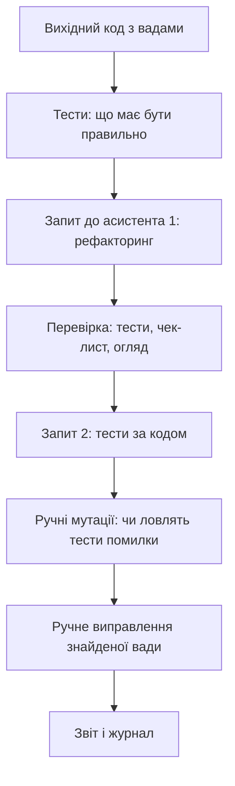

# Використання інструментів штучного інтелекту для генерації та рефакторингу коду

> [!abstract] Коротко
> Інструменти на основі мовних моделей стали звичною частиною роботи розробника, але вони не знімають з нього відповідальності, а підвищують ціну неуважності. У цій роботі ШІ-асистент – предмет вивчення, а не виконавець: ви отримаєте від нього рефакторинг і тести, але **перевірятимете** все самі. Спочатку напишете тести, які фіксують бажану поведінку, потім сформулюєте завдання за структурою, оцінюватимете відповідь за чек-листом, шукатимете вигадані виклики та вразливості й нарешті порівняєте, як деталізація запиту впливає на результат.

## Мета і результати навчання

Після виконання роботи ви вмієте:

- [ ] формулювати завдання для асистента з контекстом, обмеженнями й прикладами;
- [ ] перевіряти згенерований код за чек-листом: коректність, тести, безпека, ліцензія, стиль;
- [ ] використовувати тести як незалежний критерій приймання результату;
- [ ] виявляти типові вади згенерованого коду (вигадані API, поглинання помилок, приховані зміни поведінки, вразливості);
- [ ] ставити експеримент для порівняння формулювань запиту та фіксувати його як вимірюваний результат;
- [ ] чесно та безпечно користуватися асистентом: не передавати секретів і персональних даних, зазначати використання.

## Професійні компетентності

Після виконання практичної роботи здобувач освіти повинен навчитися формулювати завдання для ШІ-асистента, критично перевіряти згенерований код і застосовувати його для рефакторингу та створення тестів.

Відповідно до освітньої програми робота формує компетентності:

- СК03. Здатність застосовувати теоретичні та емпіричні знання для розроблення, тестування, впровадження та супроводу програмного забезпечення.
- СК07. Здатність розробляти модулі і компоненти програмного забезпечення за допомогою типових алгоритмів та інструментів.

## Перелік необхідного обладнання та програмного забезпечення

- Персональний комп'ютер, редактор коду з інтегрованим ШІ-асистентом **або** доступ до вебінтерфейсу мовної моделі. Конкретний інструмент ви обираєте самі, але зазначаєте його назву й версію моделі у звіті.
- Середовище Node.js 20 LTS або новіше, вбудований засіб запуску тестів `node --test`.
- Текстовий файл для журналу взаємодії (`ai-log.md`): кожен запит і кожну відповідь ви зберігаєте.

## Теоретична частина

### Що роблять мовні моделі й чому це важливо знати

Велика мовна модель передбачає найімовірніше продовження тексту на основі закономірностей, виявлених у величезному корпусі. Вона не «знає», що код працює: вона створює правдоподібний код. Звідси сильні й слабкі сторони.

Надійно виходять: шаблонний код (обробники, конфігурації), пояснення незнайомого фрагмента, переклад між мовами й стилями, початкові версії тестів, типові перетворення (рефакторинг у знайому конструкцію). Ненадійно виходять: нові або рідкісні API (модель може **вигадати** метод, який виглядає цілком природно), ситуації, що залежать від контексту проєкту, якого модель не бачить, тонкі питання безпеки та продуктивності, арифметика й точні числа, відповідь на питання «чи правильно це», коли її впевнений тон не залежить від правильності.

> [!warning] Типова помилка
> Впевнений тон відповіді не є ознакою правильності. Модель однаково спокійно описує реальну функцію й не існуючу. Єдина перевірка – запуск, тести та документація.

### Як ставити завдання

Якість відповіді прямо залежить від якості запиту. Корисна структура з п'яти частин:

1. **Контекст.** Мова та її версія, середовище, наявні бібліотеки, навіщо цей код.
2. **Завдання.** Що саме зробити (одна дія: «відрефактори», «напиши тести», «поясни»).
3. **Обмеження.** Чого не можна змінювати (публічний підпис, поведінку), що заборонено (нові залежності), стиль.
4. **Приклади.** Вхід і очікуваний вихід, особливо для крайніх випадків.
5. **Формат відповіді.** «Лише код у одному блоці», «спочатку список змін, потім код», «не змінюй інші файли».

Додатково: давайте **критерій приймання**, який можна перевірити («усі тести з додатка мають пройти»). Просіть **не вгадувати**: «Якщо бракує інформації, постав питання замість припущень». Вирішуйте задачу *малими кроками*: один запит – одна зміна, інакше перевірити результат неможливо.

### Ризики

| Ризик | Приклад | Як виявити |
|---|---|---|
| Вигадані виклики | `list.sumBy('price')` не існує в JavaScript | запуск, документація |
| Застарілі API | метод, видалений у новій версії бібліотеки | порівняння з документацією вашої версії |
| Ігнорування помилок | порожній `catch {}`, відсутня перевірка вхідних даних | читання коду, тести на помилки |
| Зміна поведінки під виглядом «покращення» | округлення, порядок елементів, значення за замовчуванням | тести поведінки до рефакторингу |
| Вразливості | SQL із конкатенації, `eval`, `innerHTML`, захардкоджені секрети | чек-лист безпеки, лінтери, ручний огляд |
| Ліцензійна чистота | фрагмент, дослівно схожий на код під обмежувальною ліцензією | вибірковий пошук фрагмента, політика команди |
| Витік даних | вставили в публічний сервіс ключі, персональні дані, закритий код | правила нижче |

### Відповідальність і етика

Код, що потрапив у репозиторій, належить автору коміту, а не інструментові. На ревʼю, на захисті та в разі помилки у виробництві питання ставлять вам. Тому ви повинні **розуміти кожен рядок**, який приймаєте. У навчальній роботі діє ще одне правило: використання ШІ-асистента має бути **зазначене у звіті**, із журналом запитів і відповідей. Видавання згенерованого за власну роботу є порушенням академічної доброчесності; чесно зазначене й критично перевірене використання – навичка, якої від вас чекають.

> [!definition] Що не можна передавати в публічні сервіси
> Паролі, ключі API, токени, вміст `.env`; персональні дані реальних людей; закритий або комерційний код, що не належить вам; результати контрольних робіт та іспитів. Замінюйте реальні дані вигаданими.

## Підготовка

Створіть проєкт і журнал:

```bash
mkdir practice05-ai && cd practice05-ai
npm init -y
mkdir src test
touch ai-log.md
```

У `package.json` додайте `"type": "module"` і скрипт `"test": "node --test"`. У `ai-log.md` ви записуватимете для кожного звернення: дату/час, інструмент і модель, повний текст запиту, повну відповідь (або посилання на неї), що ви з нею зробили.

## Хід роботи



### Етап 1. Вихідний код

Усі беруть однаковий початковий матеріал, щоб результати можна було порівнювати. Збережіть у `src/cart.js`:

```js
// src/cart.js – вихідна версія (навмисно недосконала)
export function calculateTotal(items, coupon) {
  var total = 0;
  for (var i = 0; i < items.length; i++) {
    items[i].subtotal = items[i].price * items[i].qty;
    total = total + items[i].subtotal;
  }
  if (coupon == 'SALE10') total = total - total * 0.1;
  if (coupon == 'SALE20') total = total - total * 0.2;
  if (coupon == 'FREE') total = 0;
  if (total > 1000) total = total - 50;
  return total;
}
```

> [!info] Якщо маєте свій код
> За погодженням із викладачем можна взяти власну функцію з попередніх робіт (до 40 рядків). Вона повинна мати очевидні недоліки та зрозумілу очікувану поведінку. Тоді замість поданих нижче вимог та тестів складіть свої за тим самим принципом.

**Специфікація (поведінка, яка має бути):**

1. Позиція – об'єкт `{ price, qty }`: `price` – скінченне число ≥ 0, `qty` – ціле число ≥ 1; інакше помилка (`TypeError` для типу, `RangeError` для значення).
2. Вхідний масив і його елементи **не змінюються**.
3. Підсумок – у гривнях з точністю до копійок (без похибок `0.30000000000000004`).
4. Купон нечутливий до регістру: `SALE10` (мінус 10%), `SALE20` (мінус 20%), `FREE` (нуль), відсутній купон – без знижки. Невідомий купон – `RangeError`.
5. Після купона, якщо сума **більша за 1000**, віднімається 50 грн.
6. Порожній масив дає `0`.

### Етап 2. Тести перед усім іншим

Ключова ідея роботи: **критерій приймання існує до відповіді асистента**. Інакше ви перевіряєте код «на око», а це якраз те, чого модель не боїться. Збережіть у `test/cart.test.js`:

```js
import { test } from 'node:test';
import assert from 'node:assert/strict';
import { calculateTotal } from '../src/cart.js';

const item = (price, qty) => ({ price, qty });

test('порожній кошик – нуль', () => {
  assert.equal(calculateTotal([]), 0);
});

test('сума без купона', () => {
  assert.equal(calculateTotal([item(100, 2), item(50, 1)]), 250);
});

test('купони SALE10 / SALE20 / FREE', () => {
  assert.equal(calculateTotal([item(500, 2)], 'SALE10'), 900);
  assert.equal(calculateTotal([item(500, 2)], 'SALE20'), 800);
  assert.equal(calculateTotal([item(500, 2)], 'FREE'), 0);
});

test('купон нечутливий до регістру', () => {
  assert.equal(calculateTotal([item(500, 2)], 'sale10'), 900);
});

test('знижка 50 грн, якщо сума після купона перевищує 1000', () => {
  assert.equal(calculateTotal([item(600, 2)]), 1150);
  assert.equal(calculateTotal([item(600, 2)], 'SALE10'), 1030);
  assert.equal(calculateTotal([item(500, 2)]), 1000);        // рівно 1000 – без знижки
});

test('точність до копійок', () => {
  assert.equal(calculateTotal([item(0.1, 3)]), 0.3);
  assert.equal(calculateTotal([item(19.99, 3)], 'SALE10'), 53.97);
});

test('вхідні дані не змінюються', () => {
  const items = [item(100, 2)];
  const copy = structuredClone(items);
  calculateTotal(items, 'SALE10');
  assert.deepEqual(items, copy);
});

test('невідомий купон – RangeError', () => {
  assert.throws(() => calculateTotal([item(100, 1)], 'HACK'), RangeError);
});

test('некоректні позиції', () => {
  assert.throws(() => calculateTotal([item(-1, 1)]), RangeError);
  assert.throws(() => calculateTotal([item(10, 0)]), RangeError);
  assert.throws(() => calculateTotal([item(10, 1.5)]), RangeError);
  assert.throws(() => calculateTotal([item('10', 1)]), TypeError);
  assert.throws(() => calculateTotal([item(NaN, 1)]), RangeError);
});

test('items не масив – TypeError', () => {
  assert.throws(() => calculateTotal(null), TypeError);
});
```

Запустіть `npm test` на вихідному коді та запишіть у звіт, **які тести падають і чому** (мають впасти щонайменше 5). Це «початкова точка» та доказ, що тести справді перевіряють вимоги.

**Контрольна точка 1.** Таблиця: тест – результат на вихідному коді – причина.

### Етап 3. Запит на рефакторинг

Сформулюйте запит за п'ятичастинною структурою. Нижче приклад **шаблону**; змістовно доповніть його самі, а не копіюйте дослівно.

```
Контекст: JavaScript (Node.js 20, ES-модулі), без сторонніх бібліотек. Функція рахує
підсумок кошика інтернет-магазину. Нижче вихідний код.

Завдання: відрефактори функцію calculateTotal.

Вимоги до поведінки:
1. ... (вставте шість пунктів специфікації)

Обмеження: збережи ім'я та підпис calculateTotal(items, coupon), експорт іменований;
не додавай залежностей; без глобального стану; код має бути читабельним, з короткими
функціями; коментарі лише там, де логіка неочевидна.

Приклади: [item(500,2) + 'SALE10'] -> 900; [item(600,2)] -> 1150; [item(0.1,3)] -> 0.3.

Формат відповіді: спочатку список змін (3–6 пунктів), потім один блок коду з усім файлом.
Якщо чогось бракує – запитай, а не вгадуй.

[вихідний код]
```

Надішліть запит, **збережіть повну відповідь** в `ai-log.md` і створіть `src/cart.ai.js` з отриманого коду (вихідний `cart.js` не чіпайте).

### Етап 4. Приймання: тести та чек-лист

1. Змініть імпорт у тестах на `../src/cart.ai.js` (або задайте шлях змінною середовища) і запустіть `npm test`. Запишіть результат у звіт.
2. Пройдіть **чек-лист** і для кожного пункту дайте відповідь «так / ні / частково» із коментарем:

| № | Питання | Відповідь |
|---|---|---|
| 1 | Чи пройшли всі тести без змін у тестах? | |
| 2 | Чи зберігся підпис і спосіб експорту? | |
| 3 | Чи використано лише існуючі API (перевірено в документації)? | |
| 4 | Чи не змінилася поведінка в крайніх випадках, яких немає в тестах? | |
| 5 | Чи є порожні `catch`, проковтнуті помилки, `console.log` у виробничому коді? | |
| 6 | Чи округлення виконане коректно (цілі копійки, а не `toFixed` на сумі)? | |
| 7 | Чи немає прихованих зайвих залежностей, глобальних змінних, `eval`? | |
| 8 | Чи читабельніший код за вихідний (на ваш погляд і за метриками)? | |
| 9 | Чи розумієте ви кожен рядок? Опишіть рядок, який зрозуміли найгірше | |

3. Порівняйте версії за метриками: кількість рядків (`wc -l`), кількість функцій, найглибша вкладеність, цикломатична складність (можна підключити правило ESLint `complexity` або порахувати вручну).

> [!warning] Типова помилка
> Підміна тестів. Якщо тест не проходить, найпростіше «підправити» тест під відповідь асистента. Тут це **заборонено**: тести є вимогою. Якщо ви вважаєте, що тест неправильний, обґрунтуйте це письмово у звіті, а не мовчки змінюйте.

### Етап 5. Запит на тести

Тепер навпаки: попросіть асистента написати тести **для його власного коду** і оцініть, чи вони чогось варті.

Запит: «Напиши модульні тести на `node:test` для функції `calculateTotal` з файлу нижче. Покрий вимоги 1–6, крайні випадки, помилки. Не змінюй код функції» + код `cart.ai.js`. Отримані тести збережіть у `test/cart.ai.test.js`, запустіть, зафіксуйте результат.

**Ручні мутації.** Тести цінні лише настільки, наскільки вони ловлять помилки. Перевірте це: по черзі вносьте у `cart.ai.js` пошкодження і дивіться, чи падає хоч один тест (власний набір і набір асистента окремо).

| Мутація | Власний набір | Набір асистента |
|---|---|---|
| Замінити `> 1000` на `>= 1000` | | |
| Замінити `0.1` на `0.2` для `SALE10` | | |
| Прибрати перевірку `qty` цілого | | |
| Прибрати нечутливість купона до регістру | | |
| Видалити знижку 50 грн | | |
| Дозволити мутацію вхідного масиву | | |

Висновок у звіті: яка частка мутацій «вижила» (її не помітив жоден тест) – це оцінка якості набору. Пояснення такого підходу: його називають **мутаційним тестуванням**, а автоматично його виконують інструменти (Stryker для JavaScript).

### Етап 6. Пошук вад у згенерованому коді

У будь-якому коді знайдеться про що сперечатися. Знайдіть у `cart.ai.js` або в тестах асистента **щонайменше одну** ваду чи спірне рішення і виправте її **вручну** без допомоги асистента. Приклади категорій:

- завелике або зайве ускладнення (абстракції, яких не просили);
- прихована зміна поведінки (наприклад, інше округлення на півкопійці);
- відсутня перевірка, не покрита тестами;
- неоднозначні імена, магічні числа без констант;
- тест, що перевіряє реалізацію, а не поведінку;
- зайвий коментар, що повторює код.

Оформіть знахідку: фрагмент до, фрагмент після, що було не так, як ви це виявили, який тест це доводить (додайте його).

### Етап 7. Полювання на вигадки та вразливості

Два короткі експерименти, що тренують недовіру.

**Експеримент А: неіснуючий API.** Запитайте асистента про властивість чи метод, якого в мові немає. Наприклад: «Які параметри приймає метод `Array.prototype.sumBy` у JavaScript і наведи приклад». Перевірте відповідь у документації MDN. Запишіть: чи модель визнала, що методу немає, чи вигадала сигнатуру? Спробуйте ще один запит у цьому ж дусі (за темою вашого вибору) і порівняйте.

**Експеримент Б: небезпечний код.** Попросіть: «Напиши на Node.js функцію, що за назвою користувача знаходить його в базі SQLite (бібліотека `better-sqlite3`)». Перегляньте результат: чи використано параметризований запит (`?` із передаванням значення окремо), чи склеєно рядок? Перевірте на вводі `x' OR '1'='1`. Далі спитайте: «Чи є тут вразливості?» і порівняйте самооцінку моделі з вашою. (Принцип описано в [[courses/web-programming/labs/06-robota-z-bazoiu-danykh-cherez-orm|лабораторній 6]].) Запишіть, що ви побачили.

> [!warning] Типова помилка
> «Модель сказала, що безпечно». Перевіряйте вразливості інструментами (лінтери безпеки, `npm audit`, сканери) і власними знаннями. Самооцінка моделі так само ненадійна, як і її код.

**Контрольна точка 2.** Заповнений чек-лист, таблиця мутацій, знайдена й виправлена вада (до/після), результати двох експериментів із висновками.

## Завдання для самостійного виконання

Проведіть порівняння двох різних формулювань того самого завдання – короткого й докладного. Опишіть, як деталізація запиту вплинула на придатність результату.

1. **Запит К (короткий).** Один рядок: «Відрефактори цю функцію» + код. Нічого більше.
2. **Запит Д (докладний).** Повна п'ятичастинна структура з етапу 3.
3. Для **кожного** запиту повторіть результат тричі (інколи відповіді відрізняються між запусками): отримаєте шість версій.
4. Для кожної версії виміряйте:

| Показник | К-1 | К-2 | К-3 | Д-1 | Д-2 | Д-3 |
|---|---|---|---|---|---|---|
| Пройдено тестів із 10 | | | | | | |
| Збережено підпис | | | | | | |
| Кількість рядків | | | | | | |
| Додано зайві залежності/файли | | | | | | |
| Змінено поведінку поза специфікацією | | | | | | |
| Пояснення дано / не дано | | | | | | |

5. Побудуйте висновок: у чому відрізняються короткі й докладні запити за якістю та за *стабільністю* (розбіжність між трьома запусками). Яка частина докладного запиту, на вашу думку, дала найбільший ефект (контекст, обмеження, приклади чи формат)? Перевірте, прибравши її й повторивши запит.
6. Сформулюйте 3–5 власних правил роботи з асистентом, які ви використовуватимете надалі.

## Завдання підвищеної складності

> [!example] Рівень «добре» (необов'язково)
> Налаштуйте файл правил проєкту (інструкції для асистента: стиль, заборони, тести), який підключається до всіх запитів, і покажіть на двох прикладах, як він змінює відповіді. Опишіть, які правила виявилися корисними, а які асистент ігнорує.

> [!example] Рівень «відмінно» (необов'язково)
> Перенесіть перевірку в автоматизацію: додайте скрипт, що запускає тести, лінтер і `npm audit` однією командою (`npm run verify`), і підготуйте його до підключення в конвеєр з [[courses/web-programming/practicals/06-konveier-bezperervnoi-intehratsii-ta|практичної 6]]. Обґрунтуйте, чому такий автоматичний бар'єр важливіший за уважність рецензента, особливо коли код пише модель.

## Вимоги до звіту

1. Титульна сторінка, перелік використаних інструментів (назва, версія моделі, дата).
2. **Журнал запитів і відповідей** (додаток або посилання).
3. Результат тестів на вихідній версії, на версії асистента, таблиця метрик.
4. Заповнений чек-лист.
5. Таблиця ручних мутацій і висновок про якість тестів.
6. Знайдена вада: до, після, пояснення, тест.
7. Результати експериментів А і Б.
8. Порівняння формулювань К і Д (таблиця та висновок), власні правила.
9. Заява про використання ШІ: що створено асистентом, що вами, як перевірено.
10. Висновки.

Звіт, у якому відсутні журнал запитів і заява про використання, не приймається.

## Критерії оцінювання

| Критерій | Балів |
|---|---|
| Тести складено до звернення до асистента, на вихідному коді падають | 15 |
| Якість запиту: п'ять частин, критерій приймання | 10 |
| Приймання: чек-лист, метрики, без підміни тестів | 15 |
| Тести асистента та ручні мутації, оцінка якості | 15 |
| Знайдена й виправлена вручну вада з доказом | 10 |
| Експерименти А і Б, висновки | 10 |
| Порівняння формулювань: вимірювання й висновок | 10 |
| Журнал, заява про використання, чесність звіту | 5 |
| Захист (пояснення будь-якого рядка коду) | 10 |
| **Разом** | **100** |

## Контрольні питання

> [!question] Перевірте себе
> 1. Які завдання розробника ШІ-асистент виконує надійно, а які – ні?
> 2. Чому згенерований код потрібно покривати тестами?
> 3. Які ризики має бездумне копіювання коду з відповіді моделі?
> 4. Як деталізація запиту впливає на результат?
> 5. Хто відповідає за помилки у згенерованому коді?
> 6. Із яких частин складається добре сформульований запит?
> 7. Що таке «вигаданий» виклик і як його виявити?
> 8. Чому тести слід писати до звернення до асистента, а не після?

> [!exam] На іспиті
> Задача: «Асистент запропонував код, що проходить усі ваші тести, але використовує метод, якого немає у вашій версії Node.js. Як це могло статися й як виявити?» Відповідь: або тести не торкаються цього шляху виконання, або метод є лише в новішій версії; виявляють запуском на цільовій версії (CI з тією самою версією Node), читанням документації та кращим покриттям.

## Далі

Наступна, остання практична, автоматизує саме ту перевірку, яку ви тут робили вручну: [[courses/web-programming/practicals/06-konveier-bezperervnoi-intehratsii-ta|Практична робота 6. Конвеєр безперервної інтеграції та розгортання]]. Теорія – [[courses/web-programming/lectures/13-rozrobka-za-dopomohoiu-shtuchnoho-intelektu|лекція 13]], а про економіку й автоматизацію випуску – [[courses/web-programming/lectures/14-git-ci-cd-deploi-ta-ekonomika-vebrozrobky|лекція 14]] і стаття [[courses/web-programming/glossary/ci-cd|CI-CD]].

## Література

- MDN Web Docs: JavaScript reference – перевіряйте тут кожен незнайомий метод (developer.mozilla.org)
- OWASP: Top 10, OWASP Top 10 for LLM Applications (owasp.org)
- Node.js Documentation: Test runner (nodejs.org)
- Документація обраного вами ШІ-інструмента: політика щодо даних і приватності
