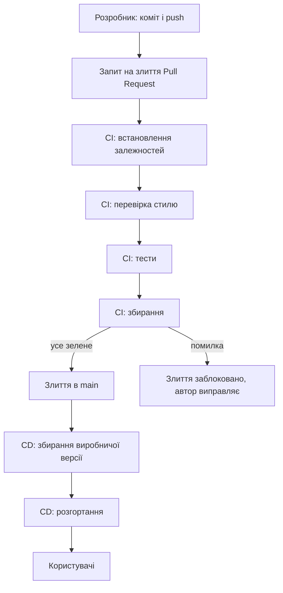

# Налаштування конвеєра безперервної інтеграції та розгортання застосунку

> [!abstract] Коротко
> Завершальна практична курсу автоматизує все, що ви раніше робили руками: перевірку стилю, запуск тестів, збирання й публікацію. Ви розмістите проєкт на GitHub, опишете конвеєр у GitHub Actions, переконаєтеся, що несправний код не проходить на головну гілку й не потрапляє в публікацію, налаштуєте автоматичне розгортання на хмарну платформу зі змінними середовища та перевірите залежності на вразливості. Підсумок – живе посилання на ваш сайт, що оновлюється самостійно після кожної зміни.

## Мета і результати навчання

Після виконання роботи ви вмієте:

- [ ] працювати з Git у зв'язці з віддаленим репозиторієм: гілки, запити на злиття, захист головної гілки;
- [ ] описувати конвеєр файлом налаштувань: події, середовище, кроки, залежності між завданнями;
- [ ] автоматично перевіряти стиль коду, запускати тести, збирати артефакт;
- [ ] розгортати збірку на хмарній платформі й повертатися до попередньої версії;
- [ ] правильно поводитися зі змінними середовища та таємницями;
- [ ] перевіряти залежності на відомі вразливості й інтерпретувати результати.

## Професійні компетентності

Після виконання практичної роботи здобувач освіти повинен навчитися налаштовувати автоматичне складання й перевірку проєкту, а також розгортати вебзастосунок на хмарній платформі.

Відповідно до освітньої програми робота формує компетентності:

- СК03. Здатність застосовувати теоретичні та емпіричні знання для розроблення, тестування, впровадження та супроводу програмного забезпечення.
- СК07. Здатність розробляти модулі і компоненти програмного забезпечення за допомогою типових алгоритмів та інструментів.

## Перелік необхідного обладнання та програмного забезпечення

- Персональний комп'ютер, система керування версіями Git (`git --version`).
- Обліковий запис на GitHub (безкоштовний); для роботи з терміналом – SSH-ключ або GitHub CLI (`gh auth login`).
- Середовище Node.js 20 LTS або новіше, редактор коду.
- Обліковий запис хмарної платформи розгортання: GitHub Pages (обов'язковий варіант, окремий акаунт не потрібен) та за вибором Cloudflare Pages, Netlify чи Vercel (варіант Б).

## Теоретична частина

### Навіщо автоматизація

Уявіть команду з п'яти людей. Кожен змінює код, і кожен «звіряє» зміни вручну: «у мене працює». Рано чи пізно хтось забуває запустити тести, хтось збирає з іншою версією Node.js, хтось викладає на сервер файли не з тієї гілки. **Безперервна інтеграція** (Continuous Integration, CI) усуває людський фактор: кожна зміна в репозиторії автоматично збирається й перевіряється в чистому середовищі, а результат видно всім.

**Безперервне доставляння/розгортання** (Continuous Delivery/Deployment, CD) продовжує ланцюг: успішна збірка автоматично доставляється до користувачів (або готується до натискання однієї кнопки). Слово «безперервне» тут означає «малими частинами й часто», а не «без перерв»: малу зміну легко перевірити, а у разі проблеми легко знайти винуватця й відкотити.



### Як влаштований конвеєр

Конвеєр у GitHub Actions описується YAML-файлом у `.github/workflows/`. Основні поняття:

- **Подія** (`on`): що запускає конвеєр: `push`, `pull_request`, розклад, ручний запуск.
- **Завдання** (`jobs`): незалежні групи кроків, кожне запускається на окремій свіжій віртуальній машині (**runner**). Між завданнями можна задати залежність `needs`.
- **Кроки** (`steps`): послідовні дії всередині завдання – готова *дія* (`uses: actions/checkout@v4`) або команда оболонки (`run: npm test`).
- **Артефакт**: файли, які завдання зберігає для подальшого використання (збірка, звіти).

Помилка (ненульовий код виходу) на будь-якому кроці **зупиняє** завдання, а завдання, яким воно потрібне через `needs`, не запускаються. Це і є механізм, що не пускає несправний код у публікацію.

> [!definition] Артефакт збірки
> Результат збирання проєкту (теки `dist` із мінімізованими файлами), який конвеєр зберігає й публікує. Артефакт збирають **один раз** і розгортають саме його, а не збирають повторно на сервері: тоді в публікацію потрапляє те, що пройшло перевірки.

### Таємниці й змінні середовища

Налаштування, які відрізняються між середовищами (адреса API, ключі), не вшивають у код. **Змінні середовища** задають поза репозиторієм: для розробки – у `.env`, у виробництві – у налаштуваннях платформи. **Таємниці** (secrets: токени, паролі, приватні ключі) в GitHub Actions зберігаються в зашифрованому вигляді й підставляються як `${{ secrets.NAME }}`; у журналах їх значення маскуються.

Є важливий нюанс, що стосується саме клієнтського коду. Все, що потрапляє в бандл браузера, **публічне**: будь-хто відкриє DevTools і прочитає. Тому в Vite змінні, що потрапляють у клієнтський код, мають префікс `VITE_`, і їх призначення – тільки для нечутливих налаштувань (адреса API). Секретний ключ сервера в клієнтський застосунок класти не можна ніколи, навіть через змінну середовища.

> [!warning] Типова помилка
> Закомічений `.env` або ключ у коді – найчастіша причина витоку. Навіть якщо ви видалили файл наступним комітом, значення лишилося в історії Git; єдине правильне рішення – **негайно відкликати й замінити ключ**, а не «почистити історію».

### Безпека залежностей

Ваш застосунок складається здебільшого з чужого коду: у `node_modules` потрапляють сотні пакунків, і кожен може містити вразливість. Команда `npm audit` звіряє встановлені версії з базою відомих вразливостей. Автоматизація тут цінніша за разову перевірку: нові вразливості з'являються щодня в уже випущеному коді, тому перевірку запускають у конвеєрі й за розкладом, а оновлення пропонує бот (Dependabot).

## Підготовка: навчальний проєкт

Щоб не залежати від попередніх робіт, створіть маленький проєкт. За бажанням замість нього можна взяти застосунок із попередніх практичних і лабораторних, якщо в нього є скрипти `lint`, `test` і `build`.

```bash
npm create vite@latest practice06-cicd -- --template vanilla
cd practice06-cicd
npm install
npm install --save-dev vitest eslint @eslint/js globals
```

Створіть `src/slugify.js` і тест:

```js
// src/slugify.js
export function slugify(text) {
  return text
    .toLowerCase()
    .trim()
    .replace(/[^a-z0-9]+/g, '-')
    .replace(/^-+|-+$/g, '');
}
```

```js
// src/slugify.test.js
import { describe, it, expect } from 'vitest';
import { slugify } from './slugify.js';

describe('slugify', () => {
  it('замінює пробіли дефісами та переводить у нижній регістр', () => {
    expect(slugify('Hello World')).toBe('hello-world');
  });
  it('прибирає зайві символи на краях', () => {
    expect(slugify('  --Hi!--  ')).toBe('hi');
  });
  it('повертає порожній рядок для порожнього вводу', () => {
    expect(slugify('')).toBe('');
  });
});
```

Змініть `src/main.js`, щоб використати функцію (інакше її «ніхто не використовує»), наприклад, виведіть `slugify('Мій перший сайт з CI')` у `#app`. Створіть `eslint.config.js`:

```js
import js from '@eslint/js';
import globals from 'globals';

export default [
  { ignores: ['dist'] },
  js.configs.recommended,
  {
    languageOptions: { ecmaVersion: 2022, sourceType: 'module', globals: globals.browser },
    rules: { 'no-unused-vars': 'error', eqeqeq: 'error' },
  },
];
```

І `vite.config.js` з базовим шляхом для GitHub Pages (сайт проєкту живе за адресою `https://<користувач>.github.io/<репозиторій>/`):

```js
import { defineConfig } from 'vite';

export default defineConfig({
  base: process.env.BASE_PATH ?? '/',
});
```

У `package.json` задайте скрипти:

```json
"scripts": {
  "dev": "vite",
  "build": "vite build",
  "preview": "vite preview",
  "lint": "eslint .",
  "test": "vitest run",
  "verify": "npm run lint && npm test && npm run build"
}
```

Перевірте локально: `npm run verify` має пройти повністю. **Це ваш еталон: те, що CI має відтворити.** Створіть `.gitignore` (мінімум `node_modules`, `dist`, `.env`, `.env.*` – окрім `.env.example`).

## Хід роботи

### Етап 1. Репозиторій

```bash
git init -b main
git add .
git status                      # переконайтеся, що node_modules і .env не потрапили
git commit -m "Початковий проєкт"
```

Створіть порожній репозиторій на GitHub (без README і `.gitignore`, вони вже є), потім:

```bash
git remote add origin git@github.com:<користувач>/practice06-cicd.git
git push -u origin main
```

> [!warning] Типова помилка
> Не вставляйте особистий токен у адресу репозиторію (`https://token@github.com/...`): він збережеться у `.git/config` у відкритому вигляді. Користуйтеся SSH або `gh auth login`.

Перед першим `git add .` перегляньте `git status`: у списку не повинно бути `node_modules`, `dist` та `.env`. Це часта помилка, яку складно виправити після коміту.

### Етап 2. Конвеєр безперервної інтеграції

Створіть файл `.github/workflows/ci.yml`:

```yaml
name: CI

on:
  push:
    branches: [main]
  pull_request:

concurrency:
  group: ci-${{ github.ref }}
  cancel-in-progress: true

permissions:
  contents: read

jobs:
  check:
    name: check (Node ${{ matrix.node }})
    runs-on: ubuntu-latest
    strategy:
      fail-fast: false
      matrix:
        node: [20, 22]
    steps:
      - name: Отримати код
        uses: actions/checkout@v4

      - name: Налаштувати Node.js
        uses: actions/setup-node@v4
        with:
          node-version: ${{ matrix.node }}
          cache: npm

      - name: Встановити залежності
        run: npm ci

      - name: Перевірити стиль
        run: npm run lint

      - name: Запустити тести
        run: npm test

      - name: Зібрати проєкт
        run: npm run build

      - name: Зберегти збірку
        if: matrix.node == 22
        uses: actions/upload-artifact@v4
        with:
          name: dist
          path: dist
          retention-days: 7
```

Розберіть кожну частину, цього вимагатиме захист.

- `npm ci` замість `npm install`: встановлює точно ті версії, що записані в `package-lock.json`, і падає, якщо файл блокування не збігається з `package.json`. Тому збірки відтворювані.
- `cache: npm` зберігає завантажені пакунки між запусками й прискорює конвеєр.
- `matrix` запускає ті самі кроки на двох версіях Node.js: так ви виявляєте несумісність до користувачів.
- `concurrency` скасовує застарілий запуск, якщо в ту ж гілку надійшов новий коміт.
- `permissions: contents: read` – принцип найменших привілеїв: конвеєр не отримує права запису, яких не потребує.

Закомітьте й відправте:

```bash
git add .github
git commit -m "Додати CI"
git push
```

Відкрийте вкладку **Actions** у репозиторії. Дочекайтеся зеленого результату; знімок запуску (список кроків із тривалістю) – у звіт.

### Етап 3. Запит на злиття: коли конвеєр вмикається

Працюємо за стандартним процесом: усі зміни – через гілку й запит на злиття (pull request).

```bash
git switch -c feature/slugify-unicode
# внесіть будь-яку невелику зміну, наприклад додайте тест
git add . && git commit -m "Додати тест"
git push -u origin feature/slugify-unicode
```

Створіть Pull Request на GitHub. Унизу сторінки PR з'явиться блок «Checks» із вашими завданнями (`check (Node 20)`, `check (Node 22)`). Дочекайтеся зеленого стану. Знімок PR – у звіт.

### Етап 4. Захист головної гілки

Налаштуйте правило: у `main` неможливо влити код, якщо перевірки червоні.

`Settings → Branches → Add branch ruleset` (або `Branch protection rule`) для гілки `main`:

- Require a pull request before merging;
- Require status checks to pass before merging → додайте `check (Node 20)` та `check (Node 22)`;
- Block force pushes.

(Для приватних репозиторіїв на безкоштовному тарифі окремі правила можуть бути недоступні; тоді опишіть у звіті, як працює механізм, і виконайте етап 5 без блокування кнопки злиття.)

### Етап 5. Навмисна помилка: конвеєр зупиняє зміни

Це центральний експеримент роботи. Створіть нову гілку `feature/break-test` і зламайте тест:

```js
it('повертає порожній рядок для порожнього вводу', () => {
  expect(slugify('')).toBe('УМИСНА ПОМИЛКА');
});
```

Відправте гілку й відкрийте PR. Очікуваний результат:

1. Завдання `check` стає червоним ✗ на кроці «Запустити тести». Зафіксуйте знімок журналу з повідомленням vitest про розбіжність значень.
2. Кроки «Зібрати проєкт» і «Зберегти збірку» **не виконувалися**: пропущені після збою.
3. Кнопка «Merge» неактивна: «Required statuses must pass before merging» (якщо ви налаштували захист).

Тепер виправте тест, відправте новий коміт: конвеєр запускається знову й стає зеленим. Перевірте у вкладці Actions, що попередній запуск було **скасовано або замінено** (завдяки `concurrency`).

Додайте другий вид помилки, для порівняння: порушення стилю (змінна, яку не використано, `==` замість `===`). Перевірте, що `lint` зупиняє конвеєр *раніше* тестів. Поясніть у звіті, чому порядок кроків «спочатку дешеві перевірки» економить час і ресурси.

**Контрольна точка 1.** Знімки: зелений запуск, червоний запуск із збійним кроком, заблоковане злиття, зелений запуск після виправлення.

### Етап 6. Розгортання (CD) на GitHub Pages

Увімкніть публікацію: `Settings → Pages → Build and deployment → Source: GitHub Actions`.

Створіть `.github/workflows/deploy.yml`. Розгортання залежить від успішних перевірок і відбувається **лише з гілки main**.

```yaml
name: Deploy

on:
  push:
    branches: [main]
  workflow_dispatch:

permissions:
  contents: read
  pages: write
  id-token: write

concurrency:
  group: pages
  cancel-in-progress: false

jobs:
  test:
    runs-on: ubuntu-latest
    steps:
      - uses: actions/checkout@v4
      - uses: actions/setup-node@v4
        with:
          node-version: 22
          cache: npm
      - run: npm ci
      - run: npm run lint
      - run: npm test

  build:
    needs: test
    runs-on: ubuntu-latest
    steps:
      - uses: actions/checkout@v4
      - uses: actions/setup-node@v4
        with:
          node-version: 22
          cache: npm
      - run: npm ci
      - name: Зібрати виробничу збірку
        run: npm run build
        env:
          BASE_PATH: /${{ github.event.repository.name }}/
      - uses: actions/configure-pages@v5
      - uses: actions/upload-pages-artifact@v3
        with:
          path: dist

  deploy:
    needs: build
    runs-on: ubuntu-latest
    environment:
      name: github-pages
      url: ${{ steps.deployment.outputs.page_url }}
    steps:
      - id: deployment
        uses: actions/deploy-pages@v4
```

Зверніть увагу на ланцюг `test → build → deploy` через `needs`: збій у першому завданні унеможливлює наступні. Права `pages: write` та `id-token: write` потрібні лише цьому конвеєру, тому виділені тут, а не в загальному.

Злийте PR у `main` (після зеленого CI). У вкладці **Actions** з'явиться запуск `Deploy`; після завершення відкрийте адресу `https://<користувач>.github.io/<репозиторій>/` з журналу завдання `deploy`. Сторінка має працювати, і зображення/стилі мають завантажуватись (якщо ні, перевірте `BASE_PATH`, типова помилка: `404` для `/assets/...`).

**Тепер перевірте головне:** повторіть експеримент зі зламаним тестом, але цього разу **влийте** його в `main` (вимкніть захист тимчасово або скористайтеся власним репозиторієм без правил). Покажіть, що завдання `test` у `Deploy` червоне, а `build` і `deploy` показано як «Skipped», тобто **стара робоча версія сайту лишилася нетронутою**. Відкрийте опублікований сайт і переконайтесь, що він працює. Знімок запуску – у звіт. Поверніть правильний тест.

### Етап 7. Відкат

У платформах «статичного хостингу» відкат – це розгортання попередньої версії. Для GitHub Pages: у вкладці Actions відкрийте успішний запуск `Deploy` попереднього коміту та натисніть **Re-run all jobs**, або відкотіть коміт командою:

```bash
git revert <хеш-коміту>
git push
```

Конвеєр сам опублікує версію без проблемної зміни. Опишіть у звіті, чому `git revert` (новий коміт, що скасовує зміну) безпечніший за `git reset --hard` з примусовим надсиланням у спільній гілці.

### Етап 8. Змінні середовища та таємниці

Додайте у застосунок нечутливу налаштовувану змінну:

```js
// у src/main.js
const apiUrl = import.meta.env.VITE_API_URL ?? 'http://localhost:3000';
document.querySelector('#app').insertAdjacentText('beforeend', ` API: ${apiUrl}`);
```

1. Локально створіть `.env` з `VITE_API_URL=http://localhost:3000` (він у `.gitignore`) і `.env.example` з тим самим іменем та безпечним значенням (його коммітять).
2. У GitHub: `Settings → Secrets and variables → Actions → Variables → New repository variable`: `VITE_API_URL = https://api.example.com`. Це **змінна** (не таємниця), бо адреса API публічна.
3. Передайте її на крок збірки в `deploy.yml`: у блоці `env` додайте `VITE_API_URL: ${{ vars.VITE_API_URL }}`.
4. Опублікуйте й переконайтесь, що на сайті відображається адреса зі змінної.
5. Створіть **таємницю** `Settings → … → Secrets → New repository secret`: `DEPLOY_NOTE_TOKEN` зі значенням `super-secret-123` (навчальне). Додайте тимчасовий крок `run: echo "token=${{ secrets.DEPLOY_NOTE_TOKEN }}"` і подивіться в журналі: GitHub замаскує значення як `***`. Потім **видаліть** цей крок. Поясніть у звіті, чому навіть маскування не виправдовує виведення таємниць у журнал (їх можна вивести у зміненому вигляді, наприклад, посимвольно).
6. Відкрийте опублікований бандл у DevTools → Sources/Network і знайдіть там `apiUrl`. Зробіть висновок: чому в клієнтську збірку не можна класти секретний ключ навіть через `VITE_`.

### Етап 9. Варіант Б: розгортання через платформу

Альтернативний шлях, що застосовується найчастіше для реальних проєктів: платформа сама стежить за репозиторієм і збирає код. Виконайте **для одного** сервісу на вибір (Cloudflare Pages, Netlify, Vercel):

1. Підключіть репозиторій у кабінеті платформи.
2. Задайте: команда збірки `npm run build`, тека виводу `dist`, версія Node (змінна `NODE_VERSION` = `22`).
3. Додайте змінну `VITE_API_URL` у налаштуваннях платформи.
4. Створіть PR: платформа створить **превʼю-розгортання** на окремій адресі й залишить посилання в PR.
5. Заповніть таблицю порівняння з GitHub Actions + Pages: хто виконує збірку, де зберігаються змінні, як працює превʼю, як відкотити, що буде, якщо тести червоні (чи блокує платформа розгортання? Зазвичай *ні*, якщо тести не частина команди збірки!). Запишіть, як ви це виправили: додайте `npm test &&` до команди збірки або налаштуйте перевірку статусів GitHub як обов'язкову.

Деталі налаштувань відрізняються між платформами й змінюються, тому користуйтеся актуальною документацією сервісу.

**Контрольна точка 2.** Опублікований сайт відкривається за посиланням; зламаний код не підмінює робочу версію; змінна середовища дійшла до збірки; можете пояснити, чому тут немає таємниць у клієнті.

## Завдання для самостійного виконання

Додайте до конвеєра крок перевірки залежностей на відомі вразливості. Опишіть, які висновки дала перевірка й що робити з виявленими попередженнями.

1. Додайте в завдання `check` (після `npm ci`) крок:

   ```yaml
   - name: Перевірити залежності на вразливості
     run: npm audit --audit-level=high
   ```

   Параметр `--audit-level=high` означає: падати лише на вразливостях рівня `high` і `critical`. Зафіксуйте, чи пройшов крок. Запустіть `npm audit` локально без параметра, збережіть повний вивід.
2. Проаналізуйте **кожне** знайдене попередження: назва пакунка, рівень, чи прямий це пакунок чи транзитивний, чи є виправлена версія (`fix available`), чи вразливість досяжна у вашому використанні (наприклад, вразливість лише в інструменті розробки, який не потрапляє у виробничу збірку, має менший пріоритет).
3. Застосуйте виправлення за порядком безпеки: `npm audit fix` (сумісні оновлення) і лише потім, свідомо, `npm audit fix --force` (може зламати сумісність; після нього обов'язково повний `npm run verify`). Зафіксуйте, що змінилося в `package-lock.json`.
4. Для вразливості, яку виправити неможливо (немає виправленої версії), опишіть рішення: тимчасова заміна пакунка, відмова від функції, документування прийнятого ризику.
5. Налаштуйте Dependabot: файл `.github/dependabot.yml`

   ```yaml
   version: 2
   updates:
     - package-ecosystem: npm
       directory: /
       schedule:
         interval: weekly
       open-pull-requests-limit: 5
     - package-ecosystem: github-actions
       directory: /
       schedule:
         interval: weekly
   ```

   Поясніть, чому оновлення дій у `github-actions` теж важливі (самі дії є залежностями вашого конвеєра, і підміна дії – вектор атаки на ланцюг постачання).
6. Відповідь у звіті: чи варто робити крок `npm audit` обов'язковим для злиття? Які є недоліки (новий CVE у залежності, яку не виправити, блокує всю команду) і як їх пом'якшити (розклад + окреме завдання з `continue-on-error`, автоматичні PR від бота).

## Завдання підвищеної складності

> [!example] Рівень «добре» (необов'язково)
> Захистіть публікацію середовищем: створіть у репозиторії `Settings → Environments → production` з обов'язковим схваленням перед розгортанням (Required reviewers) і змініть `deploy`, щоб він використовував це середовище. Додайте друге середовище `staging`, яке публікується з гілки `develop` без схвалення. Поясніть, яку проблему розв'язує ручне схвалення.

> [!example] Рівень «відмінно» (необов'язково)
> Зробіть повторно використовуваний робочий процес (`workflow_call`) `quality.yml` із кроками перевірки й викликайте його з `ci.yml` і `deploy.yml`, щоб не дублювати текст. Додайте перевірку покриття тестами з порогом (наприклад, не нижче 80%, `vitest run --coverage`) та сканування коду CodeQL. Виміряйте в Actions вплив кешу на час запуску: «до» і «після».

## Типові помилки

> [!warning] Типова помилка
> - Файл конвеєра не в `.github/workflows/` або з розширенням `.yaml.txt`: нічого не запускається.
> - Відступи в YAML: пробіли, а не табуляція; неправильна вкладеність робить файл недійсним (GitHub покаже помилку у вкладці Actions).
> - `npm install` замість `npm ci`: різні версії локально та в CI.
> - Забутий `package-lock.json` у репозиторії.
> - Збірка залежить від файлів, яких немає в репозиторії (`.env`, згенеровані файли).
> - Розгортання не залежить від тестів (немає `needs`).
> - Неправильний `base` шляху: на GitHub Pages сайт проєкту працює у підкаталозі.
> - Версія Node.js у CI відрізняється від локальної.
> - Секрети у коді, у `.env` у репозиторії, у журналі.
> - Захист гілки вказує на назву завдання, якої вже не існує (перейменували `check`): злиття заблоковане назавжди.

## Вимоги до звіту

1. Титульна сторінка, посилання на репозиторій і на опублікований сайт.
2. Схема вашого конвеєра (діаграма завдань і залежностей).
3. Текст `ci.yml` і `deploy.yml` з поясненням кожного блоку своїми словами.
4. Знімки: зелений запуск, червоний запуск (збійний крок), PR із заблокованим злиттям, запуск, у якому `deploy` пропущено через помилку.
5. Опис відкату.
6. Робота зі змінними й таємницями: що є змінною, що таємницею та чому.
7. Результати `npm audit`, аналіз і виправлення; Dependabot.
8. Таблиця порівняння з платформним розгортанням (варіант Б).
9. Висновки: що автоматизація дала, що вона не гарантує.

## Критерії оцінювання

| Критерій | Балів |
|---|---|
| Репозиторій, `.gitignore`, робота через гілки й PR | 10 |
| CI: лінтер, тести, збірка, `npm ci`, кеш, матриця, права | 20 |
| Навмисна помилка: зупинка конвеєра, заблоковане злиття | 15 |
| CD: розгортання залежить від перевірок, опублікований сайт працює | 20 |
| Змінні середовища, таємниці, розуміння публічності клієнтського коду | 10 |
| Перевірка залежностей, аналіз, Dependabot | 10 |
| Звіт, схема, порівняння з платформним варіантом | 5 |
| Захист | 10 |
| **Разом** | **100** |

## Контрольні питання

> [!question] Перевірте себе
> 1. Чим безперервна інтеграція відрізняється від безперервного розгортання?
> 2. Чому таємниці не можна зберігати в репозиторії?
> 3. Які кроки доцільно виконувати до складання збірки?
> 4. Навіщо розгортати гілку в окреме тимчасове середовище?
> 5. Як конвеєр запобігає потраплянню несправного коду у виробниче середовище?
> 6. Чим `npm ci` відрізняється від `npm install` і чому в CI використовують саме його?
> 7. Що означає `needs` у файлі конвеєра?
> 8. Чому змінна `VITE_*` не підходить для секретного ключа?

> [!exam] На іспиті
> Задача: «Тести червоні, але сайт все одно оновився. Назвіть три можливі причини». Відповідь: розгортання не залежить від завдання з тестами (немає `needs`/обов'язкових статусів); платформа збирає код сама, не запускаючи тести; тести не входять до команди збірки; використано `continue-on-error`.

## Далі

Це завершальна практична: тепер ви вмієте довести проєкт від ідеї до опублікованого сайту. Повторіть пов'язану теорію в [[courses/web-programming/lectures/14-git-ci-cd-deploi-ta-ekonomika-vebrozrobky|лекції 14]], терміни – у статтях [[courses/web-programming/glossary/ci-cd|CI-CD]], [[courses/web-programming/glossary/http|HTTP]] та [[courses/web-programming/glossary/dns|DNS]] (як ім'я сайту перетворюється на адресу). Тема безпеки токенів і секретів продовжена в [[courses/web-programming/labs/07-avtentyfikatsiia-korystuvachiv-za-tokenamy-jwt|лабораторній 7]].

## Література

- Документація GitHub Actions: Workflow syntax, Using secrets, Deploying with GitHub Pages (docs.github.com)
- Vite: Static Deploy, Env Variables and Modes (vite.dev/guide)
- npm Docs: `npm audit`, `npm ci` (docs.npmjs.com)
- OWASP: CI/CD Security Cheat Sheet (cheatsheetseries.owasp.org)
- Jez Humble, David Farley. Continuous Delivery. Addison-Wesley
